# Real-Time Event Aggregation — Mermaid Diagrams

> Start with **Diagram 1** — it's the central split every other diagram clips onto.
> **Reference:** [answers.md](./answers.md) · [simple-diagram.md](./simple-diagram.md) · [questions.md](./questions.md)
> **Cross-links:** [message-queues](../message-queues/) (Kafka mechanics in depth) · [sse](../sse/) (hop 1/hop 2 for the live dashboard) · [scaling-writes](../../patterns/scaling-writes.md) · [observability](../observability/) (alerting philosophy generally)

---

## Diagram 1 — The Central Split: One Log, Two Readers

> **When to use:** Q2, Q9, Q10, Q21, Q22, Q23 — open with this the moment "real-time" and "exact" both appear in the prompt.

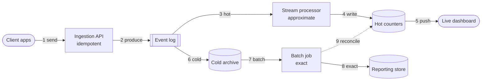

**Draw order (~60s)**
1. Stadium far left: "Clients". Box: "Ingestion API". Arrow between.
2. Queue shape: "Event log". Arrow in.
3. Split into two: down to "Stream processor" and down to "Cold archive".
4. From Stream processor: "Hot counters" then "Dashboard".
5. From Cold archive: "Batch job" then "Reporting store".
6. Dashed arrow back from Batch job to Hot counters.

**Say while drawing**
1. "One log. Everything downstream reads from it, nothing writes to it twice."
2. "The hot path is fast and approximate."
3. "The cold path is slow and exact."
4. "They never feed each other in real time."
5. "The cold path corrects the hot one, nightly."

**What the interviewer is checking**
- Do you split on "how stale can this be", not on data type?
- Do you know the two paths are independent readers of one source, not a pipeline?
- Do you name reconciliation before being asked?

---

## Diagram 2 — Tumbling vs Sliding Windows

> **When to use:** Q3.

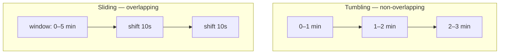

**Draw order (~40s)**
1. Left box labeled "Tumbling". Three boxes in a row inside it: 0–1, 1–2, 2–3.
2. Right box labeled "Sliding". Three boxes in a row: a 5-min window, then two small "shift" boxes.

**Say while drawing**
1. "Tumbling windows never overlap. Each event lands in exactly one."
2. "Sliding windows overlap. The same event can count in several."
3. "Use tumbling for reporting. Use sliding for a smooth alert signal."

**What the interviewer is checking**
- Can you pick the right window type for the right consumer, not just define both?
- Do you connect window choice to who's reading the output?

---

## Diagram 3 — One Event, Two SLAs

> **When to use:** Q6–Q10 — the requirements-clarifying conversation.

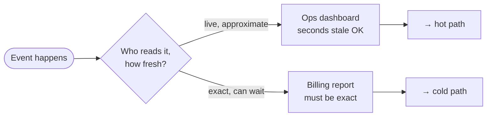

**Draw order (~40s)**
1. Stadium: "Event happens". Diamond: "Who reads it, how fresh?"
2. Two boxes off the diamond: "Ops dashboard" and "Billing report".
3. Arrow from each into its path label.

**Say while drawing**
1. "The same event has two different readers."
2. "One wants it now and can tolerate error."
3. "One can wait and cannot tolerate error."
4. "That answer is what forks the architecture."

**What the interviewer is checking**
- Do you ask "who reads this" before drawing infrastructure?
- Do you derive the two-path architecture from a requirement, not from habit?

---

## Diagram 4 — Idempotent Ingestion

> **When to use:** Q11–Q15.

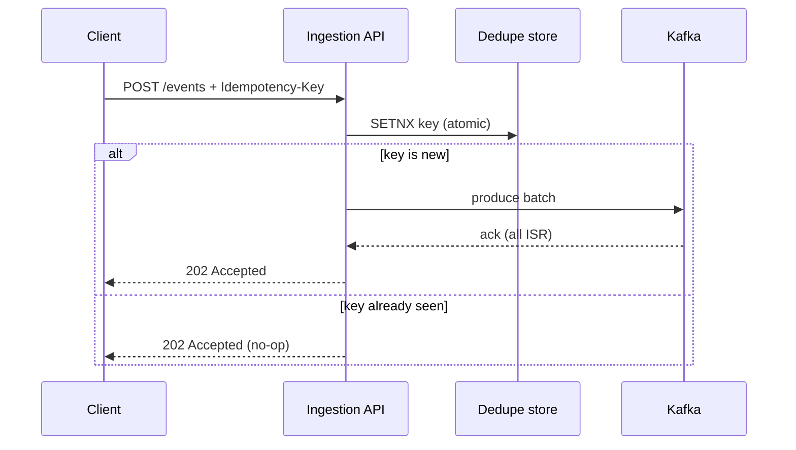

**Draw order (~50s)**
1. Four lifelines: Client, API, Dedupe store, Kafka.
2. Arrow Client to API: "POST + Idempotency-Key".
3. Arrow API to Dedupe: "SETNX".
4. Branch: new key → produce to Kafka → ack → 202. Seen key → 202 straight back.

**Say while drawing**
1. "The client sends a batch with a key it generated."
2. "The API checks that key atomically, before producing anything."
3. "A retry with the same key is a no-op, not an error."
4. "Only a new key actually reaches Kafka."

**What the interviewer is checking**
- Is the dedupe check *before* the produce call, not after?
- Do you return the same success response for a duplicate as for the original?

---

## Diagram 5 — Partitioning by Session

> **When to use:** Q16–Q17.

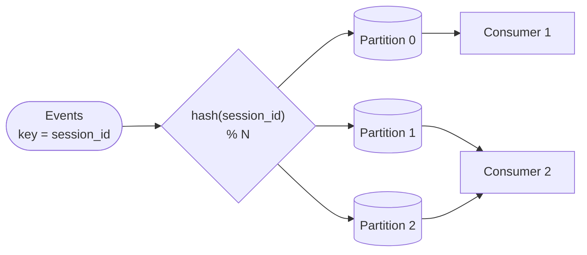

**Draw order (~50s)**
1. Stadium: "Events, key = session_id". Diamond: "hash % N".
2. Three cylinders below: Partition 0, 1, 2.
3. Two boxes: Consumer 1 reads Partition 0; Consumer 2 reads Partitions 1 and 2.

**Say while drawing**
1. "Every event's key decides its partition."
2. "Same key, same partition, always — that's your ordering guarantee."
3. "One consumer can read more than one partition."
4. "One partition is never split across two consumers."

**What the interviewer is checking**
- Do you partition on the entity that needs ordering, not on event type?
- Do you know partition count caps consumer parallelism, not just throughput?

---

## Diagram 6 — Consumer Group Rebalance

> **When to use:** Q18, Q20 *(failure mode)*.

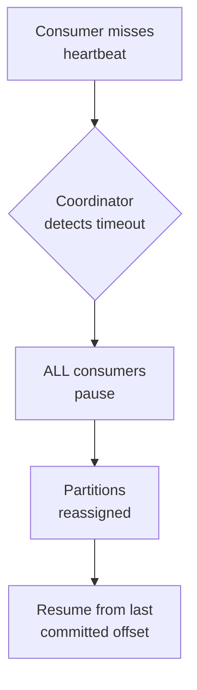

**Draw order (~30s)**
1. Box: "Consumer misses heartbeat". Diamond: "Coordinator detects timeout".
2. Box: "ALL consumers pause". Box: "Partitions reassigned". Box: "Resume from last offset".
3. One straight chain of arrows.

**Say while drawing**
1. "A missed heartbeat starts it."
2. "Every consumer in the group pauses, not just the dead one."
3. "Partitions get reassigned."
4. "Work resumes from the last committed offset — some of it gets redone."

**What the interviewer is checking**
- Do you know a rebalance pauses the *whole* group, not just the failed member?
- Do you connect this to why consumers must be idempotent?

---

## Diagram 7 — Lambda Architecture

> **When to use:** Q21–Q23.

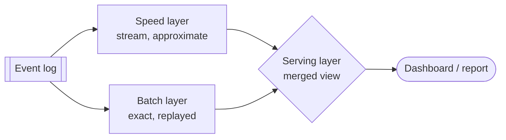

**Draw order (~30s)**
1. Queue: "Event log". Two arrows down: to "Speed layer" and "Batch layer".
2. Diamond: "Serving layer" — arrows in from both. Stadium: "Dashboard/report" — arrow in from Serving.

**Say while drawing**
1. "One log, read by two independent layers."
2. "Speed layer is fast, approximate, recent."
3. "Batch layer is slow, exact, complete."
4. "The serving layer merges both when someone queries."

**What the interviewer is checking**
- Can you name Lambda architecture by structure, not just by buzzword?
- Do you know the cost — the aggregation logic exists twice?

---

## Diagram 8 — Count-Min Sketch

> **When to use:** Q26–Q27.

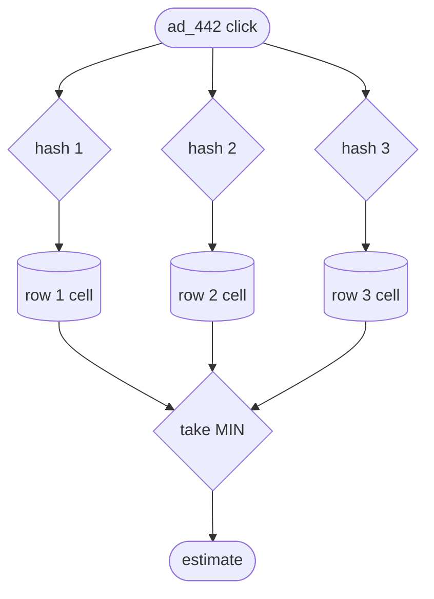

**Draw order (~50s)**
1. Stadium: "ad_442 click". Three diamonds below it: hash 1, 2, 3.
2. Three cylinders, one per hash: row cells.
3. Diamond: "take MIN". Stadium: "estimate".

**Say while drawing**
1. "One item, several hash functions."
2. "Each hash increments one cell in its own row."
3. "To estimate, take the minimum across all rows."
4. "The error is always an overcount, never an undercount."

**What the interviewer is checking**
- Do you know the error is one-directional (overcount only)?
- Can you say what problem this solves that an exact counter can't — memory that doesn't grow with cardinality?

---

## Diagram 9 — Window Lifecycle and the Watermark

> **When to use:** Q29, Q30 *(failure mode)*.

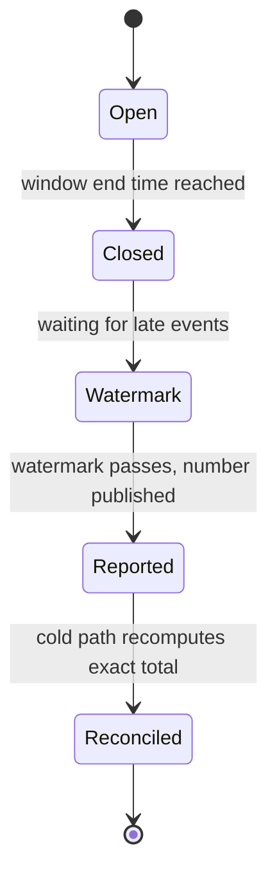

**Draw order (~40s)**
1. Chain of five boxes: Open, Closed, Watermark, Reported, Reconciled.
2. One arrow between each, labeled with what triggers the move.

**Say while drawing**
1. "A window opens, then closes at its end time."
2. "It doesn't report immediately — it waits out the watermark."
3. "Once reported, it's not reopened."
4. "The cold path reconciles it later, in place."

**What the interviewer is checking**
- Do you know a closed, reported window is never reopened for late data?
- Do you route lateness to reconciliation instead of to a reopened window?

---

## Diagram 10 — Circuit Breaker on the Dedupe Store

> **When to use:** Q32.

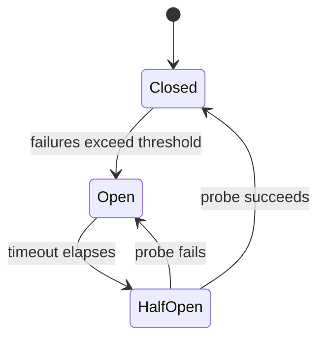

**Draw order (~30s)**
1. Three states: Closed, Open, HalfOpen.
2. Arrow Closed→Open, Open→HalfOpen, HalfOpen→Closed, HalfOpen→Open.

**Say while drawing**
1. "Closed is normal — calls go through."
2. "Too many failures trips it open — calls stop, fail fast."
3. "After a timeout, one probe call is allowed through."
4. "The probe's result decides: back to closed, or open again."

**What the interviewer is checking**
- Do you place the breaker on the synchronous dependency (dedupe store), not on the durable log?
- Do you know the half-open state exists so recovery is detected, not assumed?

---

## Diagram 11 — Per-Tenant Isolation

> **When to use:** Q33, Q34.

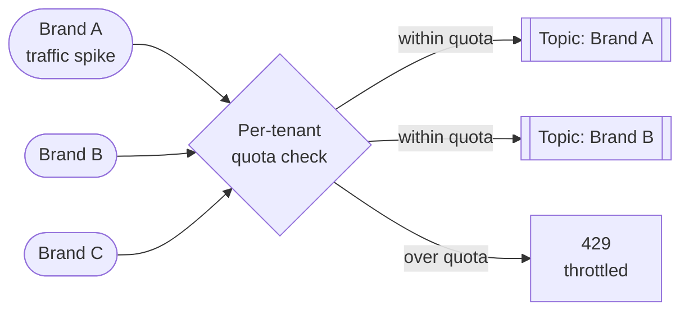

**Draw order (~40s)**
1. Three stadiums: Brand A, B, C. One diamond: "Per-tenant quota check".
2. Two queues out: "Topic: Brand A", "Topic: Brand B". One box: "429 throttled".

**Say while drawing**
1. "Every brand goes through its own quota check."
2. "Under quota, it reaches its own topic."
3. "Over quota, it's throttled — the other brands are untouched."

**What the interviewer is checking**
- Do you isolate by tenant before a spike happens, not react after?
- Do you know a shared, unquota'd topic is the actual failure mode here?

---

## Diagram 12 — Multi-Region Failover

> **When to use:** Q35, Q36 *(failure mode)*.

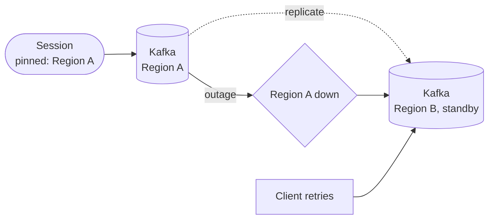

**Draw order (~40s)**
1. Stadium: "Session, pinned to Region A". Cylinder: "Kafka Region A".
2. Cylinder: "Kafka Region B, standby". Dashed arrow A to B: "replicate".
3. Diamond: "Region A down" — arrow into it from A, arrow out to B.
4. Box: "Client retries" — arrow into B.

**Say while drawing**
1. "Every session is pinned to one home region."
2. "That region continuously replicates to a standby."
3. "On outage, traffic fails over to the standby."
4. "Loss is bounded by replication lag — not zero."

**What the interviewer is checking**
- Do you pin sessions to avoid creating the double-count, rather than deduping after?
- Do you state a bounded loss instead of claiming zero data loss?

---

## Diagram 13 — What "System Health" Actually Means

> **When to use:** Q37–Q39.

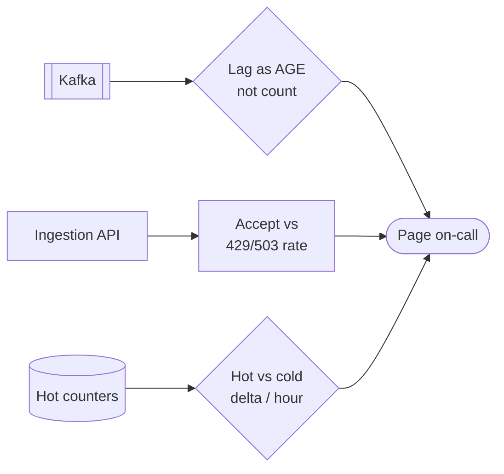

**Draw order (~40s)**
1. Queue: "Kafka" → diamond "Lag as AGE".
2. Box: "Ingestion API" → box "Accept vs 429/503 rate".
3. Cylinder: "Hot counters" → diamond "Hot vs cold delta / hour".
4. All three feed one stadium: "Page on-call".

**Say while drawing**
1. "Three independent signals feed one alert surface."
2. "Lag is measured as age, because count lies at different throughputs."
3. "Hot-versus-cold delta catches drift before it becomes a billing dispute."

**What the interviewer is checking**
- Can you name specific, derived health metrics instead of "monitor everything"?
- Do you defend why raw events/sec alone is not on the list?

---

## Quick Interview Reference

**Scale numbers**
- ~12K events/sec average, ~60–90K peak (5–8x) at 50M DAU × 20 events/session
- ~5–10 MB/s per Kafka partition, planning number `⚠️ verify`
- Kafka retention: keep short (days) for replay speed; S3 for months-long archive

**Domain quick-ref**

| Question shape | Reach for |
|---|---|
| "Real-time dashboard AND exact billing" | Lambda split — hot path + cold path, reconciled |
| "Count this cheaply at huge cardinality" | Count-Min Sketch (counts) or HyperLogLog (uniques) |
| "Client retried, don't double count" | Idempotency-Key at the door + `event_id` dedupe downstream |
| "One brand's spike is starving the others" | Per-tenant topic or quota, not a shared unbounded topic |
| "Define system health" | Lag-as-age, e2e latency, accept/reject rate, hot/cold delta, per-tenant fairness |

**Canonical tradeoffs**
- Lambda (two codebases, both fast and exact) vs Kappa (one codebase, replay-dependent)
- Exact counter (expensive at high cardinality) vs sketch (approximate, fixed memory)
- Kafka retention (expensive, fast replay) vs S3 archive (cheap, slow replay)

**Common mistakes**
- One global atomic counter instead of a write-sharded one (A26)
- "Kafka gives exactly-once" stated without the boundary caveat (A5)
- Lag alerting on count instead of age (A38)
- OpenSearch in the ingestion or billing path instead of as a derived query layer (A24)

---

## 🎯 The One-Page Master Diagram — Everything on One Screen

> **When to use:** final revision, 10 minutes before the interview. If you can narrate this end-to-end and name the tradeoff at each red box, you're ready.

### The central split in one sentence

**One durable log is read by two independent consumers — a hot path that trades exactness for seconds of latency, and a cold path that trades latency for exactness — and the entire design's job is reconciling the two without ever letting one silently stand in for the other.**

> **Tier R — reference only. Don't draw this one. Draw the reduction below it.**

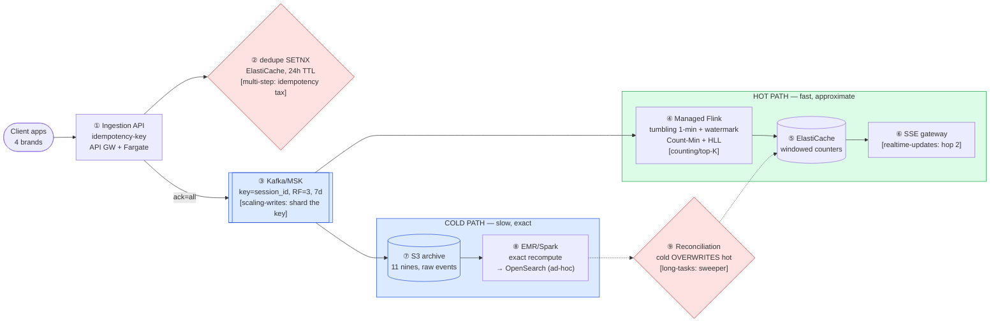

### The Tier D reduction — what you actually draw

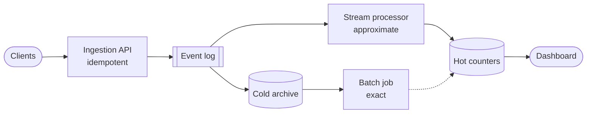

### The 60-second narration

*(the whole system, one short line per numbered box — say this end to end)*

1. Clients send batches to one idempotent ingestion API.
2. It checks a dedupe store before producing anything.
3. Accepted events go to Kafka, keyed by session, replicated three ways.
4. A stream processor reads it, windows it, counts it approximately.
5. Results land in Redis as live counters.
6. Those counters push to the dashboard over SSE.
7. The same log also lands, raw, in S3.
8. A batch job recomputes it exactly, feeding OpenSearch for ad-hoc queries.
9. That exact number reconciles the approximate one, in place.

### The 3-minute walkthrough

*(the same flow with the reasoning attached — this is what you say during the architecture block, while drawing)*

1. Clients batch their events and send them to one door — batching because one HTTP call per event is the actual bottleneck at ~90K/sec peak, not Kafka.
2. That door checks an idempotency key against Redis with an atomic `SETNX` before it produces anything — this is what makes a client's timeout-retry safe rather than a duplicate.
3. Accepted events produce into Kafka, partitioned by `session_id` so per-session order is preserved and the partition count caps how many consumers can ever work in parallel — replication factor 3 so a broker loss doesn't lose data.
4. A stream processor — Kafka Streams or managed Flink — reads it in 1-minute tumbling windows with a watermark for late data, and uses Count-Min Sketch and HyperLogLog so memory doesn't scale with the number of distinct ads or viewers.
5. It writes windowed counters into Redis, write-sharded across keys so one popular ad's counter isn't a single hot partition.
6. The dashboard subscribes over SSE — that's hop 2 of the real-time-updates pattern, a bus getting the update to whichever pod holds the socket.
7. Independently, the same Kafka log lands raw in S3 — cheap, durable, and the only copy anyone should ever bill from.
8. A batch job — Spark on EMR — recomputes the exact total from that raw archive, feeding a derived OpenSearch index for ad-hoc, human queries.
9. When the batch total disagrees with the windowed estimate, the batch number wins and overwrites the served counter — reconciliation, not agreement, is what keeps the two paths honest.

### The five numbers that justify the design

| Number | Derivation | Therefore |
|---|---|---|
| ~12K events/sec average | 50M DAU × 20 events/session ÷ 86,400s | Sizes the baseline Kafka/ingestion capacity |
| ~60–90K events/sec peak | 5–8x average for a live-event spike | Load-test and provision for this, not the average |
| ~5–10 MB/s per partition `⚠️ verify` | Kafka/MSK planning guidance | Sets a starting partition count, and the ceiling on parallel consumers |
| ~1–2% HLL error `⚠️ verify` | Typical HyperLogLog estimator error | Acceptable for a live "unique viewers" tile, not for a billed total |
| 7-day Kafka retention | Covers a weekly incident-recovery window at bounded cost | Long-tail replay (months) comes from S3, not Kafka |

### The patterns this assembles

| Pattern | Where | The move |
|---|---|---|
| [Scaling Writes](../../patterns/scaling-writes.md) | Ingestion + counter store | Aggregate before you write; shard the hot key |
| Counting & top-K at scale ([gap pattern](../../patterns/README.md#gaps--recurring-sub-problems-not-yet-written-up)) | Stream processor | Count-Min Sketch + HyperLogLog trade exactness for fixed memory |
| [Real-Time Updates](../../patterns/realtime-updates.md) | Counters → dashboard | Hop 2 — a bus (SSE fan-out) gets the update to the right socket |
| [Multi-Step Processes](../../patterns/multi-step-processes.md) | Ingestion + every consumer | Idempotency is the tax every layer pays for at-least-once delivery |

### The three things that break (and the mitigation)

| Failure | Blast radius | Mitigation | How you detect it |
|---|---|---|---|
| Stream processor down | Dashboard goes stale; no data lost | Kafka retention + resume from last committed offset | Consumer lag age climbing |
| Hot-key counter contention | One popular ad's counter throughput caps out | Write-shard the counter key, sum on read | Per-partition/per-key throughput skew |
| Regional Kafka outage | Bounded event loss = the replication-lag window | Cross-region replication + client-side local buffering | Cross-region replication lag metric |

### If you only remember one thing

> **One log, read twice — fast and approximate for a human looking at a dashboard right now, slow and exact for the number someone gets billed — and reconciliation, not agreement, is what keeps them both honest.**
