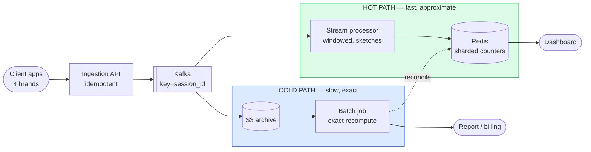
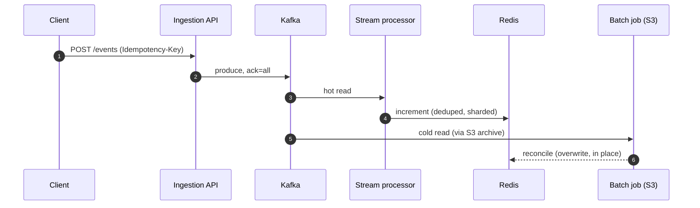

# RADIO Walkthrough — Real-Time Event Aggregation (Ad Click / Telemetry Pipeline)

> **What this is:** this design performed the way you'd say it out loud in a 45-minute interview, structured by the [RADIO framework](../../docs/RADIO_FRAMEWORK.md): **R**equirements → **A**rchitecture → **D**ata model → **I**nterface → **O**ptimizations.
> **How to use it:** read once for the flow, then practice saying each section from memory. Every number below shows **how it was derived and what decision it drives** — that derivation is the point, not the digit. Numbers are reused from [answers.md](./answers.md), never re-derived here.
> **Depth lives elsewhere:** this is the *spine*. For the grill, see [questions.md](./questions.md) / [answers.md](./answers.md); for internals and capacity math, [deep-dive.md](./deep-dive.md); for a demo-first walkthrough of the core mechanism, [teach.md](./teach.md).
> ⚠️ Numbers are order-of-magnitude teaching estimates. In a real interview, state them as assumptions to verify against telemetry.

---

## R — Requirements Exploration *(~7 min)*

**Restate:** "Clients emit a high-volume event stream — ad clicks, or product telemetry — and I need to ingest it, show a live approximate view on a dashboard, and produce an exact, auditable total for reporting or billing. I'll design the backend for that." *(Get a nod before drawing anything.)*

### Functional (in scope — the journeys that carry signal)
1. **Ingest** — accept a high-volume, bursty event stream, idempotently, without losing data under retries.
2. **Serve a live dashboard** — a windowed, near-real-time aggregate, seconds-stale is fine.
3. **Serve an exact report** — a reconciled, auditable total someone gets billed or paid from.

### Explicitly out of scope (say this — scoping *down* is signal)
The ad-serving/targeting decision itself, click-fraud model training (fraud *scoring* is named as a third consumer of the same log — [AB1](./answers.md#ab1-click-fraud--bot-traffic) — but the model isn't designed here), the billing/invoicing system downstream of the exact total, multi-tenant auth/authz.

### Non-functional / correctness bars
- **Dashboard** latency: seconds of staleness acceptable — this is a windowed estimate, not a claim of instant truth.
- **Report/billing total** must be **exact** and reproducible from raw data — no silent loss, ever, even under retries, rebalances, or a regional outage.
- **No double-count under retry.** A client that times out and resends must never move either number twice.
- Availability: the dashboard can degrade gracefully (go stale); the **ingestion accept path** is what must stay durable.
- Multi-tenant: shared across 4 apps/brands — one brand's spike must not starve the others.

### Capacity estimate *(state assumptions → arithmetic → decision)*

**Assume 50M DAU across 4 apps, ~20 events/session** (tell me to change it).

| Quantity | Derivation | Result | **Decision it drives** |
|---|---|---|---|
| Avg event rate | 50M × 20 ÷ 86,400 s | **~12K events/s** | Sizes the baseline Kafka/ingestion tier |
| Peak event rate | live-event traffic peaks 5–8× average | **~60K–90K events/s** | Load-test and provision for this, not the average — a season finale, not a normal Tuesday |
| Per-partition throughput | ~5–10 MB/s planning number `⚠️ verify` | ~45 MB/s peak ÷ ~7.5 MB/s | **~6 starting partitions** for throughput; the **real** ceiling is max parallel consumers, not this number |
| Kafka retention | keep short — days, not months | **7 days** | Covers a weekly incident-recovery window; longer-tail replay comes from **S3**, not Kafka — keeping Kafka's expensive copy small |
| HLL error (unique counting) | typical estimator error `⚠️ verify implementation` | **~1–2%** | Fine for a live "unique viewers" tile; **never** the number billing reads |

**The headline the estimate buys you:** *"~12K events/sec average is not the hard part — a partitioned log handles that easily. The hard part is that this same stream has to answer two different questions at two different prices: a dashboard that's fine being a little wrong right now, and an invoice that can never be wrong, ever, just slower. That's the whole design."*

---

## A — Architecture / High-Level Design *(~9 min)*

### Central split (say this FIRST)
> **"One durable log, read by two independent consumers — a hot path that trades exactness for seconds of latency, and a cold path that trades latency for exactness — reconciled, never merged into one system that's secretly neither."**

Name the dominant pattern out loud: *"this is fundamentally a scaling-writes problem — write-sharded counters, aggregate before you read — with a counting/top-K problem sitting on top of it, because exact counting at this cardinality doesn't fit in memory."*

### The boxes (and why each exists)



**Need before tool, in the order you'd actually say it:**
1. "I need clients to send events without losing any to a flaky network — so an **ingestion API** that's idempotent, sitting in front of..."
2. "...a **durable, partitioned log** — Kafka — because both readers below need to replay it independently, at their own pace."
3. "One reader needs to be **fast**: a stream processor doing windowed, sketch-based aggregation into **Redis**, which is what the dashboard actually reads."
4. "One reader needs to be **exact**: the same log, archived raw to **S3**, recomputed by a batch job whenever the report is generated."
5. "The batch job's output **reconciles** the fast path's counters — it overwrites, in place, rather than the two ever needing to agree in real time."

### Narrate one request end-to-end (do this out loud)
*"A client sends a batch with an idempotency key → the API checks it against a dedupe store, then produces to Kafka with `ack=all` → the stream processor reads it, dedupes again by `event_id`, updates a windowed, write-sharded counter in Redis → the dashboard reads that counter. Independently, the same Kafka record lands raw in S3 → a batch job, run on schedule or on demand, re-reads the full hour exactly → that exact number overwrites the dashboard's estimate and is what the report/invoice reads."*



### Tech, framed as defensible
Kafka/MSK for the log — a partitioned, replayable log, or Kinesis on AWS. Redis/ElastiCache for hot counters — atomic increment, sub-ms read. S3 for the raw archive — cheap, durable, 11 nines. EMR/Spark for the exact recompute. OpenSearch as the human ad-hoc query layer over the cold path, never the ingestion target. Every one is swappable — the properties are the point.

---

## D — Data Model / Core Entities *(~7 min)*

| Entity | Key fields | Owning store | Shard/partition key ← dominant access | Why this store |
|---|---|---|---|---|
| **Event** | `event_id`, `session_id`, `type`, `ts`, `ad_id` | Kafka (the log) | `session_id` | Ordering + colocation per session; replayable by both readers |
| **IdempotencyRecord** | `idempotency_key` → seen | Redis, 24h TTL | key itself | Sub-ms check at the door; TTL bounds memory, no cleanup job |
| **WindowedCounter** | `ad_id`, `window`, `shard`, `count` | Redis | write-sharded suffix on `ad_id` | Hot-key trap: one popular ad can't be one key ([Q26](./answers.md#a26-why-one-atomic-counter-is-the-wrong-answer)) |
| **RawEventArchive** | full raw event, partitioned by hour | S3 | hour partition | The only copy anyone should ever bill from |
| **ExactTotal** | `ad_id`, `hour`, `count`, `computed_at`, `job_run_id` | Reporting store (Postgres/OpenSearch) | `ad_id` + `hour` | Reproducible, auditable — references the batch run that produced it |

**The one modeling decision that carries signal:** the windowed counter's key is `ad_id` **plus a shard suffix**, not `ad_id` alone — a popular ad at peak traffic would otherwise pin every increment to one Redis key, capping throughput regardless of cluster size. Sum the shards only on read.

---

## I — Interface / API Definition *(~7 min)*

```http
# --- Ingestion (write, idempotent, batched) ---
POST /v1/events
    Headers: Idempotency-Key: {uuid}              # retry-safe — same key, same batch, no double-count
    Body: {tenant_id, session_id, events: [{event_id, type, ts, ad_id, attrs}]}
    → 202 Accepted                                 # durably queued; processing is async
    → 400 Bad Request                               # malformed — rejected before it touches the log
    → 429 Too Many Requests                         # backpressure, with Retry-After
    → 503 Service Unavailable                       # log itself unavailable — buffer locally or fail fast, never hang

# --- Dashboard (read, fast, approximate) ---
GET /dashboard/{metric}?window=1m
    → 200 {value, window, as_of, approximate: true} # seconds-stale, sketch-based — labeled as such

# --- Report (read, exact, auditable) ---
GET /reports/{metric}?date=
    → 200 {value, computed_at, job_run_id, approximate: false}
```

**Contract decisions to say out loud:**
- **`Idempotency-Key` on `POST /events`** — the single most important line, same pattern as [payment-system](../payment-system/) and [e-commerce](../e-commerce/) checkout. A retry with the same key is a no-op, not a second acceptance.
- **Ingestion is async (`202`)** — the API's job is "accept durably and get out of the way," not to wait for the aggregate to update.
- **The dashboard response is explicitly labeled `approximate: true`** — the contract itself tells the caller not to bill from it.
- **Protocol per interaction:** REST for ingestion and reports; **SSE** for a live-updating dashboard tile instead of polling `GET /dashboard` (see [sse](../sse/) for hop 1/hop 2).

---

## O — Optimizations & Deep Dive *(~15 min — the scoring section)*

Pick the two hardest parts: (1) counting at scale without one hot key melting the system, and (2) keeping the hot and cold paths honest instead of silently disagreeing. For each: **bottleneck → options → pick → failure mode → detect/recover.**

### Deep dive 1 — Counting at scale (the *scale* problem)

**Bottleneck:** ~60–90K events/sec peak, against a cardinality of thousands of ads, each needing its own count. A single exact counter per ad, on one key, caps at one partition's throughput regardless of how big the cluster is.

**Design:**
- **Write-shard the counter.** `clicks:{ad_id}:{shard}`, `shard = hash(event_id) % N`, summed only on read. Spreads contention across N independent keys instead of one.
- **Approximate at high cardinality.** A Count-Min Sketch answers "how many clicks on ad X" in fixed memory that doesn't grow with the number of distinct ads — trading a small, one-directional overcount for that fixed footprint. HyperLogLog answers the different question "how many *unique* viewers" the same way.
- **Bound how long you wait for late data.** A watermark (e.g. 1-minute window, 2-minute allowed lateness) closes and reports a window, then routes anything later to reconciliation instead of reopening it.

**Failure modes & recovery:**
- **Hot ad at a live event** → the sketch sized for an *average* ad's cardinality systematically overcounts the most popular one more — name this unprompted; it can bias a "top ad" ranking, not just totals.
- **A mobile client offline 40 minutes** → its events land after the watermark closes → folded into cold-path reconciliation next run, never reopening the closed window.
- **Detect:** hot-vs-cold delta per hour, watched continuously, not just when finance calls.

### Deep dive 2 — Keeping hot and cold honest (the *correctness* problem)

**Bottleneck:** two independent readers of one log will inevitably disagree — the hot path's watermark cutoff and sketch error guarantee it — and a retried client can duplicate a count at three different layers if nothing stops it.

**Design — the same idempotency tax at every layer, named explicitly:**

```go
func apply(event Event, store StateStore) {
    if store.HasSeen(event.EventID) { // idempotency check — the exactly-once EFFECT
        return
    }
    store.Increment(event.WindowKey, event.EventID)
}
```

- **Door:** client-supplied `Idempotency-Key`, atomic `SETNX` before producing to Kafka.
- **Log:** Kafka's own idempotent producer prevents duplicate records from a single producer session.
- **Consumer:** `event_id`-level dedupe in state, because a rebalance guarantees some reprocessing ([Q18](./answers.md#a18-consumer-group-rebalances)).
- **Reconciliation:** the cold, replayed, exact number always wins — it **overwrites the served counter in place**, tagged as a correction, never triggering a hot-path replay.

**Failure modes & recovery:**
- **Stream processor down 20 minutes** → nothing lost (Kafka retention), dashboard goes stale, catches up from last committed offset on restart.
- **Regional Kafka outage** → failover is bounded-loss, not zero-loss — the loss equals replication lag at the moment of failure; say that number out loud, don't imply zero.
- **Detect:** consumer lag as **age**, not count — a dead consumer produces zero errors and a flat graph; age is the only signal that's non-zero in that failure mode.

### Peak & multi-tenant isolation (one brand's live event, 5–8× spike)
- **Per-tenant quota or topic** so one brand's spike can't starve the other three — a shared, unquota'd topic is the actual failure mode, not a hypothetical.
- **Backpressure pushed to the client** (`429` + `Retry-After`) rather than silently dropped events — a capacity problem must never become a correctness problem.
- **What to measure (SLOs):** lag-as-age, ingestion accept-vs-429/503 rate, hot-vs-cold delta per hour, per-tenant throughput share.

---

## 30-second recap (say this to close)

> "One log, read twice: a hot path — windowed, sketch-approximated, write-sharded counters in Redis — feeds a dashboard that's honest about being seconds-stale and approximate; a cold path — the same log, archived raw to S3 and recomputed exactly by a batch job — feeds anything that bills or reports. Idempotency is the tax paid at every layer, because at-least-once delivery is the only thing a network actually gives you. And the two paths were never supposed to agree in real time — the exact number reconciles the approximate one, in place, on schedule, which is the whole design in one sentence."

*See also: [teach.md](./teach.md) for the same core mechanism (idempotency, hot vs cold) told demo-first, and [`docs/RADIO_FRAMEWORK.md`](../../docs/RADIO_FRAMEWORK.md) for the estimation toolkit.*
