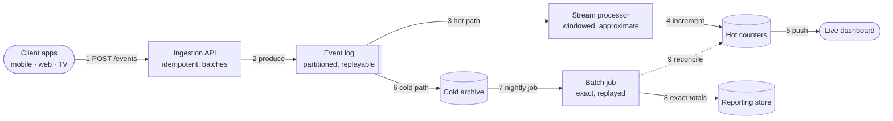
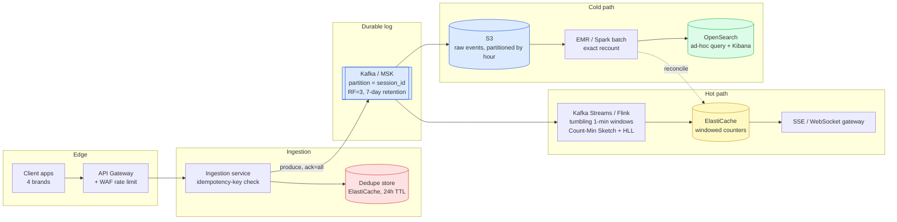

# Simple Diagram: Real-Time Event Aggregation

> Start here, before [questions.md](./questions.md). This is the mental model to hold while you read everything else.

---

## 1. The Simple Mental Model

Every event is written **once**, to one durable log, then read **twice**: once by a fast path that trades exactness for latency, once by a slow path that trades latency for exactness.



### The pen version

```text
Clients ──▶ [Ingestion API] ──▶ [[Event log]]
                                    │       │
                          hot ──────┘       └────── cold
                           ▼                          ▼
                     [Stream proc]                (S3 archive)
                           │                          │
                           ▼                          ▼
                      (counters) ──▶ Dashboard   [Batch job] ──▶ (Reporting)
```

**Draw order (~60s)**
1. Stadium far left: "Clients". These are the mobile/web/TV apps.
2. Box: "Ingestion API". One arrow in from Clients.
3. Queue shape: "Event log". One arrow in from the API.
4. Split the log into two arrows: one down to "Stream processor" (hot), one down to "S3 archive" (cold).
5. From Stream processor, a cylinder: "Hot counters". Then a stadium: "Dashboard".
6. From S3 archive, a box: "Batch job". Then a cylinder: "Reporting store".
7. Dashed arrow back from Batch job to Hot counters: "reconcile".

**Say while drawing**
1. "Clients send events. They don't care what happens after."
2. "One API ingests everything. It's idempotent."
3. "Every event lands in one durable, partitioned log."
4. "That log is read twice, not once."
5. "The hot path is fast and approximate — it feeds live dashboards."
6. "The cold path is slow and exact — it feeds reports and billing."
7. "Nightly, the exact totals correct the approximate ones."

### The 9 components to remember

| Component | Job (one line) |
|---|---|
| Client apps | Emit events; never block the user on a network call |
| Ingestion API | Validate, deduplicate, and durably accept before responding |
| Event log | One immutable, partitioned, replayable copy of the truth |
| Stream processor | Windowed aggregation, seconds of latency, approximate |
| Hot counters | Serve the live dashboard read path, sub-100ms |
| Live dashboard | What "system health" looks like to a human, right now |
| Cold archive | Cheap, durable, replayable storage of every raw event |
| Batch job | Recomputes exact totals; the source of truth for billing |
| Reporting store | What finance and ad-ops query; never touched by the hot path |

### The one idea that ties it together

**The hot path and the cold path answer different questions, at different prices, and neither one is allowed to pretend it's the other.** The hot path tells you "is the system healthy right now" — it can be a little wrong. The cold path tells you "what do we bill this advertiser" — it cannot be wrong, so it waits. Everything else in this topic is mechanics in service of keeping that split honest.

---

## 2. The Detailed Diagram

> **Tier R — reference only. Don't draw this in the room. Draw the reduction above it.**



### Service cheat-sheet

| Concept | Primitive (say this first) | AWS service | Native / OSS | One-line why |
|---|---|---|---|---|
| Ingestion door | idempotent write, dedupe by key, fast ack | **API Gateway + Lambda/Fargate** | Nginx + a stateless service | The API's only job is "accept durably and get out of the way" |
| Idempotency store | key → seen, short TTL, atomic `SETNX` | **ElastiCache (Redis)** | Redis | Sub-ms check; TTL bounds memory without a cleanup job |
| Durable event log | partitioned, replayable, ordered per key | **MSK** (managed Kafka) or **Kinesis Data Streams** | Kafka | Per-key order plus a replay window is what makes reconciliation possible at all |
| Hot-path compute | windowed, stateful stream compute | **Managed Service for Apache Flink** | Kafka Streams, Flink | Tumbling windows over a keyed stream, checkpointed state |
| Hot counters | in-memory, atomic increment, TTL per window | **ElastiCache (Redis)** | Redis | The dashboard's read path must never touch Kafka or the log directly |
| Live push to dashboard | server→client push, one HTTP response | *(see [sse](../sse/))* | SSE / WebSocket | Reuses the real-time-updates pattern; the counters are the source, SSE is the wire |
| Cold archive | cheap, durable, append-only, 11 nines | **S3** | HDFS, MinIO | The only copy anyone is allowed to bill from |
| Cold-path compute | distributed batch, exact, idempotent re-run | **EMR (Spark)** / **Glue** | Spark on K8s | Re-runnable from S3 any time; correctness over latency |
| Ad-hoc query + ops dashboards | tokenized search + aggregation, faceting | **OpenSearch Service** (+ Kibana/OpenSearch Dashboards) | Elasticsearch, OpenSearch | Derived index for humans to query; never the source of truth |
| Rate limiting the edge | token bucket, per-tenant | **WAF rate rules / API Gateway usage plans** | Envoy, a Redis token bucket | Protects the ingestion tier from one brand's traffic spike |

### AWS gotchas for this topic

- Kinesis shards impose **head-of-line blocking** — one poison record stalls everything behind it on that shard `⚠️ verify`.
- DynamoDB/ElastiCache atomic counters on **one hot key** (e.g. "total clicks today") cap out on a single partition's throughput — this is the exact trap Q26 tests.
- OpenSearch is a **derived** store. If it's ever the only place a number lives, the design is wrong — verify there's always a replay path from S3/Kafka that can rebuild it.
- MSK/Kafka retention is a **cost dial**, not a free safety net — 7 days of retention on a high-throughput topic is real storage spend; size it from the numbers in Q40, don't guess.

### Protocols worth naming

- **HTTP/1.1 or HTTP/2** for ingestion — plain request/response, `202 Accepted` once durably queued.
- **Kafka's wire protocol** (or Kinesis's) between producers/consumers and the log — you don't implement this, but naming "ack=all" (all in-sync replicas) versus "ack=1" (leader only) is the fluency signal.
- **SSE** (`text/event-stream`) from the counters tier to the live dashboard — one more consumer of the hot path, not a new source of truth. See [sse](../sse/) for the hop-1/hop-2 mechanics.
