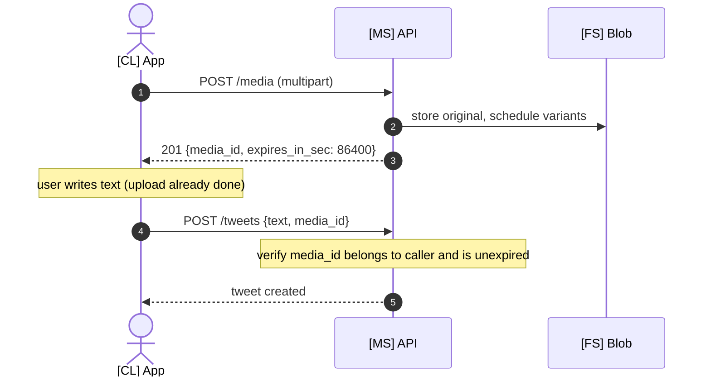
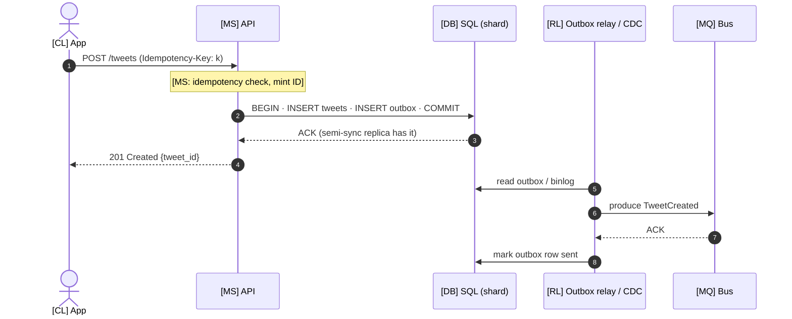
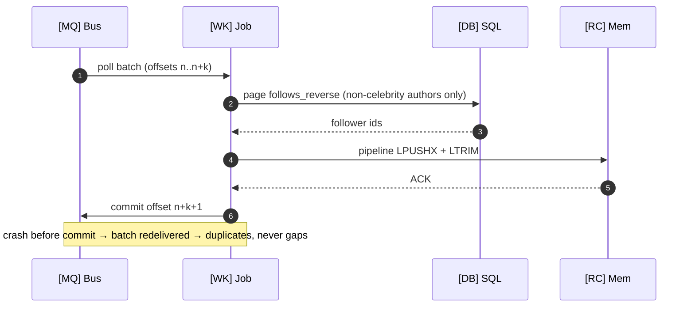
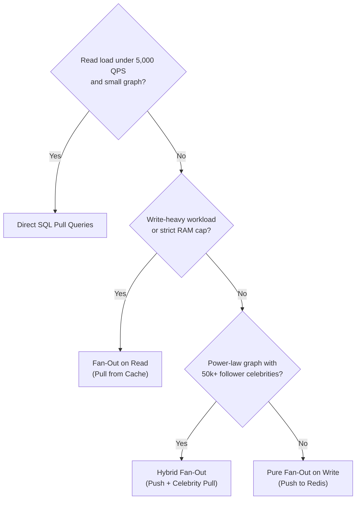

# Answers: Social Feed (Twitter / X)

> Keyed to [questions.md](./questions.md). Read questions first.
> Every answer includes either code or a comparison table so you can defend tradeoffs clearly.
>
> **Canonical numbers and choices** come from [system_design_twitter_microblogging_service.md](./system_design_twitter_microblogging_service.md): 150M DAU · 6K tweets/s (12K peak) · 300K timeline reads/s (600K peak) · ~50:1 · celebrity cut-off 50K followers · Redis packed list of 800 × 20-byte entries · sharded MySQL keyed by Snowflake `tweet_id` · FlockDB-style forward/reverse graph · Kafka + stateless fan-out workers · BlobStore + CDN.
>
> **🗂 Previous version** blocks keep the earlier answer (500M DAU / 1000:1 / Redis sorted set / Cassandra by `author_id`) verbatim, so you can compare both designs.
>
> ⚠️ Latency figures are *illustrative* (from the source doc), and capacity inputs such as "100 active followers per tweet" are assumptions — verify against real data. Python is the main code; Java is in the collapsible blocks. Check redis-py / Jedis / confluent-kafka signatures against the client versions you use.

---

## Level 1 — Core Problem

### A1. Naive approach and why it fails

**Naive approach**: When user opens feed, query all tweets from their 200 followees, sort by timestamp, return top N.

```sql
SELECT * FROM tweets
WHERE user_id IN (SELECT followee_id FROM follows WHERE follower_id = ?)
ORDER BY tweet_id DESC
LIMIT 20;
```

**Why it fails** (150M DAU, 300K timeline reads/s average, 600K peak):
- Each read touches 200 followees → 300K × 200 = **60M per-author lookups/s** (120M at peak).
- Tweets are sharded by `tweet_id`, so `user_id IN (...)` has no shard locality — every feed query is a scatter-gather to **every** shard.
- Even if sharded by author, a 200-shard fan-out has p99 = the slowest of 200 shards (tail-latency amplification) → seconds, not the 200 ms budget.
- `ORDER BY` across shards needs a coordinator merge-sort on every request.

<details>
<summary>🗂 <b>Previous version</b> — 500M DAU framing</summary>

```sql
SELECT * FROM tweets 
WHERE author_id IN (SELECT followee_id FROM follows WHERE follower_id = ?)
ORDER BY created_at DESC
LIMIT 100;
```

**Why it fails**:
- 500M DAU × 10 feed loads/day = 5B feed loads/day
- Each load fans out to 200 followees
- That's 1 trillion row scans per day
- The IN clause across 200 shards is catastrophically slow
- p99 latency would be 10+ seconds, not 200ms

</details>

---

### A2. Read-heavy system optimization

With a ~50:1 read-to-write ratio:
- 6,000 tweets/s × 86,400 = **518.4M tweets/day**
- 300,000 timeline reads/s

Count *cache operations*, not just requests: under hybrid fan-out a tweet costs ~100 cache writes (600K/s), and a read costs ~6 lookups (300K × 6 = 1.8M/s). Reads still dominate, so you **optimize for reads**: pre-compute timelines at write time, keep them in memory, and make the read a lookup plus a multi-get.

| Ratio | Optimize | Strategy |
|---|---|---|
| 1000:1 read-heavy | Reads | Pre-compute, cache, denormalize |
| 50:1 read-heavy (this design) | Reads | Pre-compute for most authors; pull the few that are too expensive to push |
| 1:1 balanced | Both | Index carefully, cache hot paths |
| 1:1000 write-heavy | Writes | Append-only logs, batch processing |

> **Previous numbers were internally inconsistent:** A1 used 5B feed loads/day (≈58K/s) but A2 used 500B reads/day (≈5.8M/s) — 100× apart. Pick one set of inputs and derive every number from it.

<details>
<summary>🗂 <b>Previous version</b> — 1000:1</summary>

With 1000:1 read-to-write ratio:
- 500M tweets/day = 5,800 writes/sec
- 500B feed reads/day = 5.8M reads/sec

**Optimize for reads**: Pre-compute results at write time. Store materialized timelines. Trade write complexity for read simplicity.

</details>

---

### A3. Fan-out on write vs fan-out on read

| Model | Definition |
|---|---|
| **Fan-out on write (push)** | When user tweets, push tweet ID to all followers' timelines immediately |
| **Fan-out on read (pull)** | When user loads feed, pull tweets from all followees at request time |
| **Hybrid** | Push for ordinary authors; pull-and-merge only for high-follower ("celebrity") authors |

```text
Fan-out on WRITE:
  User A tweets → Push to 1000 followers' timelines (write-time work)
  User B loads feed → Read pre-computed timeline (fast)

Fan-out on READ:
  User A tweets → Store tweet (fast)
  User B loads feed → Query 200 followees' tweets, merge, sort (read-time work)
```

Push moves the cost to the write and scales with the **author's follower count**. Pull moves it to the read and scales with the **reader's followee count**.

---

### A4. Celebrity tweet fan-out storm

If a user with 50M followers tweets using fan-out on write:

```text
50,000,000 followers × 1 LPUSH (+LTRIM) = 50M cache insertions for ONE tweet
Payload alone: 50M × 20 B = 1 GB written, ×3 replicas

Steady hybrid push load = 600K cache writes/s (1.2M at peak)
If the push tier is provisioned at ~1M writes/s (assumption — size from load tests):
  50M ÷ 1M/s ≈ 50 s of the ENTIRE cluster's push capacity
```

**Problems**:
- Breaks the **5 s delivery** target for this tweet and for every ordinary tweet queued behind it (same Kafka partitions, same workers) — the **hot-spot resilience** target fails.
- Uneven delivery: early followers see it in seconds, late ones in a minute.
- Memory queues overflow, causing backpressure on unrelated authors.

<details>
<summary>🗂 <b>Previous version</b></summary>

```text
50,000,000 followers × 1 write per follower = 50M writes
At 100K writes/sec throughput = 500 seconds = 8.3 minutes
```

**Problems**:
- Tweet appears in feeds 8 minutes late for some followers
- Fan-out workers saturated, slowing all other tweets
- Memory queues overflow, causing backpressure
- Uneven follower delivery (early followers see it, late ones don't for minutes)

</details>

---

### A5. Pure fan-out on read failure

Pure pull from cache at 200 followees is already **201 lookups per read** (200 `user_tweets` lists + 1 `MGET`) — illustrative p99 ~250 ms, over the 200 ms budget (see A48). At 1,000 followees it is 1,001 lookups per read, and 300K reads/s × 1,001 ≈ 300M cache ops/s.

Against the database instead of cache:

```text
- Query 1000 users' recent tweets
- Scattered across ~1000 shards
- Each query: ~5ms
- Total: 5 seconds (unacceptable)
- Plus sorting and merging 10,000+ tweets
```

**Result**: p99 latency > 5 seconds, users rage-quit the app.

---

## Level 2 — Data Model & Storage

### A6. Core entities

| Entity | Fields | Store (canonical) |
|---|---|---|
| **User** | `user_id BIGINT PK`, `handle VARCHAR(32)`, `follower_count INT`, `is_celebrity BOOL` | MySQL `users`, sharded by `user_id` |
| **Tweet** | `tweet_id BIGINT PK` (Snowflake), `user_id BIGINT`, `text VARCHAR(280)`, `media_id BIGINT`, `created_at INT` | MySQL `tweets`, sharded by `tweet_id` (consistent hash) |
| **Follow** | `(follower_id, followee_id, state, updated_at)` | MySQL `follows_forward` (by `follower_id`) + `follows_reverse` (by `followee_id`) — FlockDB-style |
| **Home timeline** | `timeline:{user_id}` → packed list ≤ 800 × 20 B (`tweet_id`, `author_id`, `flags`) | Redis |
| **Celebrity set** | `celebs:{user_id}` → set of followed `author_id`s with `is_celebrity = true` | Redis |
| **User timeline** | `user_tweets:{user_id}` → list of recent `tweet_id`s by that author | Redis |
| **Tweet object** | `tweet_obj:{tweet_id}` → serialized `text`, `author_handle`, `media_url`, counts | Redis, read with `MGET` |
| **Media** | `media_id` → blob variants, CDN URL | BlobStore + edge CDN |

The `state` column on follow edges makes unfollow a state change, not a delete. That keeps both copies (forward/reverse) easy to reconcile.

<details>
<summary>🗂 <b>Previous version</b> — Cassandra + sorted set</summary>

| Entity | Fields | Storage |
|---|---|---|
| **User** | id, username, display_name, follower_count, is_celebrity | PostgreSQL (OLTP) |
| **Tweet** | id, author_id, content, media_urls, created_at, reply_to | Cassandra (write-optimized, sharded by author_id) |
| **Follow** | follower_id, followee_id, created_at | Cassandra or Redis (fast fan-out lookup) |
| **Timeline** | user_id → list of tweet_ids (sorted by time) | Redis Sorted Set |
| **TweetCache** | tweet_id → full tweet object | Redis Hash |

</details>

---

### A7. Tweet table sharding

**Partition key**: `tweet_id`, consistent-hashed (hash, **not** range).

```text
shard = consistent_hash(tweet_id)
```

| Concern | Shard by `tweet_id` (canonical) | Shard by `author_id` (previous) |
|---|---|---|
| Write distribution | Uniform — no author can concentrate writes | Prolific authors skew one shard |
| Hydration fallback (`tweet_obj` miss) | One shard, point lookup | Need author to find shard (or a lookup table) |
| "Tweets by user X" | Not local → served from `user_tweets:{X}` in Redis + a durable `(user_id, tweet_id)` index | Local range scan |
| Celebrity read hot-spot | Spread across shards | One shard takes millions of reads |

- **Hash, not range**: range-sharding by Snowflake ID puts every new write on the "now" shard — a permanent hot spot.
- The source doc relies on `user_tweets:{user_id}` for profile pages. It doesn't name the durable index behind it. A `user_tweet_index(user_id, tweet_id)` table sharded by `user_id` is my addition, needed for rebuilds after a Redis loss.

<details>
<summary>🗂 <b>Previous version</b> — shard by author_id</summary>

**Partition key**: `author_id`

```text
Shard = hash(author_id) % num_shards
```

**Why author_id**:
- Tweets by same user co-located (efficient "get user's tweets")
- Fan-out workers read all tweets by one user from one shard
- Write amplification avoided (each tweet written once)

**Not tweet_id**: Would scatter one user's tweets across shards, making profile pages slow.

</details>

---

### A8. Follow graph storage comparison

| Option | Pros | Cons | Use When |
|---|---|---|---|
| **Sharded MySQL adjacency (FlockDB-style) — canonical** | 1-hop queries are index range scans; partitions horizontally; mature replication/backup tooling | No multi-hop traversal; app must keep forward and reverse copies in sync | Follow graph where every query is 1-hop ("my followees", "my followers") |
| **Relational single node (PostgreSQL)** | ACID, familiar | Doesn't scale to billions of edges | < 10M users |
| **Graph DB (Neo4j)** | Traversal optimized | Hard to shard; multi-hop strength unused here | Deep graph queries needed (friend-of-friend, recommendations) |
| **Wide-column (Cassandra)** | Scales horizontally, fast range queries | No joins; tunable (eventual) consistency | Billions of edges, write-heavy |

**Canonical schema**:
```
follows_forward: (follower_id, followee_id, state, updated_at)  sharded by follower_id → "who do I follow?"
follows_reverse: (followee_id, follower_id, state, updated_at)  sharded by followee_id → "who follows me?"
```

<details>
<summary>🗂 <b>Previous version</b> — Cassandra-style</summary>

**Twitter's choice**: Cassandra-style with two tables:
```
follows_by_follower: (follower_id, followee_id) → for "who do I follow?"
follows_by_followee: (followee_id, follower_id) → for "who follows me?"
```

> Note: this conflicted with QB4, which (correctly) describes FlockDB as built on MySQL shards.

</details>

---

### A9. Querying tweets by user in time range

With tweets sharded by `tweet_id`, use the **time inside the ID**. A Snowflake ID's top bits are milliseconds since the custom epoch, so any time bound converts directly into an ID bound (layout in A52):

```python
def min_id_since(ts_ms):
    return (ts_ms - CUSTOM_EPOCH_MS) << 22

def tweets_last_24h(user_id, now_ms):
    floor = min_id_since(now_ms - 86_400_000)
    ids = [int(t) for t in redis.lrange(f"user_tweets:{user_id}", 0, -1)]
    return [t for t in ids if t >= floor]
```

Durable fallback, single-shard range scan, and no `created_at` index needed:

```sql
SELECT tweet_id FROM user_tweet_index
WHERE user_id = ? AND tweet_id >= ?
ORDER BY tweet_id DESC
LIMIT 100;
```

<details>
<summary>🗂 <b>Previous version</b> — Cassandra sharded by author_id</summary>

With tweets sharded by `author_id`, query is local to one shard:

```sql
-- Cassandra CQL
SELECT * FROM tweets 
WHERE author_id = ?
AND created_at > ? AND created_at < ?
ORDER BY created_at DESC
LIMIT 100;
```

**Clustering key**: `created_at DESC` for efficient range scans within a partition.

</details>

---

### A10. Getting all followers of user X

The reverse copy of the edge, sharded by `followee_id`:

```sql
CREATE TABLE follows_reverse (
    followee_id BIGINT  NOT NULL,
    follower_id BIGINT  NOT NULL,
    state       TINYINT NOT NULL,
    updated_at  INT     NOT NULL,
    PRIMARY KEY (followee_id, follower_id)
);

SELECT follower_id FROM follows_reverse
WHERE followee_id = ? AND state = 1 AND follower_id > ?
ORDER BY follower_id
LIMIT 5000;
```

This is the fan-out lookup table — "give me everyone who follows this user." Keyset pagination (`follower_id > last_seen`) lets a worker stream a 49,999-follower list in batches without `OFFSET`. Accounts above 50K followers never need this query on the hot path, because they're pulled, not pushed.

<details>
<summary>🗂 <b>Previous version</b> — Cassandra</summary>

```sql
-- follows_by_followee table
CREATE TABLE follows_by_followee (
    followee_id UUID,
    follower_id UUID,
    created_at TIMESTAMP,
    PRIMARY KEY (followee_id, created_at, follower_id)
);
```

Query: `SELECT follower_id FROM follows_by_followee WHERE followee_id = ?`

</details>

---

### A11. Follow table sharding problems

| Shard By | Query "Who do I follow?" | Query "Who follows me?" |
|---|---|---|
| follower_id only | ✅ Fast (local) | ❌ Scatter-gather across all shards |
| followee_id only | ❌ Scatter-gather | ✅ Fast (local) |
| Both (two tables: `follows_forward` + `follows_reverse`) | ✅ Fast | ✅ Fast |

**Solution**: Maintain two copies of the relationship (write amplification for read efficiency). Every follow/unfollow writes both. If one write fails, a reconciler repairs it by comparing the `state` + `updated_at` of the two copies.

---

## Level 3 — Feed Generation Models

### A12. Fan-out on write step by step

```text
1. API mints a Snowflake tweet_id
2. INSERT row into MySQL tweets (shard = hash(tweet_id)); append tweet_id to user_tweets:{author}
3. Event reaches Kafka (via outbox — see A55); client gets the ack
4. Fan-out worker polls a batch
5. If author.is_celebrity → stop (followers pull it, A15)
   Else page follows_reverse for followers and, per follower:
   5a. LPUSHX timeline:{f} <20-byte entry>   (no key = inactive user = no write)
   5b. LTRIM  timeline:{f} 0 799
6. Commit the Kafka offset only after the Redis pipeline succeeds (A56)
7. Tweet visible in followers' feeds within the 5 s delivery bound
```

> The source's sequence diagram appends to `user_tweets` only in the celebrity branch. Profile pages need it for **every** author, so do it on every tweet.

```python
import struct

ENTRY = struct.Struct(">QQI")  # tweet_id(8) | author_id(8) | flags(4) = 20 bytes
TIMELINE_CAP = 800

def fanout_tweet(tweet):
    if tweet.author.is_celebrity:
        return
    entry = ENTRY.pack(tweet.id, tweet.author_id, tweet.flags)
    for batch in iter_follower_batches(tweet.author_id, size=5000):
        pipe = redis.pipeline(transaction=False)
        for follower_id in batch:
            key = f"timeline:{follower_id}"
            pipe.lpushx(key, entry)
            pipe.ltrim(key, 0, TIMELINE_CAP - 1)
        pipe.execute()
```

`LPUSHX` writes only if the key exists. Inactive users' timeline keys have expired (30-day TTL, A28), so the "skip inactive users" rule needs no extra lookup.

<details>
<summary>☕ <b>Java</b> — pipelined, one round trip per 5,000 followers</summary>

```java
static final int TIMELINE_CAP = 800;

static byte[] packEntry(long tweetId, long authorId, int flags) {
    return ByteBuffer.allocate(20).putLong(tweetId).putLong(authorId).putInt(flags).array();
}

void fanoutTweet(Tweet tweet) {
    if (tweet.author().isCelebrity()) return;

    byte[] entry = packEntry(tweet.id(), tweet.authorId(), tweet.flags());
    for (List<Long> batch : followerBatches(tweet.authorId(), 5_000)) {
        Pipeline pipe = jedis.pipelined();
        for (long followerId : batch) {
            byte[] key = ("timeline:" + followerId).getBytes(StandardCharsets.UTF_8);
            pipe.lpushx(key, entry);
            pipe.ltrim(key, 0, TIMELINE_CAP - 1);
        }
        pipe.sync();
    }
}
```

</details>

<details>
<summary>🗂 <b>Previous version</b> — sorted set</summary>

```text
1. User A posts tweet T
2. Tweet Service stores T in Tweets table (shard by A's user_id)
3. Fan-out Service queries follows_by_followee for all of A's followers
4. For each follower F:
   4a. Add T's ID to F's timeline in Redis (ZADD with timestamp as score)
   4b. Trim timeline to max 800 entries (ZREMRANGEBYRANK)
5. Tweet available in followers' feeds immediately on next load
```

```python
# Fan-out worker pseudocode
def fanout_tweet(tweet):
    followers = get_followers(tweet.author_id)
    for follower_id in followers:
        redis.zadd(f"timeline:{follower_id}", {tweet.id: tweet.created_at})
        redis.zremrangebyrank(f"timeline:{follower_id}", 0, -801)  # Keep last 800
```

<details>
<summary>☕ <b>Java</b> — pipelined so 5,000 followers isn't 10,000 round trips</summary>

```java
// Fan-out worker
void fanoutTweet(Tweet tweet) {
    List<String> followers = getFollowers(tweet.authorId());

    // Pipeline: one round trip per batch, not two per follower.
    Pipeline pipe = jedis.pipelined();
    for (String followerId : followers) {
        String key = "timeline:" + followerId;
        pipe.zadd(key, tweet.createdAt().toEpochMilli(), tweet.id());
        pipe.zremrangeByRank(key, 0, -801);      // Keep last 800
    }
    pipe.sync();
}
```

</details>

</details>

---

### A13. Fan-out on read step by step

```text
1. User B opens feed
2. Feed Service queries follows_forward for all of B's followees
3. For each followee, read their recent tweets (canonical: LRANGE user_tweets:{id} 0 19, pipelined)
4. Merge all tweet IDs into one list
5. Sort by tweet_id (Snowflake = time order) or ranking score
6. Return top N
```

```python
def get_feed_fan_out_read(user_id):
    followees = get_followees(user_id)
    all_tweets = []
    for followee_id in followees:
        tweets = get_recent_tweets(followee_id, limit=20)
        all_tweets.extend(tweets)
    all_tweets.sort(key=lambda t: t.created_at, reverse=True)
    return all_tweets[:100]
```

<details>
<summary>☕ <b>Java</b> — flatMap + sorted replaces the accumulate-then-sort</summary>

```java
List<Tweet> getFeedFanOutRead(String userId) {
    return getFollowees(userId).stream()
            .flatMap(followeeId -> getRecentTweets(followeeId, 20).stream())
            .sorted(Comparator.comparing(Tweet::createdAt).reversed())
            .limit(100)
            .toList();
}
```

</details>

---

### A14. Hybrid fan-out model

| User Type | Follower Count | Strategy |
|---|---|---|
| Normal user | < 50K | Fan-out on write (push into followers' lists) |
| Celebrity (`is_celebrity = true`) | ≥ 50K | Fan-out on read (append to own `user_tweets` only) |

```text
When normal user tweets:
  → Push to active followers' timelines (fast, cheap)

When celebrity tweets:
  → Store in celebrity's tweet list only (no fan-out)
  → Followers pull celebrity tweets at read time
```

**Why the cut-off is a tunable, not a law:** it trades write amplification (followers × tweets) against read cost (one extra `LRANGE` per celebrity followed). Raise it → more push writes, fewer read lookups. Lower it → the opposite. Pick it from the cost curve (A46, A48), and add hysteresis (A21).

> I don't have a verified source for Twitter's real cut-off. The previous version's "~10K" and this doc's "50K" are both design parameters.

<details>
<summary>🗂 <b>Previous version</b> — 10K threshold</summary>

| User Type | Follower Count | Strategy |
|---|---|---|
| Normal user | < 10K | Fan-out on write |
| Celebrity | >= 10K | Fan-out on read |

**Twitter's actual threshold**: ~10K followers (varies). *(unverified)*

</details>

---

### A15. Merging pushed and pulled tweets

Three round trips: (1) own timeline + celeb set, (2) celeb lists pipelined, (3) `MGET` hydrate.

```python
def get_feed_hybrid(user_id, max_id=None, limit=20):
    pipe = redis.pipeline(transaction=False)
    pipe.lrange(f"timeline:{user_id}", 0, TIMELINE_CAP - 1)
    pipe.smembers(f"celebs:{user_id}")
    pushed_raw, celeb_ids = pipe.execute()

    pipe = redis.pipeline(transaction=False)
    for celeb_id in celeb_ids:
        pipe.lrange(f"user_tweets:{int(celeb_id)}", 0, 49)
    celeb_lists = pipe.execute()

    ids = {ENTRY.unpack(raw)[0] for raw in pushed_raw}
    ids.update(int(t) for lst in celeb_lists for t in lst)

    page = sorted((i for i in ids if max_id is None or i < max_id), reverse=True)[:limit]
    next_cursor = page[-1] if len(page) == limit else None
    return hydrate(page), next_cursor
```

- **Set, not list**: dedupes retried fan-outs (A57) and the overlap during a push→pull transition (A24).
- **Sort by `tweet_id`**: Snowflake IDs are time-ordered, so no timestamp lookup is needed (A52).
- Filter unfollowed/muted authors with the `author_id` in each entry *before* `hydrate` (A27, QB6).

<details>
<summary>☕ <b>Java</b> — two pipelines, then merge</summary>

```java
FeedPage getFeedHybrid(long userId, Long maxId, int limit) {
    Pipeline p1 = jedis.pipelined();
    Response<List<byte[]>> pushed =
            p1.lrange(("timeline:" + userId).getBytes(StandardCharsets.UTF_8), 0, TIMELINE_CAP - 1);
    Response<Set<String>> celebs = p1.smembers("celebs:" + userId);
    p1.sync();

    Pipeline p2 = jedis.pipelined();
    List<Response<List<String>>> celebLists = celebs.get().stream()
            .map(id -> p2.lrange("user_tweets:" + id, 0, 49))
            .toList();
    p2.sync();

    Set<Long> ids = new HashSet<>();
    pushed.get().forEach(raw -> ids.add(ByteBuffer.wrap(raw).getLong()));
    celebLists.forEach(r -> r.get().forEach(s -> ids.add(Long.parseLong(s))));

    List<Long> page = ids.stream()
            .filter(id -> maxId == null || id < maxId)
            .sorted(Comparator.reverseOrder())
            .limit(limit)
            .toList();

    Long next = page.size() == limit ? page.get(page.size() - 1) : null;
    return new FeedPage(hydrate(page), next);
}
```

</details>

<details>
<summary>🗂 <b>Previous version</b> — sorted set + DB pull</summary>

```python
def get_feed_hybrid(user_id):
    # 1. Get pre-computed timeline (pushed tweets from non-celebrities)
    pushed_tweet_ids = redis.zrevrange(f"timeline:{user_id}", 0, 200)
    
    # 2. Get celebrities this user follows
    celebrities = get_followed_celebrities(user_id)
    
    # 3. Fetch recent tweets from each celebrity
    celebrity_tweets = []
    for celeb_id in celebrities:
        tweets = get_recent_tweets(celeb_id, limit=10)
        celebrity_tweets.extend(tweets)
    
    # 4. Merge and sort
    all_tweet_ids = pushed_tweet_ids + [t.id for t in celebrity_tweets]
    all_tweets = hydrate_tweets(all_tweet_ids)
    all_tweets.sort(key=lambda t: t.created_at, reverse=True)
    
    return all_tweets[:100]
```

<details>
<summary>☕ <b>Java</b> — the push/pull asymmetry is the whole answer</summary>

```java
List<Tweet> getFeedHybrid(String userId) {
    // 1. Pre-computed timeline (pushed tweets from non-celebrities)
    List<String> pushedIds = new ArrayList<>(
            jedis.zrevrange("timeline:" + userId, 0, 200));

    // 2-3. Celebrities are PULLED at read time, never pushed.
    List<Tweet> celebrityTweets = getFollowedCelebrities(userId).stream()
            .flatMap(celebId -> getRecentTweets(celebId, 10).stream())
            .toList();

    // 4. Merge and sort
    List<String> allIds = new ArrayList<>(pushedIds);
    celebrityTweets.forEach(t -> allIds.add(t.id()));

    return hydrateTweets(allIds).stream()
            .sorted(Comparator.comparing(Tweet::createdAt).reversed())
            .limit(100)
            .toList();
}
```

</details>

</details>

---

### A16. Redis data structure for timeline

**Canonical: a packed Redis list** of 20-byte binary entries (`tweet_id` | `author_id` | `flags`), written with `LPUSH`/`LTRIM`.

| | Packed list (canonical) | Sorted set (previous) |
|---|---|---|
| Entry | 20 B payload | member + score, plus skiplist + dict overhead once past the listpack size limits |
| Insert | `LPUSH` O(1) + `LTRIM` | `ZADD` O(log N) |
| Retry-safe | ❌ duplicates on retry (A57) | ✅ idempotent — same member, same score |
| Order | arrival order → re-sort by `tweet_id` on read | by score |
| Cursor (`max_id`) | scan ≤ 800 entries | `ZREVRANGEBYSCORE` native |
| Remove one | `LREM` O(N) | `ZREM` O(log N) |
| Fits the access pattern | push at head, trim at tail — it's a bounded queue | general ordered set |

**Why the list wins here:** memory is the binding constraint (7.2 TB with 3 replicas even at 20 B/entry, A26). The timeline is a bounded queue, and random removal is rare because deletes, unfollows and mutes are lazy read-time filters. You pay for it with retry duplicates and no native cursor, and both are cheap to absorb at 800 entries.

> 20 B is the payload. Redis adds per-key and list-encoding overhead, so measure with `MEMORY USAGE timeline:<id>`. I believe the High Scalability write-up in the source references describes Twitter's timelines as Redis lists of tweet ID + user ID + flag bits — verify there.

<details>
<summary>🗂 <b>Previous version</b> — sorted set</summary>

**Redis Sorted Set (ZSET)**:

```bash
# Add tweet to timeline (score = timestamp)
ZADD timeline:user123 1640000000 tweet456

# Get top 100 tweets (most recent first)
ZREVRANGE timeline:user123 0 99

# Remove old tweets (keep only 800)
ZREMRANGEBYRANK timeline:user123 0 -801

# Remove specific tweet (deletion)
ZREM timeline:user123 tweet456
```

**Why Sorted Set**: O(log N) insert, O(log N + M) range query, automatic sorting by score (timestamp).

</details>

---

### A17. Storing tweet IDs vs full objects

| Store | Memory per Timeline | 150M users | × 3 replicas |
|---|---|---|---|
| Full tweet objects (~500 B × 800) | 400 KB | 60 TB | 180 TB |
| Packed entries (20 B × 800) | 16 KB | 2.4 TB | 7.2 TB |

**Store references**: 25× less memory. Tweet objects also *change* (like counts, deletes, edits). One `tweet_obj:{id}` update beats rewriting copies in N timelines. Hydrate on read with one `MGET`.

The entry carries `author_id` + `flags`, not just the ID, so unfollowed/muted authors and replies/retweets can be dropped **before** hydration (A27, QB2, QB6).

<details>
<summary>🗂 <b>Previous version</b> — 8-byte IDs, 500M users</summary>

| Store | Memory per Timeline | Total for 500M users |
|---|---|---|
| Full tweet objects (1KB × 800) | 800 KB | 400 TB |
| Tweet IDs only (8 bytes × 800) | 6.4 KB | 3.2 TB |

**Store IDs**: 125x less memory. Hydrate full tweets from Tweet Cache on read.

</details>

---

### A18. Cold start / cache miss handling

A miss means a returning-inactive user, a new user, or a lost shard. Rebuild from sources, **with a concurrency budget** so misses can't stampede MySQL (A65):

```python
rebuild_slots = threading.BoundedSemaphore(200)

def get_feed(user_id, max_id=None, limit=20):
    if redis.exists(f"timeline:{user_id}"):
        return get_feed_hybrid(user_id, max_id, limit)

    if not rebuild_slots.acquire(blocking=False):
        raise ServiceUnavailable(retry_after_sec=2)
    try:
        entries = rebuild_from_sources(user_id)
    finally:
        rebuild_slots.release()

    async_write_timeline(user_id, entries)
    return first_page(user_id, entries, max_id, limit)
```

- `rebuild_from_sources` reads non-celebrity followees from `follows_forward`, takes their recent IDs from `user_tweets` (or `user_tweet_index` in MySQL), and keeps the newest 800. `first_page` merges in celebrity pulls exactly as A15 does.
- The semaphore is per API instance, so the global budget = slots × instances. Size it against MySQL headroom.
- If a user follows nobody, write an empty sentinel so they don't rebuild on every read.

<details>
<summary>☕ <b>Java</b> — tryAcquire = fail fast instead of queueing</summary>

```java
private final Semaphore rebuildSlots = new Semaphore(200);

FeedPage getFeed(long userId, Long maxId, int limit) {
    if (jedis.exists("timeline:" + userId)) {
        return getFeedHybrid(userId, maxId, limit);
    }
    if (!rebuildSlots.tryAcquire()) {
        throw new ServiceUnavailableException(Duration.ofSeconds(2));
    }
    List<Entry> entries;
    try {
        entries = rebuildFromSources(userId);
    } finally {
        rebuildSlots.release();
    }
    asyncWriteTimeline(userId, entries);
    return firstPage(userId, entries, maxId, limit);
}
```

</details>

<details>
<summary>🗂 <b>Previous version</b> — sorted set, unbounded rebuild</summary>

```python
def get_feed(user_id):
    timeline = redis.zrevrange(f"timeline:{user_id}", 0, 100)
    
    if not timeline:  # Cache miss
        # Rebuild from source of truth
        followees = get_followees(user_id)
        tweets = []
        for followee_id in followees[:50]:  # Limit fan-out
            tweets.extend(get_recent_tweets(followee_id, limit=20))
        tweets.sort(key=lambda t: t.created_at, reverse=True)
        
        # Repopulate cache asynchronously
        async_rebuild_timeline(user_id, tweets)
        
        return tweets[:100]
    
    return hydrate_tweets(timeline)
```

<details>
<summary>☕ <b>Java</b> — same logic</summary>

```java
List<Tweet> getFeed(String userId) {
    Set<String> timeline = jedis.zrevrange("timeline:" + userId, 0, 100);

    if (timeline.isEmpty()) {                       // Cache miss — rebuild
        List<Tweet> tweets = getFollowees(userId).stream()
                .limit(50)                          // Limit fan-out
                .flatMap(id -> getRecentTweets(id, 20).stream())
                .sorted(Comparator.comparing(Tweet::createdAt).reversed())
                .toList();

        asyncRebuildTimeline(userId, tweets);       // Repopulate off the hot path
        return tweets.stream().limit(100).toList();
    }

    return hydrateTweets(new ArrayList<>(timeline));
}
```

</details>

</details>

---

## Level 4 — The Celebrity Problem

### A19. Celebrity problem definition

**Problem**: Accounts with millions of followers make fan-out on write impractical.

| Account | Followers | Fan-out writes per tweet | Strategy at 50K cut-off |
|---|---|---|---|
| Normal user | 500 | 500 | Push |
| Micro-celebrity | 50K | 50,000 | Pull (at the line) |
| Celebrity | 5M | 5,000,000 | Pull |
| Mega-celebrity | 100M | 100,000,000 | Pull |

**At 100M writes**: Queue depth explodes, workers saturate, latency spikes, timeline freshness degrades for everyone.

The follower distribution is power-law. The *mean* of 500 followers is dragged up by a few huge accounts. Removing them from push is why hybrid's average push fan-out falls so far (A46).

---

### A20. Celebrity tweet fan-out time

```text
150M followers
÷ 10K writes/sec (optimistic per worker)
= 15,000 seconds
= 4.2 hours per tweet

With 100 parallel workers:
= 150 seconds = 2.5 minutes

To meet the 5 s delivery bound for this ONE tweet:
150M ÷ 5 s = 30M writes/s — ~25× the whole hybrid peak push load (1.2M/s)
```

**Not acceptable**: User expects tweet to appear instantly. Other users' tweets are delayed while celebrity fan-out hogs resources.

---

### A21. Dynamic celebrity classification

**Static threshold** (simple): `is_celebrity = follower_count > 50000`

**Dynamic classification** (better):

```python
def classify_user(user_id):
    follower_count = get_follower_count(user_id)
    tweet_rate = get_tweets_per_day(user_id)
    
    # High-volume celebrity: many followers + tweets often
    fanout_cost = follower_count * tweet_rate
    
    if fanout_cost > THRESHOLD:  # e.g., 100K fanouts/day
        return "celebrity"  # Use pull model
    return "normal"  # Use push model
```

<details>
<summary>☕ <b>Java</b> — enum instead of stringly-typed return</summary>

```java
enum UserClass { CELEBRITY, NORMAL }

UserClass classifyUser(String userId) {
    long followerCount = getFollowerCount(userId);
    long tweetRate     = getTweetsPerDay(userId);

    // The cost that matters is followers × post rate, not followers alone.
    long fanoutCost = followerCount * tweetRate;

    return fanoutCost > THRESHOLD          // e.g. 100K fanouts/day
            ? UserClass.CELEBRITY          // pull model
            : UserClass.NORMAL;            // push model
}
```

</details>

Store classification in `users.is_celebrity`; recompute daily.

**Add hysteresis.** Every flip costs a follower-wide `celebs:{f}` update (A24), so an account hovering at the line must not flap:

```python
ENTER_AT, EXIT_AT = 50_000, 40_000

def next_is_celebrity(is_celebrity, follower_count):
    if is_celebrity:
        return follower_count >= EXIT_AT
    return follower_count >= ENTER_AT
```

---

### A22. Celebrity tweet fetch at read time

**Where**: `celebs:{user_id}` — a small Redis set per reader, kept up to date on follow/unfollow and on account transitions (A24).
**How**: pipelined `LRANGE user_tweets:{celeb_id}` from Redis. This is not a DB query.

```python
def on_follow(follower_id, target):
    insert_edge(follower_id, target.id)
    if target.is_celebrity:
        redis.sadd(f"celebs:{follower_id}", target.id)

def get_celebrity_tweet_ids(user_id, per_celeb=50):
    celeb_ids = redis.smembers(f"celebs:{user_id}")
    pipe = redis.pipeline(transaction=False)
    for celeb_id in celeb_ids:
        pipe.lrange(f"user_tweets:{int(celeb_id)}", 0, per_celeb - 1)
    return [int(t) for lst in pipe.execute() for t in lst]
```

<details>
<summary>☕ <b>Java</b> — one pipeline for all followed celebrities</summary>

```java
Set<String> getFollowedCelebrities(long userId) {
    return jedis.smembers("celebs:" + userId);
}

List<Long> getCelebrityTweetIds(long userId, int perCeleb) {
    Pipeline pipe = jedis.pipelined();
    List<Response<List<String>>> lists = getFollowedCelebrities(userId).stream()
            .map(id -> pipe.lrange("user_tweets:" + id, 0, perCeleb - 1))
            .toList();
    pipe.sync();
    return lists.stream().flatMap(r -> r.get().stream()).map(Long::parseLong).toList();
}
```

</details>

**New hot spot you created:** `user_tweets:{celeb}` is read by millions of readers. That makes it a hot key. Serve it from replicas, or from a short-TTL (~1 s) in-process cache on API servers. That's my addition, not in the source doc.

<details>
<summary>🗂 <b>Previous version</b> — celeb_follows + Cassandra pull</summary>

```python
# Store list of celebrities user follows (small set, cached)
CELEB_FOLLOWS_KEY = "celeb_follows:{user_id}"

def get_followed_celebrities(user_id):
    celeb_ids = redis.smembers(f"celeb_follows:{user_id}")
    return celeb_ids

def get_celebrity_tweets(user_id):
    celeb_ids = get_followed_celebrities(user_id)
    tweets = []
    for celeb_id in celeb_ids:
        # Each celebrity's tweets indexed by author_id
        recent = cassandra.execute(
            "SELECT * FROM tweets WHERE author_id = ? ORDER BY created_at DESC LIMIT 10",
            [celeb_id]
        )
        tweets.extend(recent)
    return tweets
```

<details>
<summary>☕ <b>Java</b> — Cassandra Java driver with a prepared statement</summary>

```java
// Small set, cached per user.
Set<String> getFollowedCelebrities(String userId) {
    return jedis.smembers("celeb_follows:" + userId);
}

List<Tweet> getCelebrityTweets(String userId) {
    PreparedStatement stmt = session.prepare("""
            SELECT * FROM tweets WHERE author_id = ?
            ORDER BY created_at DESC LIMIT 10
            """);

    return getFollowedCelebrities(userId).stream()
            .flatMap(celebId -> session.execute(stmt.bind(celebId)).all().stream())
            .map(Tweet::from)
            .toList();
}
```

</details>

</details>

---

### A23. Celebrity tweet deletion propagation

**Hybrid makes this cheap:** a celebrity's tweet was never pushed, so it sits in **one** list, `user_tweets:{celeb}`, not in 50M timelines.

```python
def delete_celebrity_tweet(tweet):
    mark_deleted_in_mysql(tweet.id)
    redis.lrem(f"user_tweets:{tweet.author_id}", 0, tweet.id)
    redis.set(f"tweet_obj:{tweet.id}", TOMBSTONE)
```

**Fan-out on write deletion** (normal authors): you'd have to `LREM` from every follower's timeline — the same cost as posting, and `LREM` is O(N) per list.

**Better approach**:
1. Mark tweet as `deleted=true` in Tweets table
2. When feed is loaded, filter out deleted tweets after hydration
3. Periodically clean up stale tweet IDs from timelines (async background job)

```python
def hydrate_tweets(tweet_ids):
    tweets = tweet_cache.mget(tweet_ids)
    return [t for t in tweets if t and not t.deleted]  # Filter deleted
```

<details>
<summary>☕ <b>Java</b> — filter(Objects::nonNull) makes the null-skip explicit</summary>

```java
List<Tweet> hydrateTweets(List<String> tweetIds) {
    // One multi-get, not N gets.
    return tweetCache.getAll(tweetIds).values().stream()
            .filter(Objects::nonNull)
            .filter(t -> !t.deleted())        // Deletions applied lazily at read time
            .toList();
}
```

</details>

Write a tombstone into `tweet_obj`, don't just `DEL` it. Otherwise a hydration miss falls through to MySQL on every read of that dead ID.

---

### A24. User going viral overnight

Order is the whole answer: **add the author to every follower's `celebs:{f}` set first, then flip `is_celebrity`.**
- Flip first → there's a window where a follower gets neither push nor pull → **missing tweets**.
- Update sets first → there's a window with both push and pull → **duplicates**, and the read path already dedupes by `tweet_id` (A15).

```python
CELEB_ENTER = 50_000

def handle_follower_milestone(user_id, old_count, new_count):
    if old_count < CELEB_ENTER <= new_count:
        async_job(promote_to_celebrity, user_id)

def promote_to_celebrity(user_id):
    for batch in iter_follower_batches(user_id, size=5000):
        pipe = redis.pipeline(transaction=False)
        for follower_id in batch:
            pipe.sadd(f"celebs:{follower_id}", user_id)
        pipe.execute()
        throttle()
    mark_as_celebrity(user_id)
```

<details>
<summary>☕ <b>Java</b> — sets first, flag last</summary>

```java
static final long CELEB_ENTER = 50_000;

void handleFollowerMilestone(long userId, long oldCount, long newCount) {
    if (oldCount < CELEB_ENTER && newCount >= CELEB_ENTER) {
        asyncJob(() -> promoteToCelebrity(userId));
    }
}

void promoteToCelebrity(long userId) {
    for (List<Long> batch : followerBatches(userId, 5_000)) {
        Pipeline pipe = jedis.pipelined();
        batch.forEach(f -> pipe.sadd("celebs:" + f, String.valueOf(userId)));
        pipe.sync();
        throttle();
    }
    markAsCelebrity(userId);   // last: overlap gives duplicates, never gaps
}
```

</details>

- The transition itself is a one-time fan-out of size `follower_count` (10M `SADD`s). Throttle it. It is still far cheaper than pushing every future tweet.
- **Alternative:** drop the per-reader set and compute celebrities at read time as `followees ∩ global_celebrity_set`. That makes the transition O(1), but every read must load the followee list (~200 IDs, cacheable).
- Existing pushed entries remain and age out of the 800-entry window.

<details>
<summary>🗂 <b>Previous version</b> — 10K threshold, flag first</summary>

```python
def handle_follower_milestone(user_id, old_count, new_count):
    CELEBRITY_THRESHOLD = 10000
    
    if old_count < CELEBRITY_THRESHOLD and new_count >= CELEBRITY_THRESHOLD:
        # Transition to celebrity model
        mark_as_celebrity(user_id)
        
        # Stop future fan-out on write
        # Existing timeline entries remain (eventually expire)
        
        # Update all followers' celeb_follows lists
        async_job(update_followers_celeb_list, user_id, "add")
```

<details>
<summary>☕ <b>Java</b> — same logic</summary>

```java
static final long CELEBRITY_THRESHOLD = 10_000;

void handleFollowerMilestone(String userId, long oldCount, long newCount) {
    boolean crossedUp = oldCount < CELEBRITY_THRESHOLD
                     && newCount >= CELEBRITY_THRESHOLD;
    if (!crossedUp) return;

    markAsCelebrity(userId);          // stop future fan-out on write

    // Existing timeline entries stay put and age out naturally.
    // Every follower needs this author added to their celeb list.
    asyncJob(() -> updateFollowersCelebList(userId, Op.ADD));
}
```

</details>

Transition is asynchronous; no immediate timeline rebuild required.

> Bug in this version: flipping the flag before the async list update leaves a window where followers get neither push nor pull.

</details>

---

## Level 5 — Timeline Caching

### A25. Redis list operations

```bash
# Entry = 20-byte binary blob: tweet_id(8) | author_id(8) | flags(4)

# Add tweet (only if this user has a live timeline)
LPUSHX timeline:123 <entry>          # O(1)
LTRIM  timeline:123 0 799            # O(K), K = elements removed

# Fetch top N most recent (arrival order; re-sort by tweet_id after merge)
LRANGE timeline:123 0 19             # O(S+N)

# Remove one tweet (rare — deletes/unfollows are lazy filters)
LREM   timeline:123 0 <entry>        # O(N); needs the exact 20 bytes

# Expire inactive users' timelines (refresh on every read)
EXPIRE timeline:123 2592000          # 30 days
```

Pagination by `max_id` has no native command on a list. Read the ≤ 800 entries and filter, which costs microseconds.

<details>
<summary>🗂 <b>Previous version</b> — sorted set operations</summary>

```bash
# Data structure: ZSET with score = Unix timestamp

# Add tweet to timeline
ZADD timeline:user123 1704067200 tweet789
# O(log N)

# Remove tweet (delete or unfollow)
ZREM timeline:user123 tweet789
# O(log N)

# Fetch top N most recent
ZREVRANGE timeline:user123 0 99
# O(log N + M) where M = 100

# Fetch with scores (for pagination cursor)
ZREVRANGE timeline:user123 0 99 WITHSCORES

# Trim to keep only last 800
ZREMRANGEBYRANK timeline:user123 0 -801
# O(log N + K) where K = elements removed
```

</details>

---

### A26. Timeline cache size

| Items | Bytes per entry | Per user | 150M users | × 3 replicas |
|---|---|---|---|---|
| 100 | 20 | 2 KB | 300 GB | 900 GB |
| **800** | 20 | **16 KB** | **2.4 TB** | **7.2 TB** |
| 10,000 | 20 | 200 KB | 30 TB | 90 TB |

**Sweet spot**: 800 entries. Deep scroll past 800 is rare and served from `user_tweets` / MySQL. Only *active* users have a key (30-day TTL), so 150M DAU is the sizing bound, not total accounts. The figures are payload only, so add Redis overhead and measure.

<details>
<summary>🗂 <b>Previous version</b> — 8-byte IDs, 500M users</summary>

| Items | Bytes per ID | Total | 500M users |
|---|---|---|---|
| 100 | 8 | 800 B | 400 GB |
| 800 | 8 | 6.4 KB | 3.2 TB |
| 10,000 | 8 | 80 KB | 40 TB |

**Sweet spot**: 800 items. Covers ~1 week of content for average user. 3.2 TB fits in a Redis cluster.

</details>

---

### A27. Unfollow timeline update

**Canonical — lazy, filtered by the `author_id` inside each entry.** That field exists so unfollowed or muted authors can be dropped *without* hydrating them first:

```python
def unfollow(follower_id, followee_id):
    set_edge_state(follower_id, followee_id, state=REMOVED)
    redis.srem(f"celebs:{follower_id}", followee_id)

def visible_ids(user_id, raw_entries):
    followees = get_followee_set(user_id)
    return [tid for tid, author, _ in map(ENTRY.unpack, raw_entries) if author in followees]
```

<details>
<summary>☕ <b>Java</b> — filter before MGET, not after</summary>

```java
void unfollow(long followerId, long followeeId) {
    setEdgeState(followerId, followeeId, EdgeState.REMOVED);
    jedis.srem("celebs:" + followerId, String.valueOf(followeeId));
}

List<Long> visibleIds(long userId, List<byte[]> rawEntries) {
    Set<Long> followees = getFolloweeSet(userId);
    return rawEntries.stream()
            .map(ByteBuffer::wrap)
            .filter(b -> followees.contains(b.getLong(8)))
            .map(b -> b.getLong(0))
            .toList();
}
```

</details>

Unfollowed entries stop showing at once and age out of the 800 window. It's asynchronous by design: there's no synchronous write to the timeline.

<details>
<summary>🗂 <b>Previous version</b> — eager vs lazy with sorted set</summary>

**Option 1 — Synchronous removal** (expensive):
```python
def unfollow(follower_id, followee_id):
    # Remove from follow graph
    remove_follow(follower_id, followee_id)
    
    # Remove all followee's tweets from follower's timeline
    followee_tweets = get_recent_tweet_ids(followee_id, limit=100)
    for tweet_id in followee_tweets:
        redis.zrem(f"timeline:{follower_id}", tweet_id)
```

<details>
<summary>☕ <b>Java</b> — varargs zrem instead of a loop</summary>

```java
// Eager: clean the timeline on unfollow.
void unfollow(String followerId, String followeeId) {
    removeFollow(followerId, followeeId);

    List<String> followeeTweets = getRecentTweetIds(followeeId, 100);
    jedis.zrem("timeline:" + followerId,
               followeeTweets.toArray(new String[0]));   // one call, not N
}
```

</details>

**Option 2 — Lazy removal** (preferred):
```python
def unfollow(follower_id, followee_id):
    remove_follow(follower_id, followee_id)
    # Don't touch timeline
    
def get_feed(user_id):
    tweet_ids = redis.zrevrange(f"timeline:{user_id}", 0, 200)
    tweets = hydrate_tweets(tweet_ids)
    followees = set(get_followees(user_id))
    # Filter out unfollowed authors
    return [t for t in tweets if t.author_id in followees]
```

<details>
<summary>☕ <b>Java</b> — Set.copyOf makes the O(1) membership check explicit</summary>

```java
// Lazy: leave the timeline alone, filter at read time.
void unfollow(String followerId, String followeeId) {
    removeFollow(followerId, followeeId);
    // Don't touch the timeline.
}

List<Tweet> getFeed(String userId) {
    Set<String> followees = Set.copyOf(getFollowees(userId));   // O(1) lookups

    return hydrateTweets(new ArrayList<>(
                jedis.zrevrange("timeline:" + userId, 0, 200)))
            .stream()
            .filter(t -> followees.contains(t.authorId()))      // drop unfollowed
            .toList();
}
```

</details>

> Difference: the previous lazy version hydrated *then* filtered — wasted `MGET` work for every unfollowed entry.

</details>

---

### A28. Cache eviction policy

| Mechanism | Behavior | Why |
|---|---|---|
| **`LTRIM 0 799`** on every insert | Bounded size per user | Caps RAM at 16 KB/user |
| **`EXPIRE` 30 days**, refreshed on read | Inactive user's key disappears | This *is* the "skip inactive users" rule — `LPUSHX` stops writing to them |
| **`maxmemory-policy volatile-lru`** | Evicts least-recently-used keys that have a TTL | Safety net under memory pressure, not the primary policy |

**User back after 30 days**: no key → cold rebuild on first read (A18), bounded by the rebuild budget (A65), or warmed asynchronously on the login event (A29).

<details>
<summary>🗂 <b>Previous version</b> — 7-day TTL</summary>

| Policy | Behavior | Use Case |
|---|---|---|
| **TTL** | Expire after 7 days of no updates | Inactive users |
| **LRU** | Evict least recently accessed | Memory pressure |
| **No eviction** | Never evict, trim old entries | Active users |

**Strategy**: 
- Trim each timeline to 800 entries on every insert
- Set TTL of 7 days on timeline key (refreshed on any access)
- Rely on Redis LRU for global memory management

</details>

---

### A29. Cache warming

**When to warm**:
- **Login event** of a user with no timeline key → warm asynchronously before their first `GET /feed`
- New user signup, after their first follows
- **After a Redis shard replacement** → re-warm from background Kafka consumers, not from synchronous read-path rebuilds (source §8.2, A65)
- Celebrity → normal demotion (followers now need pushes; backfill recent tweets)

```python
def warm_timeline(user_id):
    entries = rebuild_from_sources(user_id)
    if not entries:
        return
    key = f"timeline:{user_id}"
    pipe = redis.pipeline(transaction=True)
    pipe.delete(key)
    pipe.rpush(key, *[ENTRY.pack(e.tweet_id, e.author_id, e.flags) for e in entries])
    pipe.expire(key, 30 * 86_400)
    pipe.execute()
```

`rebuild_from_sources` returns entries newest-first, and `RPUSH` keeps that order. `transaction=True` (MULTI/EXEC) means fan-out never sees a half-built list. Race: tweets created between the source read and `EXEC` are missed, because `LPUSHX` was a no-op while the key was absent. Re-merge the last ~5 s (the delivery bound) after `EXEC`.

<details>
<summary>☕ <b>Java</b> — MULTI/EXEC via Transaction</summary>

```java
void warmTimeline(long userId) {
    List<Entry> entries = rebuildFromSources(userId);
    if (entries.isEmpty()) return;

    byte[] key = ("timeline:" + userId).getBytes(StandardCharsets.UTF_8);
    byte[][] packed = entries.stream()
            .map(e -> packEntry(e.tweetId(), e.authorId(), e.flags()))
            .toArray(byte[][]::new);

    Transaction tx = jedis.multi();
    tx.del(key);
    tx.rpush(key, packed);
    tx.expire(key, 30L * 86_400);
    tx.exec();
}
```

</details>

<details>
<summary>🗂 <b>Previous version</b> — sorted set warm</summary>

**When to warm**:
- User hasn't logged in for >7 days (timeline expired)
- New user signup (empty timeline)
- After cache failure/recovery
- User changes from celebrity → normal (needs push model)

```python
def warm_timeline(user_id):
    followees = get_followees(user_id)
    all_tweets = []
    for followee_id in followees[:100]:  # Limit to avoid overload
        tweets = get_recent_tweets(followee_id, limit=20)
        all_tweets.extend(tweets)
    
    all_tweets.sort(key=lambda t: t.created_at, reverse=True)
    
    pipeline = redis.pipeline()
    for tweet in all_tweets[:800]:
        pipeline.zadd(f"timeline:{user_id}", {tweet.id: tweet.created_at})
    pipeline.execute()
```

<details>
<summary>☕ <b>Java</b> — same logic</summary>

```java
void warmTimeline(String userId) {
    List<Tweet> tweets = getFollowees(userId).stream()
            .limit(100)                                  // Limit to avoid overload
            .flatMap(id -> getRecentTweets(id, 20).stream())
            .sorted(Comparator.comparing(Tweet::createdAt).reversed())
            .limit(800)
            .toList();

    Pipeline pipe = jedis.pipelined();
    for (Tweet t : tweets) {
        pipe.zadd("timeline:" + userId, t.createdAt().toEpochMilli(), t.id());
    }
    pipe.sync();
}
```

</details>

</details>

---

### A30. Timeline cache vs Tweet cache

| Cache | Key | Value | Purpose |
|---|---|---|---|
| Timeline cache | `timeline:{user_id}` | Packed list of 20-byte entries | Per-user, personalized: *which* tweets |
| Celebrity / user lists | `celebs:{user_id}`, `user_tweets:{user_id}` | Set / list of IDs | Pull side of hybrid; profile pages |
| Tweet cache | `tweet_obj:{tweet_id}` | Serialized `text`, `author_handle`, `media_url`, counts | Shared across all readers: *what* each tweet says |

```python
def hydrate(tweet_ids):
    raw = redis.mget([f"tweet_obj:{i}" for i in tweet_ids])
    missing = [i for i, r in zip(tweet_ids, raw) if r is None]
    found = {i: decode(r) for i, r in zip(tweet_ids, raw) if r is not None}
    found.update(load_from_mysql_by_shard(missing))
    return [found[i] for i in tweet_ids if i in found and not found[i].deleted]
```

```text
Feed read flow:
1. Get entries from timeline cache (+ celebrity pulls)
2. Filter by author_id (unfollow/mute), dedupe, sort by tweet_id
3. Hydrate: one MGET on tweet_obj; misses fall back to MySQL by tweet_id shard
4. Return hydrated tweets
```

**Why both**: one `tweet_obj` is read by thousands of timelines, so hit rate is near 100% for recent tweets. Like counts change in one place.

<details>
<summary>🗂 <b>Previous version</b> — sorted set + hash</summary>

| Cache | Key | Value | Purpose |
|---|---|---|---|
| Timeline cache | `timeline:{user_id}` | Sorted Set of tweet IDs | User's personalized feed |
| Tweet cache | `tweet:{tweet_id}` | Full tweet object (JSON) | Avoid DB lookup per tweet |

```text
Feed read flow:
1. Get tweet IDs from timeline cache
2. Hydrate: for each ID, get full tweet from tweet cache
3. Return hydrated tweets sorted
```

**Tweet cache hit rate**: Near 100% for recent tweets (hot data).

</details>

---

## Level 6 — Real-Time Updates

*(Not covered by the source doc. These answers are unchanged, apart from switching the code to the list structure.)*

### A31. Real-time tweet delivery

```text
1. User A tweets
2. Fan-out Service pushes to followers' timelines (Redis)
3. For each online follower with open WebSocket:
   3a. Publish to user's WebSocket channel
   3b. Client receives new tweet, prepends to UI
```

```python
def fanout_tweet(tweet):
    entry = ENTRY.pack(tweet.id, tweet.author_id, tweet.flags)
    pipe = redis.pipeline(transaction=False)
    for follower_id in get_followers(tweet.author_id):
        pipe.lpushx(f"timeline:{follower_id}", entry)
        pipe.ltrim(f"timeline:{follower_id}", 0, TIMELINE_CAP - 1)
        if is_online(follower_id):
            pipe.publish(f"feed:{follower_id}", tweet.id)
    pipe.execute()
```

- Publish the **ID**, not the JSON. The client hydrates through the normal path.
- Publish only to *online* followers. Otherwise you run a second full fan-out on the notification plane.
- Classic Redis Pub/Sub in Cluster mode broadcasts across nodes. Redis 7 added sharded Pub/Sub (`SPUBLISH`); verify against your Redis version.

<details>
<summary>☕ <b>Java</b> — same logic</summary>

```java
void fanoutTweet(Tweet tweet) {
    byte[] entry = packEntry(tweet.id(), tweet.authorId(), tweet.flags());
    Pipeline pipe = jedis.pipelined();
    for (long followerId : getFollowers(tweet.authorId())) {
        byte[] key = ("timeline:" + followerId).getBytes(StandardCharsets.UTF_8);
        pipe.lpushx(key, entry);
        pipe.ltrim(key, 0, TIMELINE_CAP - 1);
        if (isOnline(followerId)) {
            pipe.publish("feed:" + followerId, String.valueOf(tweet.id()));
        }
    }
    pipe.sync();
}
```

</details>

<details>
<summary>🗂 <b>Previous version</b> — sorted set + JSON publish</summary>

```python
# Using Redis Pub/Sub for real-time
def fanout_tweet(tweet):
    followers = get_followers(tweet.author_id)
    for follower_id in followers:
        # Update timeline cache
        redis.zadd(f"timeline:{follower_id}", {tweet.id: tweet.created_at})
        # Notify online clients
        redis.publish(f"feed:{follower_id}", json.dumps(tweet))
```

<details>
<summary>☕ <b>Java</b> — same logic</summary>

```java
// Redis Pub/Sub for real-time delivery
void fanoutTweet(Tweet tweet) {
    Pipeline pipe = jedis.pipelined();

    for (String followerId : getFollowers(tweet.authorId())) {
        pipe.zadd("timeline:" + followerId,                 // Update timeline cache
                  tweet.createdAt().toEpochMilli(), tweet.id());
        pipe.publish("feed:" + followerId,                  // Notify online clients
                     json.writeValueAsString(tweet));
    }
    pipe.sync();
}
```

</details>

</details>

---

### A32. WebSocket vs SSE vs Long Polling

| Method | Direction | Overhead | Best For |
|---|---|---|---|
| WebSocket | Bidirectional | Low (persistent) | Chat, real-time feeds |
| SSE | Server → Client | Low | Notifications, feeds |
| Long Polling | Simulated push | High (new request per update) | Legacy, fallback |

**For feed updates**: SSE is sufficient (server-to-client only). WebSocket if you need bidirectional (e.g., typing indicators, read receipts).

---

### A33. Scaling WebSocket connections

```text
10M concurrent users × 1 WebSocket each = 10M connections

Single server handles ~100K connections (with tuning)
→ Need 100+ WebSocket servers
```

**Affinity without fragile hashing:**
- `hash(user_id) % num_servers` is **modulo** hashing, not consistent hashing. Adding one server remaps almost every user, which means a mass reconnect.
- Use a consistent-hash ring or rendezvous hashing if you need deterministic placement. Simpler still: let any server accept the connection and register `user_id → server` in a presence registry. The fan-out side publishes to that server.

Architecture:
```text
Client → Load Balancer (sticky by user_id) → WebSocket Server → Redis Pub/Sub
```

<details>
<summary>🗂 <b>Previous version</b></summary>

```text
Session affinity: User must connect to same server for duration
Use consistent hashing: server = hash(user_id) % num_servers
```

> Bug: the formula shown is modulo hashing, not consistent hashing.

</details>

---

### A34. Thundering herd on celebrity tweet

**Problem**: Celebrity tweets → 1M online followers → 1M WebSocket pushes simultaneously. Hybrid removed the *timeline* fan-out for celebrities, but the *live-notification* fan-out is still follower-sized.

**Solutions**:

| Strategy | How |
|---|---|
| **Jittered delivery** | Add random delay (0-5s) per user |
| **Batch notifications** | Group updates, send every 1s |
| **Rate limit per celebrity** | Max 100K pushes/second |
| **Degrade to poll** | Under load, skip push, let users poll |
| **Per-author channel** | Connection servers subscribe once to `author:{celeb}` and fan out locally to their own sockets |

```python
def notify_followers_gradual(tweet, followers):
    for i, batch in enumerate(chunk(followers, 10000)):
        delay = i * 0.5  # 500ms between batches
        schedule_notification(batch, tweet, delay)
```

<details>
<summary>☕ <b>Java</b> — scheduler.schedule replaces the delay parameter</summary>

```java
void notifyFollowersGradual(Tweet tweet, List<String> followers) {
    int batchSize = 10_000;

    for (int i = 0; i * batchSize < followers.size(); i++) {
        List<String> batch = followers.subList(
                i * batchSize,
                Math.min((i + 1) * batchSize, followers.size()));

        // Stagger by 500ms per batch so 50M notifications don't land at once.
        scheduler.schedule(() -> sendNotifications(batch, tweet),
                           i * 500L, TimeUnit.MILLISECONDS);
    }
}
```

</details>

---

## Level 7 — Ranking & Filtering

*(Not covered by the source doc — unchanged. The candidate set in A36 is the hybrid merge output from A15.)*

### A35. Tweet ranking signals

| Signal | Type | Weight |
|---|---|---|
| Recency | Time decay | High |
| Author engagement | Your history with author (likes, replies) | High |
| Tweet engagement | Total likes, retweets, replies | Medium |
| Author relationship | Close friend vs acquaintance | Medium |
| Content type | Photo/video vs text | Low |
| Negative signals | Muted words, flagged content | Negative |

```python
def score_tweet(tweet, user):
    base = time_decay(tweet.created_at)  # 0.0–1.0
    engagement = author_engagement_score(user, tweet.author_id)  # 0.0–1.0
    viral = min(tweet.like_count / 1000, 1.0)  # Cap at 1.0
    return base * 0.5 + engagement * 0.3 + viral * 0.2
```

<details>
<summary>☕ <b>Java</b> — note the 1000.0 — integer division would zero this out</summary>

```java
double scoreTweet(Tweet tweet, User user) {
    double base       = timeDecay(tweet.createdAt());                  // 0.0–1.0
    double engagement = authorEngagementScore(user, tweet.authorId()); // 0.0–1.0
    double viral      = Math.min(tweet.likeCount() / 1000.0, 1.0);     // Cap at 1.0

    return base * 0.5 + engagement * 0.3 + viral * 0.2;
}
```

</details>

---

### A36. Low-latency ranking

**Full ML model per tweet**: 500 tweets × 10ms = 5 seconds. ❌

**Two-stage approach**:
1. **Candidate generation**: Get top 500 from timeline (O(1) from cache)
2. **Lightweight scoring**: Score 500 tweets with simple heuristics (<1ms each)
3. **Optional re-rank**: Top 50 through ML model (50 × 2ms = 100ms)

```python
def rank_feed(user_id):
    candidates = get_timeline(user_id, limit=500)  # Stage 1
    scored = [(t, quick_score(t, user_id)) for t in candidates]  # Stage 2
    scored.sort(key=lambda x: x[1], reverse=True)
    top_50 = scored[:50]
    reranked = ml_model.rerank(top_50, user_id)  # Stage 3 (optional)
    return reranked
```

<details>
<summary>☕ <b>Java</b> — three stages, each narrowing the set</summary>

```java
List<Tweet> rankFeed(String userId) {
    List<Tweet> candidates = getTimeline(userId, 500);          // Stage 1

    List<Tweet> topFifty = candidates.stream()                  // Stage 2: cheap score
            .sorted(Comparator.comparingDouble(
                    (Tweet t) -> quickScore(t, userId)).reversed())
            .limit(50)
            .toList();

    return mlModel.rerank(topFifty, userId);                    // Stage 3: expensive
}
// The funnel is the point: expensive scoring runs on 50 items, not 500.
```

</details>

> Budget check: the 100 ms re-rank plus the ~28 ms warm read (A66) fits in the 200 ms p99, but a cold rebuild (~134 ms) plus re-rank does not. Skip or shrink the re-rank on cold reads.

---

### A37. A/B testing ranking algorithms

```python
def get_feed(user_id):
    experiment = get_user_experiment(user_id)
    
    if experiment == "control":
        return rank_chronological(user_id)
    elif experiment == "treatment_a":
        return rank_engagement_weighted(user_id)
    elif experiment == "treatment_b":
        return rank_ml_model_v2(user_id)
```

<details>
<summary>☕ <b>Java</b> — exhaustive switch expression</summary>

```java
List<Tweet> getFeed(String userId) {
    return switch (getUserExperiment(userId)) {
        case CONTROL     -> rankChronological(userId);
        case TREATMENT_A -> rankEngagementWeighted(userId);
        case TREATMENT_B -> rankMlModelV2(userId);
    };
}
// An exhaustive switch over an enum: adding a variant becomes a compile error,
// not a silent null return.
```

</details>

**Guardrails**:
- Start with 1% of users
- Define success metrics (time spent, engagement rate)
- Automatic rollback if negative signals spike
- Use holdout group for long-term measurement

---

### A38. Content moderation in feed pipeline

| Timing | What | Examples |
|---|---|---|
| **Write time** | Block egregiously violating content | Spam, CSAM, known malware links |
| **Read time** | Filter context-sensitive content | User's mute list, geo-restrictions |
| **Async** | Deep review, account actions | ML classification, human review |

```text
Tweet created
    │
    ├─ Sync: Spam filter, keyword blocklist → Block or allow
    │
    ├─ Async: ML classifiers → Flag for review
    │
    └─ Read time: Check viewer's mute list, filter flagged content
```

Media takedowns also need a CDN purge. The 20-day edge TTL won't remove them for you (A60).

---

## Level 8 — Production Operations

### A39. Tweet storage estimation

```text
6,000 tweets/s × 86,400 s = 518,400,000 tweets/day
× 500 B/row               = 259.2 GB/day
× 365                     ≈ 94.6 TB/year   (×3 replicas ≈ 284 TB/year)

7-day hot tier: 259.2 GB × 7 ≈ 1.81 TB     (×3 ≈ 5.4 TB)

Media is separate and ~200× larger: 51.84 TB/day (A47)
```

Text is cheap. The design pressure is RAM for timelines (7.2 TB) and media bytes, not tweet rows.

<details>
<summary>🗂 <b>Previous version</b> — 500M/day × 1 KB</summary>

```text
500M tweets/day × 1 KB = 500 GB/day
7-day hot storage: 500 GB × 7 = 3.5 TB

With replication factor 3: 10.5 TB hot storage

Cold storage (1 year): 500 GB × 365 = 182.5 TB
→ Move to S3/blob after 7 days
```

</details>

---

### A40. Key monitoring metrics

| Metric | Why |
|---|---|
| **Feed latency p99** | Core user experience SLO (< 200 ms; warm < 30 ms) |
| **Kafka consumer lag (fan-out)** in seconds | Directly measures the 5 s delivery bound |
| **Fan-out queue depth** | Backlog indicates capacity issues |
| **Timeline cache hit rate** | Misses = expensive rebuilds |
| **Cold-rebuild rate + breaker rejections (503s)** | Early warning of a Redis shard loss or stampede (A65) |
| **Tweet cache hit rate** | Misses = DB pressure |
| **Fan-out worker lag** | Freshness of pushed timelines |
| **429 rate on `POST /tweets`** | Abuse or limits set too tight (A62) |
| **504 rate on writes / MySQL insert p99** | Storage stall before it becomes an outage (A63, A64) |
| **MySQL semi-sync status** | If it silently falls back to async, the durability promise is gone (A64) |
| **CDN hit ratio / origin egress** | Media cost and origin overload (A59–A61) |
| **WebSocket connection count** | Capacity for real-time updates |
| **Error rate by endpoint** | Overall health signal |

---

### A41. Circuit breaker for fan-out

**Strategy**: when lag crosses a high watermark, **defer** fan-out for low-priority recipients (followers not seen in 24 h) to a low-priority topic. Keep pushing to recently active followers. Close below a low watermark (hysteresis). The tweet is already durable, so shedding delays delivery. Nothing is lost.

```python
class FanoutCircuitBreaker:
    OPEN_AT = 1_000_000
    CLOSE_AT = 200_000

    def __init__(self):
        self.state = "closed"

    def split(self, followers):
        depth = get_queue_depth()
        if self.state == "closed" and depth > self.OPEN_AT:
            self.state = "open"
            alert("Fan-out circuit breaker opened")
        elif self.state == "open" and depth < self.CLOSE_AT:
            self.state = "closed"

        if self.state == "closed":
            return followers, []
        hot = [f for f in followers if seen_within(f, hours=24)]
        cold = [f for f in followers if not seen_within(f, hours=24)]
        return hot, cold
```

The caller pushes `hot` now and enqueues `cold` to `tweet-created-lowpri`, which drains when the breaker closes.

<details>
<summary>☕ <b>Java</b> — volatile state, two watermarks</summary>

```java
class FanoutCircuitBreaker {
    private static final long OPEN_AT = 1_000_000;
    private static final long CLOSE_AT = 200_000;
    private volatile State state = State.CLOSED;

    enum State { CLOSED, OPEN }

    record Split(List<Long> now, List<Long> deferred) {}

    Split split(List<Long> followers) {
        long depth = getQueueDepth();
        if (state == State.CLOSED && depth > OPEN_AT) {
            state = State.OPEN;
            alert("Fan-out circuit breaker opened");
        } else if (state == State.OPEN && depth < CLOSE_AT) {
            state = State.CLOSED;
        }

        if (state == State.CLOSED) return new Split(followers, List.of());
        Map<Boolean, List<Long>> parts = followers.stream()
                .collect(Collectors.partitioningBy(f -> seenWithin(f, Duration.ofHours(24))));
        return new Split(parts.get(true), parts.get(false));
    }
}
```

Two threads racing the transition is benign. The worst case is a duplicate alert.

</details>

<details>
<summary>🗂 <b>Previous version</b> — contains a logic bug</summary>

```python
class FanoutCircuitBreaker:
    def __init__(self):
        self.queue_depth_threshold = 1_000_000
        self.state = "closed"  # closed, open, half-open
    
    def should_fanout(self, tweet):
        if self.state == "open":
            # Drop low-priority fan-outs, keep celebrities
            return tweet.author.follower_count < 1000
        
        current_depth = get_queue_depth()
        if current_depth > self.queue_depth_threshold:
            self.state = "open"
            alert("Fan-out circuit breaker opened")
            return False
        
        return True
```

<details>
<summary>☕ <b>Java</b> — volatile state — the Python version's race is invisible</summary>

```java
class FanoutCircuitBreaker {
    private static final long QUEUE_DEPTH_THRESHOLD = 1_000_000;
    private volatile State state = State.CLOSED;

    enum State { CLOSED, OPEN, HALF_OPEN }

    boolean shouldFanout(Tweet tweet) {
        if (state == State.OPEN) {
            // Shed low-priority fan-outs; keep the ones users would notice.
            return tweet.author().followerCount() < 1000;
        }

        if (getQueueDepth() > QUEUE_DEPTH_THRESHOLD) {
            state = State.OPEN;
            alert("Fan-out circuit breaker opened");
            return false;
        }
        return true;
    }
}
// volatile matters: many request threads read this flag.
```

</details>

**Graceful degradation**: When circuit opens, only fan out for high-follower accounts (ironic reversal — they're the ones users care about most).

> **What was wrong:** (1) when open, it returned `follower_count < 1000`, which *keeps* small authors and sheds large ones. That contradicts both its comment and the closing sentence. (2) The state never returned to closed, and `HALF_OPEN` was declared but never used. (3) Under hybrid fan-out, celebrities are never pushed, so "keep celebrities" doesn't apply.

</details>

---

### A42. Graceful degradation design

| Load Level | Strategy |
|---|---|
| Normal | Full fan-out, real-time updates |
| Write flood | Tighten token-bucket limits on `POST /tweets` → 429 (A62) |
| High | Delay non-celebrity fan-out, batch WebSocket pushes, defer inactive recipients (A41) |
| Redis shard loss | Cap cold rebuilds; over budget → 503 with `Retry-After` (A65) |
| Critical | Disable fan-out, serve cached timelines, disable real-time |
| Emergency | Static "maintenance" page |

```python
def tweet_handler(tweet):
    load_level = get_system_load()
    
    if load_level == "critical":
        # Just store tweet, no fan-out
        store_tweet(tweet)
        return
    
    if load_level == "high":
        if tweet.author.follower_count < 1000:
            queue_delayed_fanout(tweet, delay=60)  # 1 min delay
            return
    
    # Normal operation
    store_tweet(tweet)
    fanout_tweet(tweet)
```

<details>
<summary>☕ <b>Java</b> — switch makes the ladder explicit</summary>

```java
void tweetHandler(Tweet tweet) {
    switch (getSystemLoad()) {
        case CRITICAL -> storeTweet(tweet);          // Just store, no fan-out

        case HIGH -> {
            storeTweet(tweet);
            if (tweet.author().followerCount() < 1000) {
                queueDelayedFanout(tweet, Duration.ofMinutes(1));
            } else {
                fanoutTweet(tweet);                  // big accounts still go now
            }
        }

        case NORMAL -> {
            storeTweet(tweet);
            fanoutTweet(tweet);
        }
    }
}
// A graceful degradation ladder: shed the cheapest thing first.
```

</details>

> The Python version's `high` branch returns without calling `store_tweet`. The Java version stores first, which is correct: storage happens before any degradation decision, because "acknowledged = durable" is non-negotiable (A45).

---

## Level 9 — Interview Framing & Consistency Semantics

### A43. The 45-minute plan

| Minutes | Block | On the board when it ends |
|---|---|---|
| 1–5 | Requirements | Post, follow, user timeline, home timeline (≤ 800 cached). The **50:1** asymmetry stated out loud |
| 5–10 | Estimates | 6K/300K QPS · 3M vs 600K cache writes/s · 16 KB/user → 2.4 TB → 7.2 TB |
| 10–18 | API + data model | 4 endpoints with `max_id` cursor · storage table · Snowflake layout |
| 18–28 | High-level paths | Write: API → MySQL → Kafka → workers → Redis. Read: Redis → merge → `MGET` |
| 28–38 | Deep dives | Celebrity hybrid · media + CDN · time-ordered IDs |
| 38–45 | Failures + tradeoffs | Rate limit (429), deadlines (504), cache stampede + breaker (503), decision rules |

Before drawing a single box, name the two confusions from A3 and A44: push vs pull, and ACID-C vs CAP-C. It shows you know which consistency you're giving up.

---

### A44. ACID "C" vs CAP "C"

| | ACID consistency | CAP consistency |
|---|---|---|
| Means | Application invariants hold before and after a transaction | **Linearizability**: every read on any replica sees the latest completed write |
| Scope | One database transaction | A replicated system under network partition |
| Violated by | A bug or missing constraint | Serving from a lagging replica, async replication |
| **Here — needed** | Account creation (unique handle), billing, tweet → valid `user_id`, follow edge state | Nowhere on the feed path |
| **Here — given up** | — | Home timelines: eventual, **bounded to 5 s**. Tokyo seeing a tweet 3 s after London is fine; blocking reads during a partition is not |

One session guarantee worth adding unprompted, which the doc doesn't cover: **read-your-writes for the author.** The author must see their own tweet immediately. Treat the reader's own `user_tweets:{self}` like a celebrity list in the merge (A15), or have the client insert it optimistically.

---

### A45. NFR → component map

| Target | Mechanism | Enforced by | How you prove it |
|---|---|---|---|
| p99 read < 200 ms (warm < 30 ms) | Pre-computed timeline + one `MGET`; no joins on the read path | Redis, feed API | Latency SLO; waterfall (A66) |
| Delivery ≤ 5 s | Async fan-out; per-tweet work capped by the 50K cut-off | Kafka, stateless workers | Consumer lag in seconds (A40) |
| Acked tweet never lost | Ack only after MySQL commit on a semi-sync pair; outbox to Kafka | MySQL, outbox relay | Semi-sync status; outbox age (A55, A64) |
| 50M-follower post doesn't stall others | Celebrities pulled, never pushed | `users.is_celebrity`, worker branch | Max fan-out size per event; lag p99 during celebrity posts |
| Read-heavy | All optimization on the read path | Whole design | Cache ops/s split (A48) |

**Testing**: a load test with a synthetic power-law follow graph (so celebrity behaviour actually shows up), plus chaos tests: kill a Redis primary (A65), stall a MySQL primary (A64), and pause the outbox relay (A55).

---

## Level 10 — Capacity Math

### A46. Push vs hybrid cache writes

```text
Pure push:  6,000 tweets/s × 500 avg followers        = 3,000,000 cache writes/s
            one 50M-follower tweet                     = 50,000,000 writes on its own

Hybrid:     drop celebrities (> 50K)  +  drop inactive (no login in 30 days)
            → ~100 active followers per non-celebrity tweet (assumption)
            6,000 × 100                                = 600,000 cache writes/s
            peak 12,000 × 100                          = 1,200,000 cache writes/s
```

- **Why the mean collapses:** in a power-law graph a few huge accounts dominate the mean of 500. Excluding them, plus users nobody would read for, removes most of the work.
- **The assumption to verify:** "100" is the doc's figure. Measure it as the tweet-weighted average of *active, non-celebrity* followers, because prolific authors count more than quiet ones.

---

### A47. Media bandwidth and storage

```text
3,000 images/s × 200 KB   = 600 MB/s ingest  (≈ 4.8 Gbit/s)
× 86,400 s                = 51.84 TB/day
× 365                     ≈ 18.9 PB/year
vs tweet rows             = 259.2 GB/day → media is ~200× the text
```

**What it forces:**
- Image bytes never travel through the API → Kafka → MySQL path (A59).
- A dedicated blob store, with variants (thumb, medium, large) produced asynchronously.
- An edge CDN. Egress cost and origin load are set by the **CDN hit ratio**, not by the blob store (A60–A61).

---

### A48. Pattern comparison

| Pattern | Cache writes/s | Lookups per read | Read lookups/s (×300K) | **Total cache ops/s** | Illustrative p99 |
|---|---|---|---|---|---|
| Pure push | 3,000,000 | 2 (1 feed + 1 `MGET`) | 600,000 | **3.6M** | ~22 ms |
| Pure pull | 6,000 | 201 (200 feeds + 1 `MGET`) | 60,300,000 | **~60.3M** | ~250 ms |
| **Hybrid** | 600,000 | 6 | 1,800,000 | **2.4M** | ~28 ms |

**Hybrid's 6** = 1 `LRANGE timeline` + 1 `SMEMBERS celebs` + 3 `LRANGE user_tweets` (assumes the reader follows 3 celebrities) + 1 `MGET`. These are *commands*, not round trips: pipelining makes it 3 RTTs (A15). A reader following 30 celebrities costs 33 commands but still 3 RTTs.

Hybrid has the **lowest total** and stays inside the budget. Pure push also hides a spike: one celebrity tweet adds tens of millions of writes on top of the 3M/s.

---

## Level 11 — API, IDs & Schema Decisions

### A49. 202 or 201 for `POST /tweets`?

| Code | HTTP meaning (RFC 9110) | Fits when |
|---|---|---|
| `201 Created` | The resource now exists; `Location` points to it | The row is committed before you respond — **as in this design** |
| `202 Accepted` | Accepted for processing; processing not complete and may not happen | You respond *before* durable storage (e.g. log-first ingestion, where a consumer writes MySQL later) |

**My pick: 201** with `Location: /tweets/{tweet_id}`. The tweet is durable and readable at once (`GET /tweets/{id}`, the author's profile). Fan-out to followers is an internal, unobservable follow-on. The doc's 202 is defensible if you frame "the effect" as *delivery to followers*. Either way, state the semantics and keep them consistent. If you switch to Kafka-first ingestion, 202 becomes the right code (A55).

---

### A50. Cursor pagination

| | `OFFSET` | `max_id` cursor |
|---|---|---|
| Cost | DB reads and discards `offset` rows → slower every page | Index seek: `tweet_id < max_id` |
| Stability | New tweets at the head shift every page → duplicates and skips | Anchored on an immutable ID → stable |
| Works on a Redis list | Positions shift on every `LPUSH` | Filter by ID (A15) |

```http
GET /feed?limit=20                          → items + next_cursor = 185239012384710200
GET /feed?max_id=185239012384710200&limit=20 → strictly older
GET /feed?since_id=185239012384710293        → strictly newer (pull-to-refresh)
```

- Snowflake IDs are time-ordered, so the cursor *is* a timestamp (A52).
- Make the cursor opaque (e.g. base64) so you can change its contents later.
- I believe Twitter's v1.1 API treated `max_id` as inclusive, so clients subtracted 1. Verify that. The code here uses exclusive `<`.

---

### A51. Decoupled media upload



| Reason | Effect |
|---|---|
| Retry independently | A failed 5 MB upload retries without re-posting the tweet. A failed tweet doesn't re-upload |
| Small internal payloads | MySQL rows, Kafka events and fan-out carry an 8-byte `media_id`, never bytes |
| Processing starts early | Resize, transcode and scan while the user is still typing |
| `expires_in_sec: 86400` | Abandoned drafts leave orphan blobs. Anything not attached within 24 h is garbage-collected |

**Security constraint:** check that `media_id` belongs to the caller, or anyone can attach anyone's uploaded media.
**Alternative:** a presigned URL straight to the blob store keeps the bytes off the API tier completely.

---

### A52. Snowflake IDs

```
+-----------------------------------------------------------------------+
| 1 bit  | 41 bits (Timestamp)   | 10 bits (Worker/DC) | 12 bits (Seq)  |
| Unused | Milliseconds from     | 1,024 distinct      | 4,096 IDs/ms   |
| (0)    | custom epoch (69 yrs) | worker processes    | per worker     |
+-----------------------------------------------------------------------+
tweet_id = (timestamp_ms - custom_epoch) << 22 | worker_id << 12 | sequence
```

```text
2^41 ms = 2,199,023,255,552 ms ≈ 69.7 years
2^10    = 1,024 workers
2^12    = 4,096 IDs per ms per worker ≈ 4.1M IDs/s per worker
Need    = 12,000 tweets/s peak → capacity is not the reason for 1,024 workers; availability and locality are
```

```python
class Snowflake:
    def __init__(self, worker_id, epoch_ms):
        if not 0 <= worker_id < 1024:
            raise ValueError("worker_id must fit in 10 bits")
        self.worker_id, self.epoch_ms = worker_id, epoch_ms
        self.last_ms, self.seq = -1, 0
        self.lock = threading.Lock()

    def next_id(self):
        with self.lock:
            now = time.time_ns() // 1_000_000
            if now < self.last_ms:
                raise ClockMovedBackwards(self.last_ms - now)
            if now == self.last_ms:
                self.seq = (self.seq + 1) & 0xFFF
                if self.seq == 0:
                    while now <= self.last_ms:
                        now = time.time_ns() // 1_000_000
            else:
                self.seq = 0
            self.last_ms = now
            return ((now - self.epoch_ms) << 22) | (self.worker_id << 12) | self.seq
```

<details>
<summary>☕ <b>Java</b> — synchronized, same bit math</summary>

```java
final class Snowflake {
    private final long workerId;
    private final long epochMs;
    private long lastMs = -1;
    private long seq = 0;

    Snowflake(long workerId, long epochMs) {
        if (workerId < 0 || workerId >= 1024) throw new IllegalArgumentException("10-bit worker id");
        this.workerId = workerId;
        this.epochMs = epochMs;
    }

    synchronized long nextId() {
        long now = System.currentTimeMillis();
        if (now < lastMs) throw new IllegalStateException("clock moved back " + (lastMs - now) + " ms");
        if (now == lastMs) {
            seq = (seq + 1) & 0xFFF;
            if (seq == 0) {
                while (now <= lastMs) now = System.currentTimeMillis();
            }
        } else {
            seq = 0;
        }
        lastMs = now;
        return ((now - epochMs) << 22) | (workerId << 12) | seq;
    }
}
```

</details>

| Alternative | Why not |
|---|---|
| UUIDv4 | 128 bits (2× index and cache size; breaks the 20-byte entry). Random, so B-tree inserts scatter across pages. Not time-sortable, so you need a `created_at` index for timelines and cursors |
| Single auto-increment | One sequence is a single point of contention and failure. Across shards it needs coordination. Leaks business volume |
| UUIDv7 (RFC 9562) | Time-ordered with no worker coordination — the modern alternative. Still 128 bits. Snowflake wins on fitting a `BIGINT` and 8 bytes of the 20-byte entry |

---

### A53. What breaks Snowflake

*(Not covered by the source doc. Standard failure modes of the scheme.)*

| Failure | Effect | Guard |
|---|---|---|
| Clock steps backwards (NTP step, VM migration) | Duplicate or out-of-order IDs | Refuse and alert (code above), or wait out small skews. Configure NTP to *slew*, not step |
| Two processes share a `worker_id` | **Silent duplicate IDs** — the worst one | Lease `worker_id` from a coordinator (ZooKeeper/etcd) with a TTL. Stop minting when the lease is lost |
| > 4,096 IDs in one ms on one worker | Sequence wraps | Spin to the next ms (code above) |
| Skew between workers | IDs are only *roughly* (K-) sorted, off by the skew | Fine for feeds. Never use ID order for causality (e.g. "reply sorted before parent") |
| Epoch runs out (~69 years) | Overflow into the sign bit | Choose a recent custom epoch |

---

### A54. Defending the decision table

| Decision | Chosen | Alternative | Why chosen | What breaks with the alternative | Flip it when |
|---|---|---|---|---|---|
| Timeline assembly | Hybrid (push + celeb pull) | Pure push / pure pull | Lowest total cache ops at ~28 ms (A48) | Push: celebrity storms. Pull: 201 lookups per read | Graph has no heavy tail → pure push |
| Tweet store | Sharded MySQL | Cassandra / HBase | Predictable single-row latency, local ACID, mature tooling (replication, backup, failover) | Weaker per-row transactions. Different ops skill set | Multi-region active-active writes, or very write-heavy wide partitions |
| Timeline cache | Packed Redis list, 20 B entries | Uncached SQL / pointer-based linked lists | 800 entries in 16 KB. No per-node pointer overhead | SQL: A1's failure. Linked lists: tens of bytes of pointers per node | Need native score queries → sorted set (A16) |
| IDs | Snowflake 64-bit | UUIDv4 / auto-increment | Time-sorted without a secondary index. No central contention | A52 table | Can't run worker-ID leasing → UUIDv7 |
| Graph | MySQL adjacency (FlockDB) | Neo4j | Workload is 1-hop only. MySQL partitions horizontally reliably | Sharding a graph DB is hard, and its multi-hop strength goes unused | Online multi-hop queries (put that in a separate system) |
| Media | Decoupled upload (`media_id`) | Inline multipart in `/tweets` | Independent retries. Tiny internal RPCs (A51) | Every tweet retry re-sends megabytes. Bytes leak into the event path | Never at this scale |

> I'm not certain of Twitter's internal history here. My recollection is that around 2010 Twitter looked at moving tweets to Cassandra and kept them on MySQL. Verify before quoting it.

---

## Level 12 — Write Path Durability

### A55. Dual write between MySQL and Kafka

**The bug:** the API commits the row and *then* produces to Kafka. A crash between the two leaves a durable tweet that is **never fanned out**. The author sees it on their profile, and their followers never do. Producing first is worse: followers get an ID that may never exist.

**Fix: transactional outbox.** Write the tweet row and an outbox row in the **same local transaction**, on the same shard. A relay (or CDC — change data capture from the binlog, e.g. Debezium) publishes to Kafka.


*Corrected write path (replaces the dual write in source Diagram 2)*

| Option | Lost fan-out possible? | Cost |
|---|---|---|
| Dual write (source doc) | **Yes** | None — until it happens |
| Outbox table + relay | No (relay is at-least-once) | One extra row per tweet; relay to operate |
| CDC on `tweets` binlog | No | CDC infrastructure; event schema coupled to table schema |
| Kafka-first (log is source of truth) | No | MySQL written by a consumer → read-after-write lag; then 202 is the right code (A49) |

**Client retry:** on a 504 or a dropped connection the client retries. Without protection that creates a **duplicate tweet**. Accept an `Idempotency-Key` header and store `(user_id, key) → tweet_id` for 24 h. A replay returns the original `tweet_id`. (There is an IETF HTTPAPI draft for this header; I'm not sure of its current status, so verify.)

---

### A56. Kafka ack ordering in the worker

**As drawn** (source Diagram 2: `WK-->>MQ: Events ACK` before the Redis writes), the offset is committed before the work. That's **at-most-once**: a worker crash mid-batch silently drops fan-out for that batch.

**Correct order: poll → do the Redis writes → commit the offset** = at-least-once. A crash redelivers the batch, so you get duplicates and never gaps (A57).


*Corrected fan-out sequence*

```python
consumer = Consumer({"group.id": "fanout", "enable.auto.commit": False, **KAFKA_CONF})
consumer.subscribe(["tweet-created"])

while True:
    batch = consumer.consume(num_messages=500, timeout=1.0)
    for msg in batch:
        if msg.error():
            continue
        fanout_tweet(decode(msg.value()))
    if batch:
        consumer.commit(asynchronous=False)
```

- Kafka's exactly-once transactions cover Kafka-to-Kafka pipelines. They don't make a Redis side effect exactly-once, so design for duplicates.
- A poison message blocks its partition. Retry N times, then send it to a dead-letter topic.
- Partitioning by `tweet_id` spreads load evenly. Per-author order doesn't matter because the read path sorts by ID.

---

### A57. LPUSH duplicates

A retried batch pushes the same 20-byte entry twice. Unlike `ZADD`, `LPUSH` doesn't notice.

| Option | How | Cost | Verdict |
|---|---|---|---|
| **Dedupe on read** | `set()` of `tweet_id` during the merge (A15) | O(800) per read, effectively free | ✅ **Canonical** — also fixes the push/pull overlap in A24 |
| Check-then-push in Lua | `LPOS` then `LPUSH` atomically | O(800) per write × 600K writes/s on the hottest path | Only if duplicates must never be stored |
| Sorted set | `ZADD` is idempotent | Gives up the list's memory win (A16) | The previous design |
| Worker-side dedupe | Track processed offsets per partition | Extra write per event; crash window remains | Not worth it |

```lua
-- KEYS[1] = timeline key, ARGV[1] = 20-byte entry
if redis.call('EXISTS', KEYS[1]) == 1 and not redis.call('LPOS', KEYS[1], ARGV[1]) then
  redis.call('LPUSH', KEYS[1], ARGV[1])
  redis.call('LTRIM', KEYS[1], 0, 799)
end
```

`LPOS` arrived in Redis 6.0.6, I believe; verify against your version. A Redis nil reply becomes `false` in Lua.

---

### A58. Skipping inactive users

**Why:** a write into a timeline nobody opens is pure waste. Together with excluding celebrities, it takes push from ~500 to ~100 writes per tweet (A46). It also caps Redis RAM at *active* users (2.4 TB), not every registered account.

**Mechanism here:** a 30-day `EXPIRE` refreshed on read, plus `LPUSHX` (A12, A28). No activity lookup sits on the fan-out path.

**When they return:**
1. No key → cold rebuild (A18), ~134 ms illustrative (A66), still under the 200 ms p99.
2. Bounded by the rebuild budget (A65), so a wave of returning users can't flatten MySQL.
3. Better: warm asynchronously on the login event (A29), so the first `GET /feed` is already warm.

**Tradeoff:** the first load is slower, and if the rebuild limits the number of followees it is less complete.

---

## Level 13 — Media Pipeline & CDN

### A59. Image path end to end

```text
1. Phone → POST /media → BlobStore (original); variants generated async → media_id      (A51)
2. Phone → POST /tweets {text, media_id} → tweet row stores media_id only
3. tweet_obj:{tweet_id} gets media_url (a CDN URL, not a blob URL)
4. Follower's feed hydrates → JSON contains media_url
5. Follower's app → GET media_url → Edge CDN
       miss → pull from BlobStore origin → cache with max-age=1728000 (20 days)
       hit  → served from the edge; origin never sees it
```

**Never sees the bytes:** MySQL, Kafka, fan-out workers, Redis, and the feed API. Source diagrams 7–8 show the read-through.

---

### A60. 20-day TTL and takedowns

`max-age=1728000` = 20 × 86,400 s.

**Why it's safe:** media objects are **immutable**. A new upload means a new `media_id` and a new URL. Nothing is edited in place, so the edge copy is never "wrong", and a long TTL costs nothing in correctness.

**Takedown (deleted or illegal image):** the TTL doesn't help, because the edge would keep serving it for up to 20 days.
1. Delete it, or return 404, at the origin.
2. **Purge** the key at the CDN. Purge latency varies by vendor, so verify yours.
3. Remove `media_url` from `tweet_obj` so new hydrations stop referencing it.
4. For sensitive classes, use short-lived **signed URLs**, so revocation happens at the signing layer.

> Gap in source Diagram 9: purge only removes **STALE** entries, and FRESH entries leave only through LRU eviction. A purge must remove FRESH entries too, because that's exactly what a takedown needs.

---

### A61. Edge cache entry lifecycle

| Transition | Trigger |
|---|---|
| ABSENT → WARMING | First request misses; the edge fetches from origin |
| WARMING → FRESH | Origin `200` with `max-age`; stored |
| WARMING → ABSENT | Origin timeout → `504`; fill aborted |
| FRESH → STALE | Age exceeds `max-age` |
| FRESH → ABSENT | LRU eviction under edge memory pressure |
| STALE → FRESH | Conditional GET (`If-None-Match` / `If-Modified-Since`) → **`304 Not Modified`** → TTL reset |
| STALE → ABSENT | Origin `404`, or purge |

**What 304 buys you:** revalidation without re-sending the body. For a 200 KB image the origin sends headers only.

**Worth adding** (generic CDN features; names and support vary by vendor): request collapsing during WARMING, so 10K concurrent misses on a viral image become one origin fetch. Also `stale-while-revalidate` / `stale-if-error` (RFC 5861), which keep serving STALE while the origin is slow or down.

---

## Level 14 — Failure Modes & Runbooks

### A62. Write floods → 429

**Where:** at the edge of `[MS] API` / the gateway, before any MySQL or Kafka work, so a rejection costs almost nothing.
**How:** a **token bucket** per account (authenticated) and per IP (unauthenticated or abusive) on `POST /tweets`. It allows bursts (live-tweeting) up to capacity and caps the sustained rate.
**Client sees:** `429 Too Many Requests` with `Retry-After`.

```python
def allow(key, rate_per_s, burst, now):
    tokens, ts = buckets.get(key, (burst, now))
    tokens = min(burst, tokens + (now - ts) * rate_per_s)
    if tokens < 1:
        buckets[key] = (tokens, now)
        return False
    buckets[key] = (tokens - 1, now)
    return True
```

**Runbook (from the source):** during a flood, lower the per-account and per-IP *burst* limits on `POST /tweets`. In production the bucket lives in Redis (an atomic Lua script) or a local bucket per instance with an approximate global limit. See [../rate-limiting/](../rate-limiting/).

---

### A63. Deadlines and the ambiguous 504

```text
Client timeout            2.0 s
  └─ API → MySQL deadline 1.0 s   → abort → 504 Gateway Timeout
     remaining ~1 s: outbox/Kafka ack, network, response
```

**Why the server deadline must be shorter:**
- The client gets a *definite* answer (504) instead of hitting its own timeout with no information.
- The server stops spending DB capacity on a request nobody is waiting for. Pass the remaining deadline downstream (deadline propagation, as in gRPC deadlines).

**The ambiguity:** a 504 after the DB deadline does **not** mean "not written". The API stopped *waiting*, but MySQL may still commit. The outcome is unknown, the client retries, and you get a duplicate tweet. That is exactly why the `Idempotency-Key` exists (A55).

`504` = an upstream timed out. `503` = we deliberately refused (overload, breaker open, A65). Keep them distinct in metrics.

---

### A64. MySQL shard primary stall

**Runbook (source §8.1):**
1. Detect: insert p99 and the 504 rate climb on one shard.
2. Fail over to the **semi-synchronous** standby and promote it in the shard routing map.
3. Drain retries with exponential backoff + **jitter**, so thousands of clients don't retry in lockstep.

**What semi-sync guarantees:** the primary's commit returns only after at least one replica confirms it has *received* the transaction. Every acknowledged tweet therefore exists on two hosts, and failing over to that replica loses no acked tweet (RPO 0 for acked writes).

**Caveats to name:**
- If the replica doesn't acknowledge within the semi-sync timeout, MySQL falls back to **async** without failing the write. Alert on it (A40).
- The "lossless" behaviour depends on the wait point (`AFTER_SYNC` vs `AFTER_COMMIT`), and the variable names changed from `rpl_semi_sync_master_*` to `rpl_semi_sync_source_*` in MySQL 8.0.26. I'm fairly but not fully certain of the exact version, so verify in the MySQL docs.

---

### A65. Redis timeline shard outage

**Why it threatens MySQL:** every user on the dead shard becomes a cache miss, and every miss is a cold rebuild (graph SQL + tweet SQL, ~110 ms of DB work per read; A66).
*Assumption for scale:* with 100 shards, one shard ≈ 1% of 300K reads/s = **3,000 rebuilds/s**. MySQL is sized for 6K writes/s plus light fallback reads. It saturates, and then *writes* start failing too. That's a cascade.

**Containment (source §8.2, Diagrams 11–12):**
1. **Circuit breaker on the API** caps concurrent cold rebuilds (a "rebuild budget"). Over budget → `503 Service Unavailable` + `Retry-After`. You fail a slice of reads so you don't lose the write path.
2. **Replica ring:** with 3× replication, promote a replica and route reads to it. Most users never notice.
3. **Re-warm replacement nodes asynchronously** from background Kafka consumers replaying recent `TweetCreated` events, *not* through synchronous read-path rebuilds.

```python
class ColdRebuildGuard:
    def __init__(self, max_concurrent=200):
        self.slots = threading.BoundedSemaphore(max_concurrent)

    def run(self, rebuild):
        if not self.slots.acquire(blocking=False):
            raise ServiceUnavailable(retry_after_sec=2)
        try:
            return rebuild()
        finally:
            self.slots.release()
```

<details>
<summary>☕ <b>Java</b> — bulkhead via Semaphore.tryAcquire</summary>

```java
final class ColdRebuildGuard {
    private final Semaphore slots;

    ColdRebuildGuard(int maxConcurrent) { this.slots = new Semaphore(maxConcurrent); }

    <T> T run(Supplier<T> rebuild) {
        if (!slots.tryAcquire()) throw new ServiceUnavailableException(Duration.ofSeconds(2));
        try {
            return rebuild.get();
        } finally {
            slots.release();
        }
    }
}
```

</details>

**Softer than 503** (my addition): over budget, serve a degraded feed from data still in Redis on other shards — celebrity pulls plus `user_tweets` of the reader's most-engaged followees.
**How you test it:** a chaos drill. Kill a Redis primary under replayed production traffic, then assert MySQL QPS ≤ the budget, the 503 rate is bounded, and recovery time is known.

---

### A66. Reading the latency waterfall

```text
Pure push hit : [TLS 15][API 2][Feed 2][Hydrate 3]                          = ~22 ms
Hybrid merge  : [TLS 15][API 2][Feed 2][Celeb 5][Merge 1][Hydrate 3]        = ~28 ms
Cold rebuild  : [TLS 15][API 2][Miss 2][Graph SQL 25][Tweet SQL 85][Hydrate 5] = ~134 ms
```
*(illustrative, from source Diagram 6)*

| Observation | So |
|---|---|
| TLS is 15 of 22 ms (68%) on a push hit, 54% on hybrid | Backend work is only ~7–13 ms. The biggest warm-path win is connection reuse (HTTP/2), TLS session resumption, and terminating TLS at an edge PoP near the user |
| Celebrity merge costs +6 ms | The price of hybrid. Pipelining keeps it one RTT; local caching of hot celeb lists (A22) shrinks it |
| SQL is 110 of 134 ms (82%) on a cold read | Don't make SQL faster. **Avoid the cold path**: async warm on login (A29), bounded rebuilds (A65) |
| Cold read 134 ms < 200 ms p99 | One cold read is in SLO. Thousands at once are not, which is why the budget exists |

---

## Level 15 — Architecture Decision Rules

### A67. The decision flowchart



| Branch | Defend it with |
|---|---|
| < 5K QPS, small graph → **SQL pull** | An indexed join on `(user_id, tweet_id)` is fine at that load. A cache and workers add moving parts for no benefit |
| Write-heavy or RAM-capped → **pull from cache** | Push costs writes × followers and ~16 KB of RAM per active user (7.2 TB here). If you can't afford either, pay at read time |
| Heavy-tailed graph (50K+ accounts) → **hybrid** | Under push, a single celebrity tweet is 50M writes (A4). Hybrid has the lowest total ops (A48) |
| Otherwise → **pure push** | Bounded follower counts keep push bounded. The read is 2 lookups (~22 ms) |

**What the flowchart leaves out:** the freshness requirement (5 s vs minutes changes the async budget) and ranking (A35–A36), which turns the timeline into a *candidate source* rather than the final order.

---

### A68. The 60-second answer

> "150M DAU, 6K tweets/s, 300K timeline reads/s, so reads beat writes 50:1 and I optimize the read path.
> Tweets are stored once in MySQL, sharded by a 64-bit Snowflake ID that is also the time order and the pagination cursor. I ack after commit and use an outbox to Kafka.
> Stateless workers push 20-byte entries (tweet ID, author ID, flags) into Redis lists capped at 800, only for active followers of non-celebrities. That's 600K cache writes/s, 16 KB per user, 2.4 TB, 7.2 TB with three replicas.
> Accounts over 50K followers are never pushed. Readers pull their recent IDs and merge, dedupe, sort by ID, and hydrate with one MGET: ~28 ms warm, ~134 ms cold.
> Media goes through a separate upload to a blob store and is served by a CDN with a 20-day TTL on immutable keys.
> The first thing I'd watch is fan-out consumer lag against the 5-second delivery bound. Then the cold-rebuild rate, because a lost Redis shard turns into a MySQL stampede unless rebuilds are budgeted."

---

## Bonus Answers

### QB1. Protected (private) accounts

- Don't fan out to non-followers (obviously)
- Store `is_protected` flag with tweet
- At read time, verify viewer is a follower before including
- Protected tweets never appear in public search/trending
- Fan out only to edges in the *approved* `state` of `follows_reverse`. On removal of a follower, the read-time `author_id` filter (A27) hides already-pushed entries immediately.

---

### QB2. Retweets and quote tweets

| Type | Storage | Fan-out |
|---|---|---|
| Retweet | Reference to original tweet_id | Fan-out the reference |
| Quote tweet | New tweet with embedded reference | Fan-out as regular tweet |

Retweets are lightweight (just a reference). Quote tweets are full tweets with an embedded link.

The 4-byte `flags` bitmask in each timeline entry marks reply and retweet, so "hide retweets" and "hide replies" are filters applied before hydration. Dedupe at read time when both an original and a retweet of it are in the same page.

---

### QB3. Bursty write handling (Super Bowl)

- Pre-provision extra fan-out workers before known events
- Implement backpressure: if queue > threshold, throttle non-celebrity tweets
- Use Kafka with high partition count for parallelism
- Shed load if necessary: skip fan-out for inactive users
- Size for peak: 12K tweets/s → 1.2M cache writes/s (A46). Kafka absorbs the burst; the 5 s delivery bound may stretch, but acked tweets are durable (A45)
- Token-bucket limits stop abusive bursts at the edge (A62); the fan-out breaker defers low-priority recipients (A41)

---

### QB4. Social graph hotspot (FlockDB / TAO)

**Problem**: Celebrities are hot keys — everyone queries their followers/following.

**FlockDB (Twitter)**: Distributed graph store built on MySQL shards. Handles adjacency list fan-out with read replicas for hot nodes.

**TAO (Meta)**: Graph-aware caching layer. Caches hot edges in memory. Persistent store behind cache.

In this design the follower-list hot spot mostly disappears: celebrities' `follows_reverse` lists are never paged on the hot path. The hot spot moves to the **read** side, `user_tweets:{celeb}` (A22), and is handled with replicas and a short in-process cache. Storage choice is defended in A54.

---

### QB5. Cross-device consistency

- All likes/actions go through central API → single source of truth
- WebSocket pushes action acknowledgments to all devices
- On app open, sync state from server (pull latest)
- Use vector clocks or timestamps for conflict resolution
- What you need is **read-your-writes / session consistency** for the acting user, not linearizability for everyone (A44)

---

### QB6. Mute feature implementation

```python
# Store muted users for each user
MUTED_KEY = "muted:{user_id}"

def mute_user(user_id, muted_user_id):
    redis.sadd(f"muted:{user_id}", muted_user_id)

def get_feed(user_id):
    tweets = get_timeline(user_id)
    muted = redis.smembers(f"muted:{user_id}")
    return [t for t in tweets if t.author_id not in muted]
```

<details>
<summary>☕ <b>Java</b> — same logic</summary>

```java
void muteUser(String userId, String mutedUserId) {
    jedis.sadd("muted:" + userId, mutedUserId);
}

List<Tweet> getFeed(String userId) {
    Set<String> muted = jedis.smembers("muted:" + userId);

    return getTimeline(userId).stream()
            .filter(t -> !muted.contains(t.authorId()))
            .toList();
}
// Mutes are a read-time filter, like unfollows and blocks — never a
// rewrite of every timeline the muted user appears in.
```

</details>

**No timeline modification needed** — filter at read time. Mute list is small (usually <100), so O(1) lookup per tweet. Because each packed entry carries `author_id`, the mute filter runs on raw entries **before** the `MGET` — muted tweets are never hydrated (source doc §3.2).

---

## Design Decision Ledger

*One row per decision: what we chose, what we gave up, and the question that defends it.*

| # | Decision | Canonical | Previous / alternative | Why canonical | Flip when | Defended in |
|---|---|---|---|---|---|---|
| 1 | Scale inputs | 150M DAU, 6K w/s, 300K r/s, 50:1 | 500M DAU, 1000:1 | Internally consistent; matches the referenced Twitter talk | Your own traffic numbers | A1, A2 |
| 2 | Fan-out | Hybrid, cut-off 50K, hysteresis | Pure push / pull; 10K cut-off | Lowest total ops (2.4M/s) | No heavy tail | A14, A21, A48 |
| 3 | Timeline structure | Packed Redis list, 20 B, cap 800 | Sorted set | Memory; queue-shaped access | Need idempotent writes or native cursors | A16, A57 |
| 4 | Entry contents | `tweet_id` + `author_id` + `flags` | `tweet_id` only | Filter unfollow/mute/replies before hydration | — | A17, A27, QB6 |
| 5 | Inactive users | 30-day TTL + `LPUSHX` | 7-day TTL, push to all | 500 → ~100 writes per tweet | — | A28, A58 |
| 6 | Tweet store | Sharded MySQL by `tweet_id` (hash) | Cassandra by `author_id` | Uniform writes; single-row ACID | Multi-region active-active | A7, A54 |
| 7 | Graph | FlockDB-style forward + reverse in MySQL | Cassandra two tables; Neo4j | 1-hop only | Online multi-hop | A8, A10, A11 |
| 8 | IDs | Snowflake 64-bit | UUIDv4/v7, auto-increment | Time order = sort key = cursor; fits 8 bytes | Can't lease worker IDs | A52, A53 |
| 9 | Pagination | `max_id` / `since_id` | `OFFSET` | Stable and O(1) seek | — | A50 |
| 10 | Write ack | After MySQL commit (201) | 202 as in source | Resource exists | Kafka-first ingestion → 202 | A49 |
| 11 | MySQL → Kafka | Outbox / CDC | Dual write (source) | No lost fan-out | — | A55 |
| 12 | Worker semantics | Commit offset after Redis writes | Ack first (source) | At-least-once; dedupe on read | — | A56, A57 |
| 13 | Media | Decoupled upload, blob + CDN, 20-day TTL, immutable keys | Inline multipart | Independent retries; bytes off the event path | — | A51, A59, A60 |
| 14 | Overload | 429 at the edge; 1 s DB deadline; rebuild budget → 503 | Unbounded | Shed early, protect MySQL | — | A62, A63, A65 |
| 15 | Fan-out breaker | Defer cold recipients, two watermarks | Shed by author size (buggy) | Delay, never lose | — | A41 |

---

## Quick Recall Cheat Sheet

| Concept | One-Line Recall |
|---|---|
| Scale | 150M DAU · 6K tweets/s · 300K reads/s · 50:1 |
| Fan-out on write | Push tweet to followers' timelines at write time |
| Fan-out on read | Pull from followees at read time |
| Hybrid fan-out | Push for normal users, pull for celebrities (> 50K followers, with hysteresis) |
| Push load | 3M cache writes/s naive → 600K/s hybrid + skip inactive |
| Timeline cache | Redis packed list `timeline:{user_id}`, 800 × 20 B = 16 KB/user · 2.4 TB · 7.2 TB ×3 |
| Celebrity pull | `celebs:{user_id}` set → pipelined `LRANGE user_tweets:{celeb}` |
| Tweet cache | `tweet_obj:{tweet_id}`, hydrate with one `MGET` |
| IDs | Snowflake: 41 b time · 10 b worker · 12 b seq → time order, cursor, 8 bytes |
| Tweet store | Sharded MySQL by hashed `tweet_id`; graph = forward + reverse adjacency |
| Pagination | `max_id` / `since_id`, never `OFFSET` |
| Write durability | Ack after commit (semi-sync); outbox → Kafka; Idempotency-Key for retries |
| Worker semantics | Commit offset after Redis writes → at-least-once → dedupe on read |
| Unfollow / mute / delete | Lazy filter at read time using `author_id` / tombstones — never eager rewrite |
| Real-time updates | WebSocket or SSE per user + pub/sub of IDs to online followers only |
| Ranking stages | Candidate generation → lightweight scoring → ML re-rank |
| Media | Separate upload → blob → CDN, 20-day TTL, immutable keys, purge for takedown |
| Overload | 429 (token bucket) · 504 (1 s DB deadline < 2 s client) · 503 (rebuild budget) |
| Redis shard loss | Cap cold rebuilds, promote replica, re-warm from Kafka |
| Latency | ~22 ms push · ~28 ms hybrid · ~134 ms cold — TLS dominates warm, SQL dominates cold |
| Cache warming | Async on login; Kafka replay after shard loss |
| Circuit breaker | Two watermarks; defer cold recipients, keep hot ones |
| Graceful degradation | 429 → defer fan-out → 503 rebuilds → stale cache → maintenance |
