# Topic: Designing a Microblogging Service (Twitter)

---

## Table of Contents
- [1.0 Basic Concepts and Interview Roadmap](#10-basic-concepts-and-interview-roadmap)
  - [1.1 Core Terminology and Common Confusions](#11-core-terminology-and-common-confusions)
  - [1.2 The System Design Interview Sequence](#12-the-system-design-interview-sequence)
- [2.0 Functional and Non-Functional Requirements](#20-functional-and-non-functional-requirements)
  - [2.1 Functional Scope](#21-functional-scope)
  - [2.2 Non-Functional Targets](#22-non-functional-targets)
- [3.0 Back-of-the-Envelope Capacity Calculations](#30-back-of-the-envelope-capacity-calculations)
  - [3.1 Traffic and Fan-Out Arithmetic](#31-traffic-and-fan-out-arithmetic)
  - [3.2 Memory and Durable Storage Arithmetic](#32-memory-and-durable-storage-arithmetic)
- [4.0 API and Data Model Definitions](#40-api-and-data-model-definitions)
  - [4.1 REST API Specification](#41-rest-api-specification)
  - [4.2 Storage Schema and Snowflake IDs](#42-storage-schema-and-snowflake-ids)
- [5.0 Component Rationale, Alternatives, and Tradeoffs](#50-component-rationale-alternatives-and-tradeoffs)
  - [5.1 Why Each Component Exists](#51-why-each-component-exists)
  - [5.2 Architectural Alternatives Comparison](#52-architectural-alternatives-comparison)
- [6.0 High-Level Design: Write Path and Asynchronous Fan-Out](#60-high-level-design-write-path-and-asynchronous-fan-out)
  - [6.1 Durable Tweet Ingestion and Queueing](#61-durable-tweet-ingestion-and-queueing)
  - [6.2 Push vs. Pull vs. Hybrid Fan-Out Tradeoffs](#62-push-vs-pull-vs-hybrid-fan-out-tradeoffs)
- [7.0 Architectural Deep Dives](#70-architectural-deep-dives)
  - [7.1 Deep Dive 1: Hybrid Home Timeline Read Path](#71-deep-dive-1-hybrid-home-timeline-read-path)
  - [7.2 Deep Dive 2: Decoupled Media Pipeline and Pull-Through CDN](#72-deep-dive-2-decoupled-media-pipeline-and-pull-through-cdn)
- [8.0 Bottlenecks, Failure Modes, and Mitigation Runbooks](#80-bottlenecks-failure-modes-and-mitigation-runbooks)
  - [8.1 Write Bursts, Rate Limiting, and Storage Deadlines](#81-write-bursts-rate-limiting-and-storage-deadlines)
  - [8.2 Timeline Cache Outage and Cold-Read Stampedes](#82-timeline-cache-outage-and-cold-read-stampedes)
- [9.0 Architecture Decision Rules](#90-architecture-decision-rules)
- [10.0 Summary](#100-summary)
- [11.0 References](#110-references)

---

## 1.0 Basic Concepts and Interview Roadmap

A microblogging service lets users publish short text posts (tweets) with optional media and read a unified stream of posts from accounts they follow (the **Home Timeline**). At small scale, building a timeline is a relational join between a `tweets` table and a `follows` table ordered by creation time. At hundreds of millions of daily active users, that join becomes the central bottleneck of the system: reading a timeline touches hundreds of followed accounts, while publishing a post touches up to tens of millions of followers.

### 1.1 Core Terminology and Common Confusions

Two pairs of terms are frequently confused in system design interviews for social feeds. You must state both distinctions clearly before drawing boxes:

- **Fan-Out on Write (Push) vs. Fan-Out on Read (Pull):**  
  *Fan-out* is the work of spreading one post to multiple followers.  
  - Under **Fan-Out on Write (Push)**, when User A posts a tweet, the system immediately looks up all of User A's followers and inserts the new tweet ID into each follower's pre-computed timeline cache in memory. Reads become a single fast cache lookup, but write amplification scales with the author's follower count.  
  - Under **Fan-Out on Read (Pull)**, publishing a tweet writes only once to the author's own store; when a reader opens the app, the service queries everyone the reader follows and merges their recent tweets on the fly. Pull makes writes cheap and uniform, but makes every read an expensive multi-key scatter-gather query.  
  - Production systems combine both into **Hybrid Fan-Out**: regular users push on write, while high-follower accounts ("celebrities") are pulled and merged on read.

- **ACID Consistency vs. CAP Consistency (Linearizability / Eventual Consistency):**  
  - In transactions, the **C in ACID** means application-defined data invariants hold before and after a transaction (for example, a foreign key from a tweet to a valid user account is never broken).  
  - In distributed systems, the **C in CAP** means *linearizability*: every read across replicas immediately sees the most recent completed write. A microblogging timeline sacrifices CAP linearizability in favor of eventual consistency and availability: if a user in Tokyo sees a post three seconds after a user in London, the product works normally, whereas blocking writes or reads during a network partition breaks the service. By contrast, account creation and billing still require strict invariants.

### 1.2 The System Design Interview Sequence

In a 45-minute staff or principal interview, structure your design as a progression of constraints:

1. **Scope Requirements (Minutes 1–5):** Lock down core user flows (post tweet, follow user, read home and user timelines) and establish the read-to-write asymmetry.
2. **Estimate Scale (Minutes 5–10):** Compute read QPS, write QPS, fan-out amplification, and the memory footprint required to hold active timelines in RAM.
3. **Define APIs and Data Models (Minutes 10–18):** Specify cursor-paginated HTTP endpoints, underlying tables, cache structures, and time-sortable 64-bit IDs.
4. **Draw High-Level Write and Read Paths (Minutes 18–28):** Show how writes decouple persistence from delivery and how reads assemble a feed from memory.
5. **Deep Dive into Hard Problems (Minutes 28–38):** Solve the celebrity hot-spot problem with hybrid fan-out, decouple large binary media from tweet metadata, and show how distributed IDs preserve time order.
6. **Analyze Failure Modes and Tradeoffs (Minutes 38–45):** Walk through rate limiting, cache stampedes, circuit breaking, and the engineering rationale behind each component choice.

---

## 2.0 Functional and Non-Functional Requirements

### 2.1 Functional Scope
- **Publish Tweet:** An authenticated user posts up to 280 characters of text and an optional media reference (`media_id` pointing to a pre-uploaded photo or video).
- **Follow and Unfollow:** A user subscribes to or unsubscribes from another user's public stream, mutating the directed social graph.
- **View User Timeline:** A user fetches the chronological list of tweets authored by a single specified account.
- **View Home Timeline:** A user fetches a reverse-chronological feed aggregating tweets from all accounts they follow, capped at the most recent 800 entries in fast cache.

### 2.2 Non-Functional Targets
- **Read-Heavy Asymmetry:** The system serves roughly 50 timeline reads for every 1 tweet published ($300,000\text{ read requests/s}$ vs. $6,000\text{ write requests/s}$).
- **Low Read Latency:** Home timeline reads must complete in under $200\text{ ms}$ at the 99th percentile (p99), with warm cache-hit reads finishing in under $30\text{ ms}$.
- **Bounded Eventual Consistency on Delivery:** A newly published tweet should appear in followers' home timelines within 5 seconds under normal load.
- **Durability:** Once the service acknowledges a published tweet, the post must never be lost, even if downstream timeline caches fail.
- **Hot-Spot Resilience:** A single post by an account with 50,000,000 followers must not stall timeline delivery for ordinary users.

---

## 3.0 Back-of-the-Envelope Capacity Calculations

### 3.1 Traffic and Fan-Out Arithmetic
- **Daily Active Users (DAU):** $150,000,000\text{ users}$.
- **Write Rate (New Tweets):** $6,000\text{ tweets/s}$ average; $12,000\text{ tweets/s}$ at peak:
  $$6,000\text{ tweets/s} \times 86,400\text{ s/day} = 518,400,000\text{ tweets/day}$$
- **Read Rate (Timeline Reads):** $300,000\text{ reads/s}$ average; $600,000\text{ reads/s}$ at peak.
- **Social Graph Shape:** An average user follows 200 accounts and has 500 followers (skewed heavily by power-law accounts with millions of followers).
- **Naive Push Fan-Out Load:** If every tweet is pushed to every follower's cache:
  $$6,000\text{ tweets/s} \times 500\text{ average followers} = 3,000,000\text{ cache writes/s}$$
  *When a single celebrity with 50,000,000 followers tweets once, that single write generates 50,000,000 cache insertions.*
- **Hybrid Fan-Out Load:** By skipping push fan-out for celebrity accounts ($> 50,000\text{ followers}$) and skipping cache writes for inactive users (no login in the past 30 days), the effective push fan-out drops to an average of 100 active followers per non-celebrity tweet:
  $$6,000\text{ tweets/s} \times 100\text{ active followers} = 600,000\text{ cache writes/s}$$

### 3.2 Memory and Durable Storage Arithmetic
- **Redis Timeline Entry Size:** Each cached timeline slot stores only compact identifiers, not full tweet text: an 8-byte `tweet_id`, an 8-byte `author_id` (used to filter muted or unfollowed authors at read time without rewriting caches), and 4 bytes of metadata flags (reply/retweet bitmask), totaling **20 bytes per entry** in a packed in-memory list.
- **Per-User Timeline Cache Size:** Capped at 800 entries:
  $$800\text{ entries} \times 20\text{ bytes} = 16,000\text{ bytes } (16\text{ KB})\text{ per active user}$$
- **Cluster RAM for Active Timelines:** Caching timelines for all 150M active users requires:
  $$150,000,000\text{ users} \times 16\text{ KB} = 2.4\text{ TB of primary RAM}$$
  With a $3\times$ replication factor across Redis shards:
  $$2.4\text{ TB} \times 3 = 7.2\text{ TB of RAM}$$
- **Durable Relational Tweet Storage:** At 500 bytes per record:
  $$518,400,000\text{ tweets/day} \times 500\text{ bytes} = 259.2\text{ GB/day } (\approx 94.6\text{ TB/year})$$
- **Media Object Storage:** Assuming 3,000 images/s uploaded at an average size of 200 KB across stored variants:
  $$3,000\text{ images/s} \times 200\text{ KB} = 600\text{ MB/s } (51.84\text{ TB/day})$$

---

## 4.0 API and Data Model Definitions

### 4.1 REST API Specification
Clients communicate over HTTPS using JSON payloads and OAuth2 bearer tokens. Timeline pagination uses cursor parameters (`max_id` and `limit`) rather than SQL `OFFSET`.

#### Publish a Tweet
```http
POST /tweets
Content-Type: application/json

{
  "text": "Hello world",
  "media_id": "884102938471029384"
}
```
*Response:* `202 Accepted`
```json
{
  "tweet_id": "185239012384710293",
  "created_at": 1762000000
}
```

#### Upload Media (Decoupled Endpoint)
```http
POST /media
Content-Type: multipart/form-data
```
*Response:* `201 Created`
```json
{
  "media_id": "884102938471029384",
  "expires_in_sec": 86400
}
```

#### Fetch Home Timeline
```http
GET /feed?max_id=185239012384710293&limit=20
```
*Response:* `200 OK` returning an array of hydrated tweet objects sorted descending by `tweet_id`, plus `next_cursor`.

#### Follow or Unfollow an Account
```http
POST /follows
Content-Type: application/json

{
  "target_user_id": "9920192",
  "action": "FOLLOW"
}
```
*Response:* `200 OK`

---

### 4.2 Storage Schema and Snowflake IDs

Every tweet receives a 64-bit integer identifier generated by a distributed K-sortable ID generator (Snowflake scheme):

$$\text{tweet\_id} = (\text{timestamp\_ms} - \text{custom\_epoch}) \ll 22 \;|\; (\text{worker\_id} \ll 12) \;|\; \text{sequence\_id}$$

```
+-----------------------------------------------------------------------+
| 1 bit  | 41 bits (Timestamp)   | 10 bits (Worker/DC) | 12 bits (Seq)  |
| Unused | Milliseconds from     | 1,024 distinct      | 4,096 IDs/ms   |
| (0)    | custom epoch (69 yrs) | worker processes    | per worker     |
+-----------------------------------------------------------------------+
```

#### Storage Schema Summary Table
| Store | Table / Key Pattern | Partition / Shard Key | Columns / Value Structure | Purpose |
| :--- | :--- | :--- | :--- | :--- |
| **MySQL (Tweets)** | `tweets` | `tweet_id` (consistent hash) | `tweet_id BIGINT PK`, `user_id BIGINT`, `text VARCHAR(280)`, `media_id BIGINT`, `created_at INT` | Durable system of record for all tweets. |
| **MySQL (Users)** | `users` | `user_id` | `user_id BIGINT PK`, `handle VARCHAR(32)`, `follower_count INT`, `is_celebrity BOOL` | Account profile and hybrid fan-out routing flag. |
| **MySQL (Graph)** | `follows_forward`, `follows_reverse` | `follower_id` (forward), `followee_id` (reverse) | `(follower_id, followee_id, state, updated_at)` | Bidirectional social graph (FlockDB over MySQL). |
| **Redis (Home Feed)** | `timeline:{user_id}` | `user_id` | Packed list capped at 800 items of 20 bytes (`tweet_id`, `author_id`, `flags`) | $\mathcal{O}(1)$ in-memory home timeline reads for active users. |
| **Redis (Celeb Set)** | `celebs:{user_id}` | `user_id` | Set of `author_id` integers for followed accounts with `is_celebrity = true` | Fast lookup of celebrity accounts a user follows during hybrid read merge. |
| **Redis (User Feed)** | `user_tweets:{user_id}` | `user_id` | List of recent `tweet_id` values authored by user id | Fast lookup for profile pages and celebrity pull merges. |
| **Redis (Tweet Cache)**| `tweet_obj:{tweet_id}` | `tweet_id` | Serialized string payload (`text`, `author_handle`, `media_url`, counts) | Hydrates timeline ID lists into renderable JSON via `MGET` without hitting MySQL. |

---

## 5.0 Component Rationale, Alternatives, and Tradeoffs

### 5.1 Why Each Component Exists
1. **API Gateway:** Terminates TLS, validates OAuth tokens, and enforces rate limits.
2. **Sharded MySQL (`[DB] SQL`):** Durable system of record for tweets, users, and graph edges.
3. **Kafka Event Bus (`[MQ] Bus`):** Decouples the synchronous write acknowledgement from asynchronous fan-out work.
4. **Stateless Fan-Out Workers (`[WK] Job`):** Polls Kafka, queries the graph, and pipelines `LPUSH`/`LTRIM` into Redis.
5. **Redis Timeline and Object Cache (`[RC] Mem`):** Compact packed lists keep feeds fully in-memory, avoiding relational joins.
6. **BlobStore and Edge CDN (`[FS] Blob` & `[CD] Edge`):** Keeps multi-megabyte media separate from 500-byte text tweets.

### 5.2 Architectural Alternatives Comparison
| Architectural Decision | Chosen Pattern / Component | Alternative Considered | Why Chosen / Tradeoff Accepted |
| :--- | :--- | :--- | :--- |
| **Timeline Assembly** | Hybrid Fan-Out (Push + Celeb Pull) | Pure Push or Pure Pull | Bounds write amplification while keeping warm p99 read latency under $30\text{ ms}$ ($\sim 28\text{ ms}$). |
| **Primary Tweet Store** | Horizontally Sharded MySQL | Wide-Column NoSQL (Cassandra/HBase) | Predictable single-row latency, strong local ACID guarantees, mature operational tooling. |
| **Timeline Cache Structure** | Packed Redis List (20-byte entries) | Uncached SQL or Linked Lists | Eliminates 64-bit pointer overhead; stores 800 entries in 16 KB per user. |
| **Primary Key Generation** | Snowflake 64-bit Time-Ordered IDs | UUIDv4 or Single Auto-Increment | Preserves chronological sort order without secondary indexes; no single point of contention. |
| **Social Graph Storage** | Sharded MySQL Adjacency (FlockDB) | Native Graph DB (Neo4j) | Workload only requires 1-hop queries; MySQL partitions horizontally far more reliably. |
| **Media Ingestion** | Decoupled Upload (`media_id`) | Inline Multipart Upload inside `/tweets` | Decoupling lets clients retry failed binary uploads and keeps internal RPC payloads minimal. |

---

## 6.0 High-Level Design: Write Path and Asynchronous Fan-Out

### 6.1 Durable Tweet Ingestion and Queueing

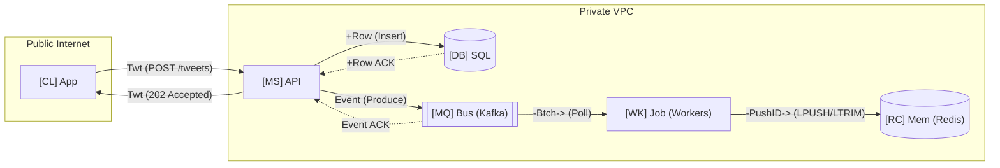
*DIAGRAM 1: Write Path and Fan-Out Topology*

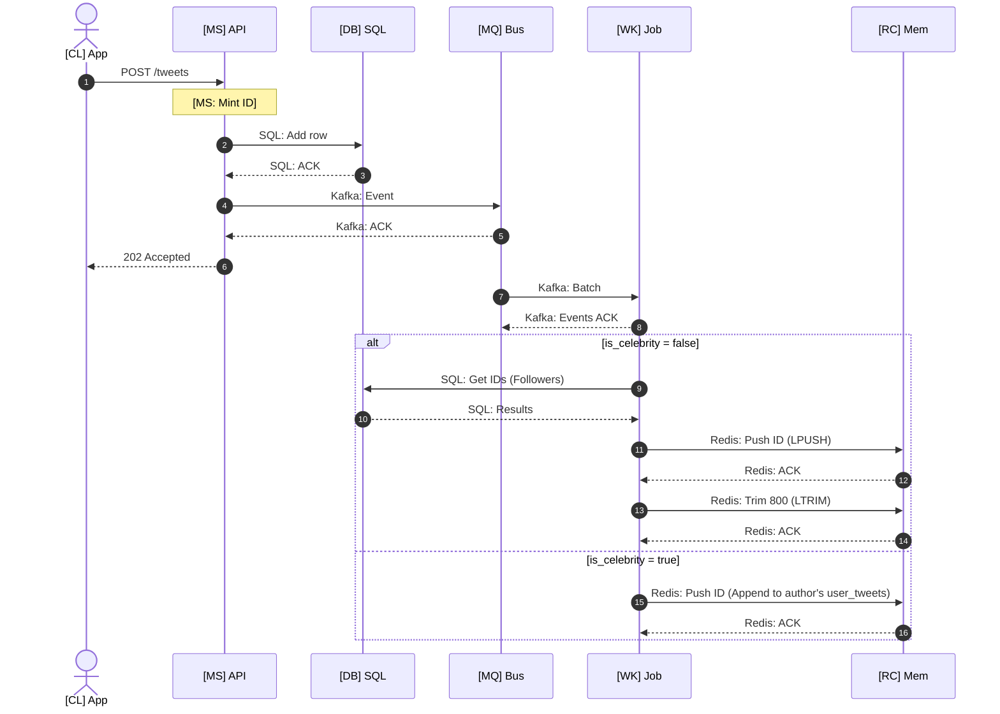
*DIAGRAM 2: Write Path and Fan-Out Sequence*

---

### 6.2 Push vs. Pull vs. Hybrid Fan-Out Tradeoffs

#### DIAGRAM 3: Illustrative Fan-Out Pattern Comparison
| Pattern | Cache Writes/s (6k tweets/s) | Read Lookups / Req (300k reads/s) | Illustrative p99 Read Latency |
| :--- | :--- | :--- | :--- |
| **Pure Push (On Write)** | 3,000,000 | 2 (1 feed + 1 MGET) | $\sim 22\text{ ms}$ |
| **Pure Pull (On Read)** | 6,000 | 201 (200 feeds + 1 MGET) | $\sim 250\text{ ms}$ |
| **Hybrid Fan-Out** | 600,000 | 6 (1 feed + 1 celeb set + 3 celeb feeds + 1 MGET) | $\sim 28\text{ ms}$ |

---

## 7.0 Architectural Deep Dives

### 7.1 Deep Dive 1: Hybrid Home Timeline Read Path

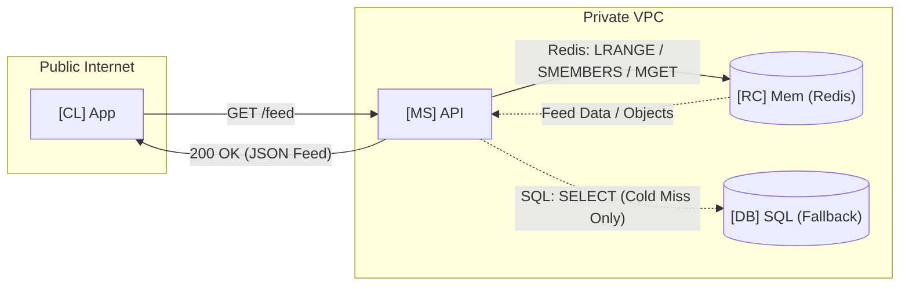
*DIAGRAM 4: Hybrid Timeline Read Topology*

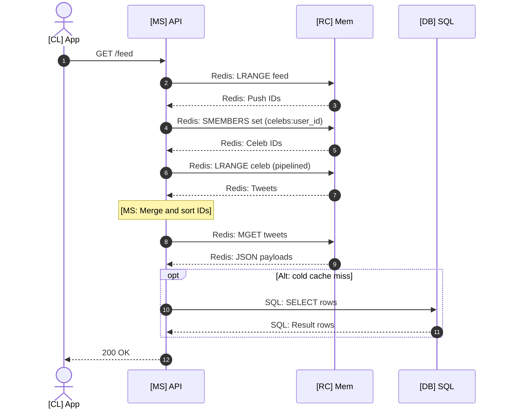
*DIAGRAM 5: Hybrid Timeline Read Sequence*

```
Pure Push Hit:
[TLS: 15ms][API: 2ms][Feed: 2ms][Hydrate: 3ms] = ~22ms

Hybrid Merge:
[TLS: 15ms][API: 2ms][Feed: 2ms][Celeb: 5ms][Merge: 1ms][Hydrate: 3ms] = ~28ms

Cold Rebuild:
[TLS: 15ms][API: 2ms][Miss: 2ms][Graph SQL: 25ms][Tweet SQL: 85ms][Hydrate: 5ms] = ~134ms
```
*DIAGRAM 6: Illustrative Timeline Read Latency Waterfall*

---

### 7.2 Deep Dive 2: Decoupled Media Pipeline and Pull-Through CDN

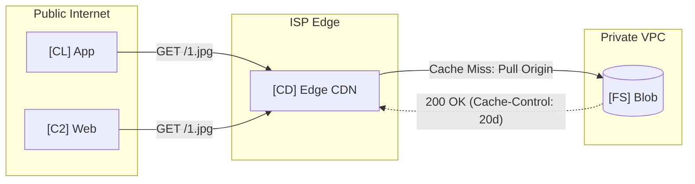
*DIAGRAM 7: Media CDN Read-Through Topology*

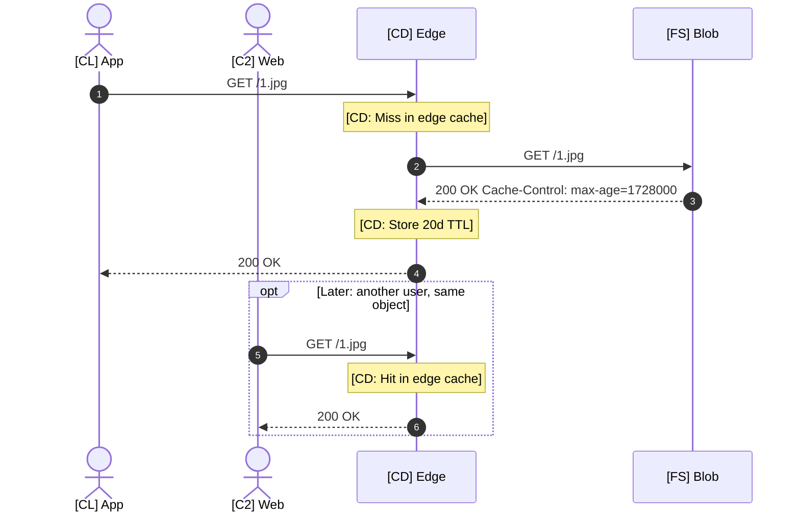
*DIAGRAM 8: Media CDN Read-Through Sequence*

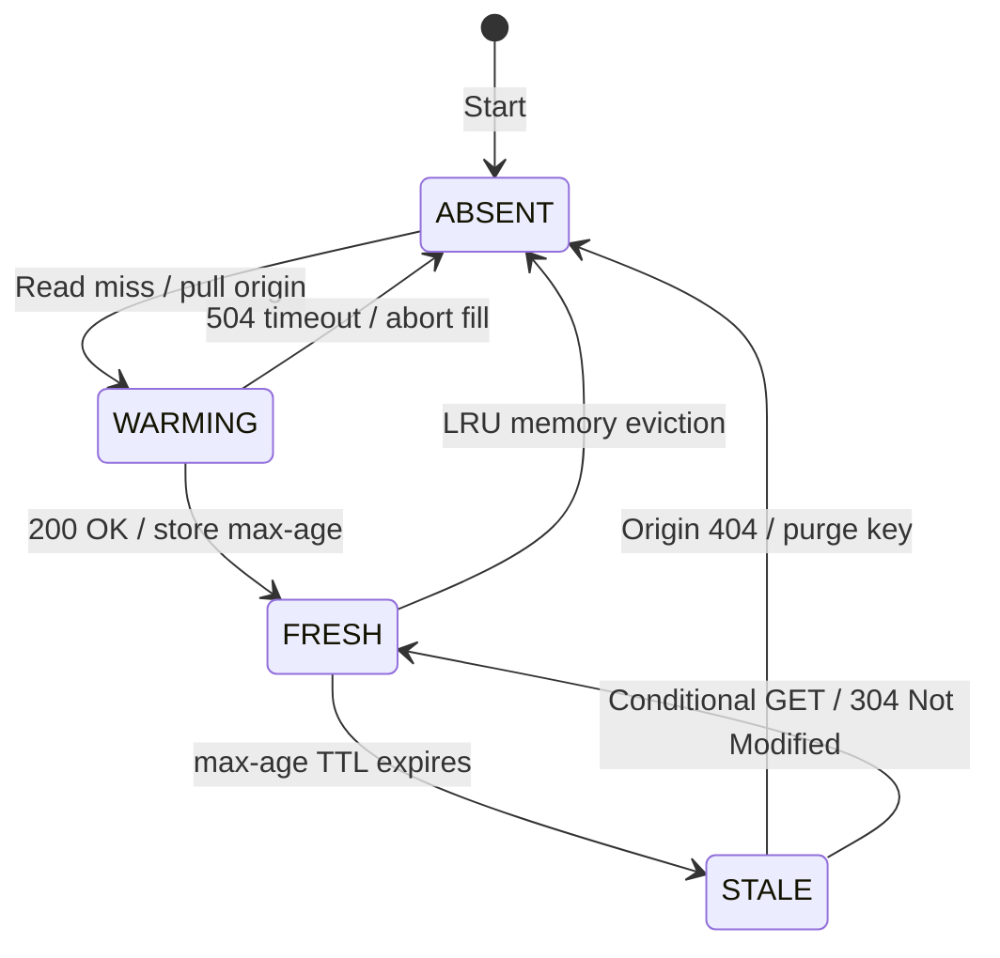
*DIAGRAM 9: Media Edge Cache Entry Lifecycle*

---

## 8.0 Bottlenecks, Failure Modes, and Mitigation Runbooks

### 8.1 Write Bursts, Rate Limiting, and Storage Deadlines

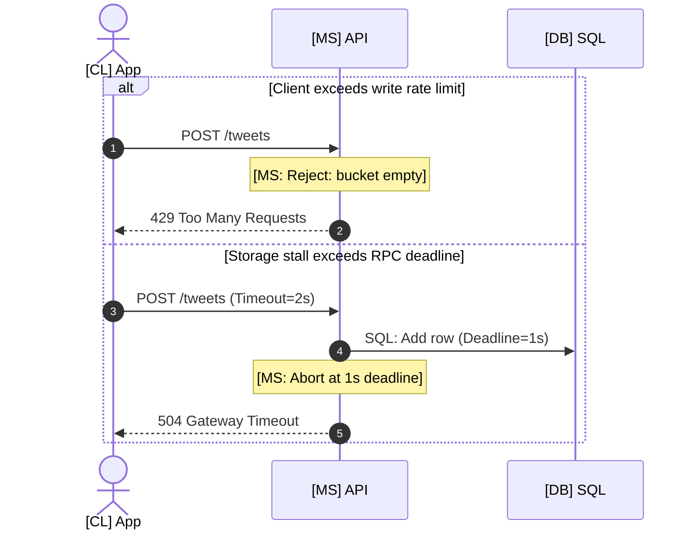
*DIAGRAM 10: Write Burst Throttling and Deadline Timeout Sequence*

#### Mitigation Runbooks
- **API Layer (Rate Limit Floods):** Act at `[MS] API`. Lower per-account and per-IP token-bucket burst limits for `POST /tweets` to shed unauthenticated or abusive requests.
- **Storage Layer (MySQL Write Stall):** Act at `[DB] SQL`. Fail over the stalled shard master to its semi-synchronous standby replica, promote the replica in the routing map, and drain retries with jitter.

---

### 8.2 Timeline Cache Outage and Cold-Read Stampedes

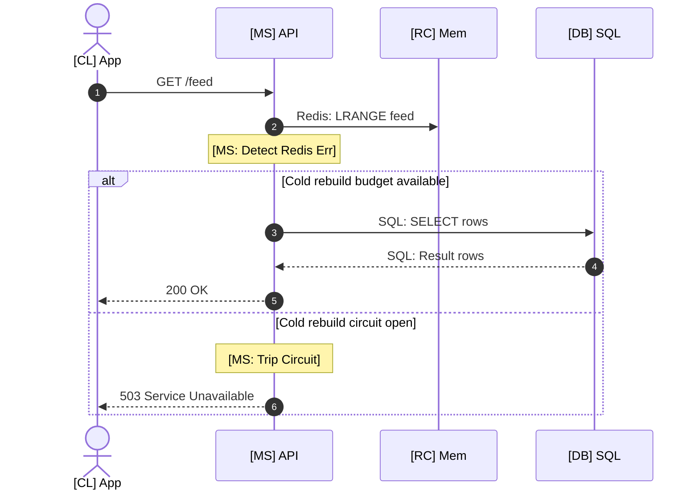
*DIAGRAM 11: Redis Outage and Circuit Breaker Sequence*

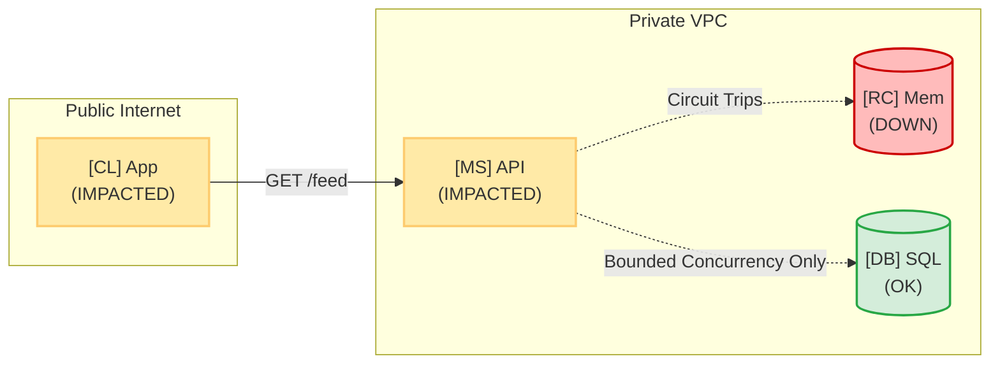
*DIAGRAM 12: Redis Timeline Shard Outage Blast Radius*

#### Mitigation Runbooks
- **Cache and Service Layers (Redis Shard Failure):**
  1. Verify the circuit breaker on `[MS] API` is capping cold-rebuild concurrency against `[DB] SQL`.
  2. Route timeline reads to the surviving replica ring in `[RC] Mem`.
  3. Warm replacement Redis nodes asynchronously from background Kafka consumers rather than synchronous read-path rebuilds.

---

## 9.0 Architecture Decision Rules

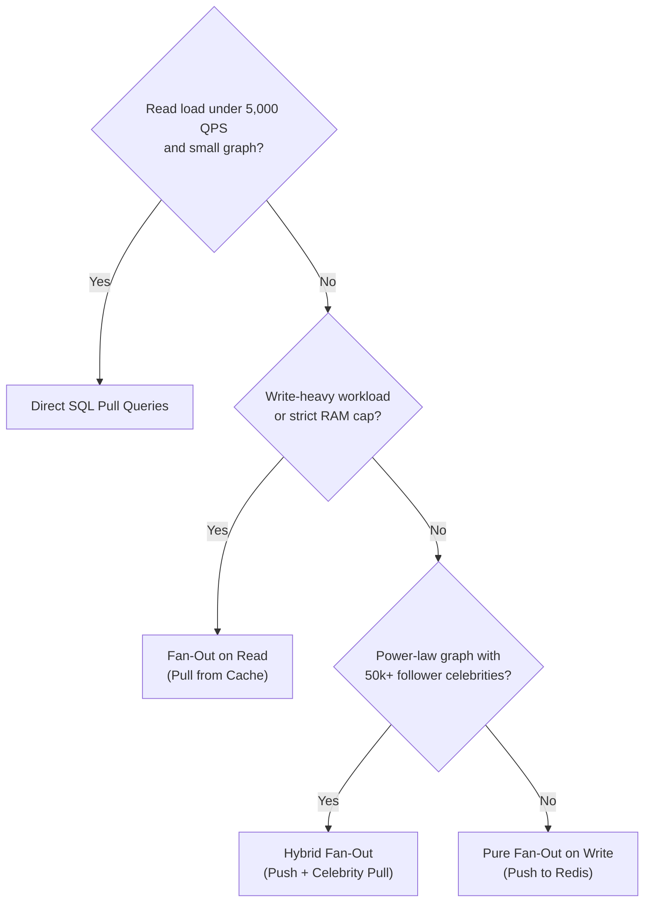
*DIAGRAM 13: Feed Architecture Decision Flowchart*

---

## 10.0 Summary

Designing a Twitter-scale microblogging system centers on taming the $50:1$ read-to-write asymmetry ($300,000\text{ timeline reads/s}$ vs. $6,000\text{ tweet writes/s}$) and the extreme skew of the social graph:
- **Durable Persistence:** Horizontally sharded MySQL keyed by 64-bit time-ordered Snowflake IDs.
- **Media Ingestion:** Decoupled BlobStore uploads served via an edge CDN with a 20-day TTL.
- **Feed Assembly:** Materialize active timelines in Redis using 20-byte packed list entries capped at 800 items ($16\text{ KB/user}$, $7.2\text{ TB}$ cluster RAM across 3 replicas).
- **Fan-Out Strategy:** **Hybrid Fan-Out** pushes tweet IDs asynchronously via Kafka workers for regular authors and pulls/merges celebrity tweets dynamically at read time.

---

## 11.0 References
- [High Scalability: The Architecture Twitter Uses to Deal with 150M Active Users, 300K QPS, a 22 MB/s Firehose, and Send Tweets in Under 5 Seconds](https://highscalability.com/the-architecture-twitter-uses-to-deal-with-150m-active-users/)
- [High Scalability: How Twitter Handles 3,000 Images Per Second](https://highscalability.com/how-twitter-handles-3000-images-per-second/)
- [InfoQ News: The Infrastructure Behind Twitter: Scaling Networking, Storage and Provisioning](https://www.infoq.com/news/2017/01/scaling-twitter-infrastructure/)