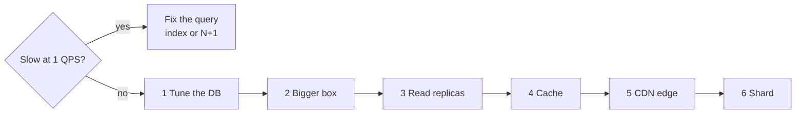
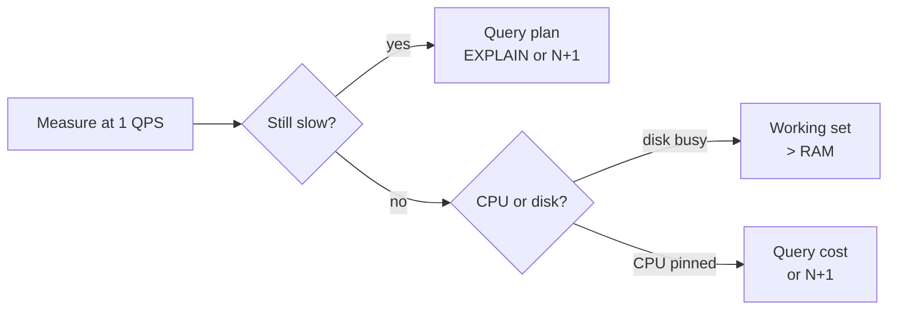
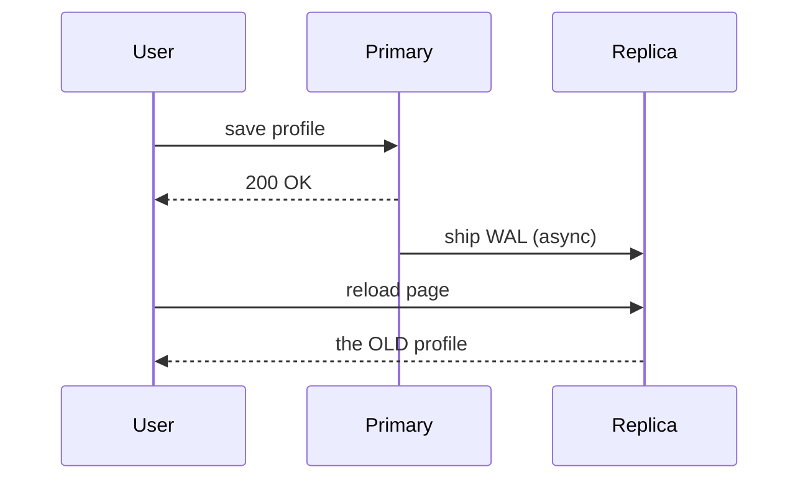
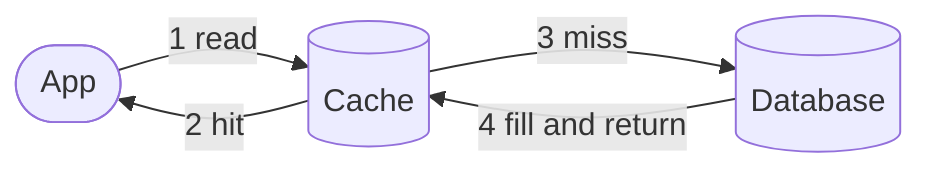
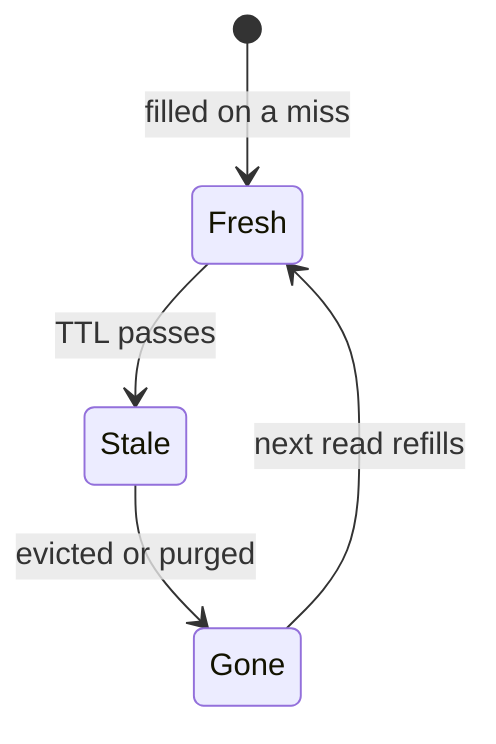
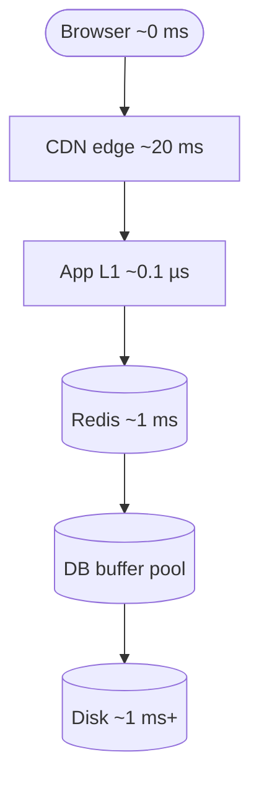
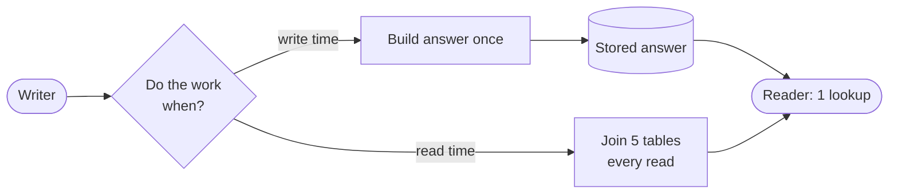
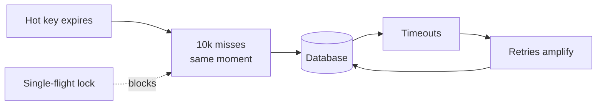

# Scaling Reads — Quick Revision

> **What this is:** the 10-minute version. Built for the morning of the interview.
> **Deep version:** [`scaling-reads.md`](./scaling-reads.md) — every section here links back to it.
> **Interviewer signal:** "100M users browse the catalog" · "the feed must load in 100 ms" · "read-heavy" · "1000:1 read/write" · "it's slow under load".

Reads are the easy side to scale. Copies are cheap. Staleness is usually negotiable.

The skill being tested is **escalating in the right order**. Most candidates skip to the expensive rung.

---

## The one-sentence split

**First prove it's volume and not a bad query. Then climb the cheapest rung that works.**

Those two halves have opposite fixes. Adding replicas to a bad query just runs it in more places.

---

## Diagram 1 — The ladder

> **When to use:** the opening 60 seconds of any read-scaling question.



**The pen version**

```text
                    ┌─yes─▶ [fix the query]
   slow at 1 QPS? ──┤
                    └─no──▶ [1 tune DB] ─▶ [2 bigger box] ─▶ [3 replicas]
                                ─▶ [4 cache] ─▶ [5 CDN] ─▶ [6 shard]
                            └── cheap ──┘        └── expensive ──┘
```

**Draw order (~45s)**
1. Diamond on the left: "slow at 1 QPS?".
2. Branch up-right to a box: "fix the query". Label the arrow "yes".
3. Branch down-right, labelled "no". Then six boxes in a row, numbered 1 to 6.
4. Bracket boxes 1 and 2. Write "no new semantics" underneath.

**Say while drawing**
1. "First question: is it slow when nobody's using it?"
2. "If yes, it's the query. More machines don't help."
3. "If no, it's volume. Then I climb this ladder."
4. "The first two rungs add nothing to reason about later."

> ⚠️ **Rung order is cost order, not the order you pick in.** The ladder ranks by
> how much complexity each rung adds forever. The [decision tree](#the-decision-tree)
> picks by access pattern — and **cache usually beats replicas** when reads repeat.

---

## Diagram 2 — Diagnose before you spend

> **When to use:** "read latency is 800 ms, where do you look?"



| Symptom | Diagnosis | Fix |
|---|---|---|
| Slow even at 1 QPS | Missing index, bad plan | `EXPLAIN`. Hardware won't fix an O(n) scan |
| Degrades as QPS rises | Real capacity ceiling | Climb the ladder |
| Mean fine, p99 terrible | Contention, locks, hot row | Fix the outlier path. Replicas won't help |
| CPU low, disk saturated | Working set exceeds RAM | More RAM, or a cache |
| CPU pinned, disk idle | Query cost, or N+1 | Fix the query |

**N+1 is the disguise.** Fetch 50 posts, then 50 more queries for each author. The graph looks exactly like a traffic problem. It's a batching bug. One `IN` query fixes it.

**Say this:** "First I'd check whether this is a query-plan problem or a volume problem. A missing index is a 1000× win for one line of DDL."

→ [v1 §1](./scaling-reads.md#1-first-is-it-volume-or-is-it-one-bad-query)

---

## Rung 1 — Tune the database

Nothing new outside the database. No new failure modes.

**Indexes.** Turn an O(n) scan into an O(log n) traversal. Three things to know:

- **Left-prefix rule.** An index on `(user_id, created_at)` serves `WHERE user_id = ?`. It does **not** serve `WHERE created_at > ?` alone. Column order is a design decision.
- **Covering index.** If the index holds every column the query wants, the DB never opens the table.
- **Selectivity.** An index on a boolean barely helps. The planner will ignore it, correctly.

**The cost candidates forget:** every index is a write amplifier. Five indexes means five B-tree writes per insert.

**Denormalization.** Store the answer's shape instead of computing it. A `comment_count` column. The author's name copied onto the post row.

The price is write amplification and staleness. A rename must now reach every copy.

**Connection pooling.** Often the real ceiling. Each Postgres connection is a process with real memory cost. PgBouncer or RDS Proxy can beat adding a replica.

→ [v1 §2](./scaling-reads.md#2-rung-1-optimize-inside-the-database)

---

## Rung 2 — A bigger box

A config change. No consistency questions. No application changes.

**The win is RAM, not CPU.** If the working set fits in the buffer pool, reads never touch disk. Memory versus SSD is roughly two orders of magnitude.

**Say this:** "I'd first check whether the working set fits in RAM on a larger instance. That's a config change, not an architecture change."

Honest limits: cost climbs super-linearly at the top, every family has a ceiling, and one box is one failure domain. It buys time, not permanence.

→ [v1 §3](./scaling-reads.md#3-rung-2-vertical-scaling-yes-really)

---

## Rung 3 — Read replicas

Ship the write-ahead log to N followers. Reads go to followers. Writes go to the primary.

```text
   writes            ┌──▶ Replica 1 ──▶ reads
  ────────▶ PRIMARY ─┼──▶ Replica 2 ──▶ reads
                │    └──▶ Replica 3 ──▶ reads
                └─ WAL shipping (async by default)
```

### Diagram 3 — Where read-your-own-writes breaks

> **When to use:** "a user edits their profile and sees the old version."



**Say while drawing:** "The primary said done before the copy had it. The user's own edit vanished."

The fix is always the same idea. Serve *that person's* read from something that definitely holds their write.

| Fix | Detail |
|---|---|
| **Primary reads after write** | Sticky flag for N seconds. Crude, effective, most common |
| **Own data to primary** | You read your own profile from primary. Everyone else's from replicas |
| **Write-through cache** | Write cache and DB together. Their read is served from cache |
| **LSN / token reads** | Client carries its write position. Replica waits until it has applied it |

### The two limits people miss

1. **Replicas do not scale writes.** Every replica applies 100% of writes. Ten replicas means the write stream executes eleven times. If the primary is write-saturated, replicas make it worse.
2. **Serial replay.** Some engines apply writes one at a time. A write-heavy primary outruns the replica and lag grows without bound. Alert on lag as an SLI.

Also worth naming: a replica in the user's region cuts ~150–200 ms of round trip. Often a bigger win than throughput.

→ [v1 §4](./scaling-reads.md#4-rung-3-read-replicas)

---

## Rung 4 — Cache

This rung buys the most for the least effort. A Redis hit is sub-millisecond. It removes load rather than redistributing it.

It works for exactly one reason: **the same thing is asked for repeatedly.** If every read is different, the cache is just an extra hop.

### Diagram 4 — Cache-aside, the default



**Say while drawing:** "Check the cache. On a miss, read the DB and store it. If the cache dies, we're slow, not broken."

| Strategy | Use when |
|---|---|
| **Cache-aside** | **Default.** Only caches what's asked for. Survives cache failure |
| **Write-through** | Write cache and DB together. Never stale. Helps read-your-writes |
| **Write-behind** | Fastest writes. Risk of loss if the cache dies before flush |
| **Refresh-ahead** | Predictably hot keys. Avoids the expiry latency spike |

### Invalidation — the actual hard part

Three honest options. Picking one deliberately *is* the answer.

1. **TTL** — accept bounded staleness. Self-healing, no coordination. Usually correct. The follow-up is "how stale is acceptable?" That's a product question, so **ask it**.
2. **Explicit invalidation** — delete the key on write. Accurate, but you must know every derived key. One missed path is permanently wrong data.
3. **Versioned keys** — put a version in the key (`user:42:v7`). A write bumps it. Old entries orphan themselves. No "did the delete succeed?" race.

**Two traps:**
- **Delete, don't update.** Two writers updating one entry can interleave and leave the cache permanently wrong. A delete is idempotent — the next read rebuilds from truth.
- **Always add a TTL backstop**, even with explicit invalidation. It turns a missed invalidation from permanent into temporary.

### Diagram 5 — A cache entry's life



`stale-while-revalidate` is the shortcut across the bottom. Serve the stale copy now, refresh behind it, so nobody waits.

**Hit ratio is non-linear.** At 90% the DB handles 10% of reads. At 99% it handles 1%. Going 90% → 99% removes 90% of the load that was left.

*Name-drop only:* LRU is the default; LFU protects a stable hot set from scan eviction.

→ [v1 §5](./scaling-reads.md#5-rung-4-caching)

---

## Rung 5 — CDN / edge

Every other rung makes the system do less work. This one makes the data travel less distance.

Sydney to Virginia is ~150 ms because of physics. No server tuning touches it. Keep a copy near the user.

Four things worth naming:

- **`Cache-Control` is the API.** `stale-while-revalidate` serves the old copy instantly and refreshes behind it. `stale-if-error` keeps serving during an origin outage.
- **`Vary` is a footgun.** `Vary: User-Agent` shatters one object into thousands of variants. Hit rate collapses.
- **Surrogate-key purge.** Tag responses `product-42`. Purge by tag, not URL. The only tractable way to invalidate dynamic content at the edge.
- **Request collapsing.** N simultaneous edge misses become one origin fetch. Stampede protection, built in.

**Dynamic content is cacheable too.** At 10k QPS, a 5-second TTL turns 50,000 origin requests into 2.

→ [v1 §6](./scaling-reads.md#6-rung-5-edge--cdn)

---

## Rung 6 — Shard (last, for reads)

Sharding splits the data itself. For **writes** and **dataset size** it's the only real answer. For **reads** it's last, because replicas and caches give you read capacity without splitting anything.

The cost lands on queries that don't name the shard key. You ask every shard and wait for the **slowest**.

**Tail-latency amplification:** 10 shards, each 1% slow → roughly 10% of requests are slow. It gets worse as you add shards. Horizontal scaling that punishes you for scaling horizontally.

Shard when the data no longer fits, or writes exceed one primary. Not because reads are slow.

And **pick the shard key to match the dominant read**, so the common query hits one shard. That choice is most of the outcome.

→ [v1 §7](./scaling-reads.md#7-rung-6-sharding-and-why-its-last-for-reads)

---

## Diagram 6 — The layered read path

> **When to use:** "walk me through a read." Drawing this with latencies is a strong whiteboard moment.



Each arrow is a miss falling through to the next layer.

Two rules fall out:

- **Every layer must survive the one below being empty.** "What happens when Redis is empty?" cannot be answered with "the database dies".
- **An L1 in-process cache is the fastest and least consistent thing you have.** Twenty instances hold twenty copies. You cannot invalidate them together. Short TTLs only.

That weakness is also its superpower. Every instance has its own copy, so **one hot key can't concentrate on one Redis node**. A 1-second L1 turns 50,000 QPS on one key into about 20.

*Latencies are order-of-magnitude planning numbers, not benchmarks.*

→ [v1 §8](./scaling-reads.md#8-the-layered-read-path)

---

## Diagram 7 — Precompute: move the work to write time

> **When to use:** any read:write ratio above ~10:1.



Same work. Different moment. The top path pays once, the bottom pays every read.

At 100:1, making writes 10× more expensive to make reads 10× cheaper is a large net win. Write-time work also happens where no user is waiting.

The forms are one idea at different scales:

- **Fan-out-on-write** — write a copy into each follower's timeline. A feed read becomes one fetch. Cost: the celebrity problem.
- **Materialized views** — the DB maintains the precomputed result.
- **CQRS** — one normalized write model, several read models shaped per query, synced by events.
- **Purpose-built stores** — search to Elasticsearch, similarity to a vector DB, time series to Prometheus.

**The bill is always the same three items:** writes cost more, data is stored several times, every copy is stale by some amount.

**Say this:** "At 100:1 fan-out-on-write is clearly right. At 1:1 it's clearly wrong."

→ [v1 §9](./scaling-reads.md#9-precomputation-materialized-views-and-cqrs)

---

## Pagination is a read-scaling problem

`OFFSET 1000000 LIMIT 20` makes the database produce a million rows and throw them away.

It has a second, worse problem — a correctness bug:

```text
 page 1  [A B C D E]          user reads
         ▲ new row F arrives at the head
 page 2  [E F G H I]          E shown twice
```

An offset counts from the start of a list that is still changing.

```sql
-- ❌ O(offset) — slower the deeper users scroll, and duplicates rows
SELECT * FROM posts ORDER BY created_at DESC LIMIT 20 OFFSET 1000000;

-- ✅ O(log n) — cursor / keyset, stable under concurrent inserts
SELECT * FROM posts
 WHERE (created_at, id) < ($last_created_at, $last_id)   -- tie-break on id
 ORDER BY created_at DESC, id DESC LIMIT 20;
```

**The tie-breaker matters.** Sort on a bare timestamp and rows sharing one get silently skipped at the page boundary.

→ [v1 §10](./scaling-reads.md#10-pagination-is-a-read-scaling-problem)

---

## Diagram 8 — When it breaks

> **When to use:** any "what happens at 2 AM" follow-up.



The dotted arrow is the fix. One request refills. The rest wait.

| Failure | Mechanism | Fix |
|---|---|---|
| **Stampede** | Hot key expires, 10k requests miss together | Single-flight lock, TTL jitter, `stale-while-revalidate` |
| **Cold cache** | Redis restarts empty. DB sized for 1% sees 100% | Capacity-plan for it, or rate-limit the refill |
| **Penetration** | Reads for keys that don't exist always miss | Negative caching + a Bloom filter |
| **Hot key** | One key exceeds one shard's capacity | L1 in front, or replicate the key with suffixes |
| **Stale forever** | An invalidation path was missed | TTL backstop turns permanent into temporary |
| **Lag spike** | A bulk backfill on the primary | Alert on lag, route back to primary, throttle backfills |
| **Tail amplification** | Scatter-gather: p99 = slowest shard | Hedged requests, per-shard timeouts, or don't scatter |

**The three fix families** — naming the family beats memorising techniques:

1. **Make only one request do the work.** Single-flight, request collapsing.
2. **Spread the moment.** TTL jitter, probabilistic early expiry, staggered deploys.
3. **Serve something imperfect.** Stale-while-revalidate, negative caching, partial results.

**Cold cache is the question that separates people who have run caches from people who have only drawn them.** If the cache absorbed 95% of reads, losing it means the DB sees 20× load. Requests queue, retries amplify, and the cache can't refill because the fill queries are timing out.

→ [v1 §11](./scaling-reads.md#11-failure-modes)

---

## The decision tree

```text
Measure first: bad query, or real volume?
├─ bad query / N+1 / missing index ──▶ FIX THE QUERY. Nothing else first.
└─ real volume
   ├─ Working set fits in RAM on a bigger box? ──▶ VERTICAL. Config change.
   ├─ Same data read repeatedly?               ──▶ CACHE (cache-aside + TTL)
   │     • can be stale? → TTL, and ask how long
   │     • must be fresh? → write-through, or invalidate + TTL backstop
   ├─ Users far away, content cacheable?       ──▶ CDN (even a 5s TTL)
   ├─ Diverse reads, primary read-saturated?   ──▶ REPLICAS
   │     + answer read-your-own-writes explicitly
   ├─ The query shape is the problem?          ──▶ PRECOMPUTE / CQRS
   └─ Too big for one box, or writes saturated? ──▶ SHARD (a writes problem)
```

→ [v1 §12](./scaling-reads.md#12-decision-framework)

---

## Scaling Reads in an Interview

### When to reach for this

- "Read-heavy", "1000:1", "100M users browsing"
- A feed, catalog, profile, or timeline with a latency SLA
- "It's slow under load" with no diagnosis attached
- Any question where the same data is read many times between changes

### Where it breaks down

| Limit | What you say instead |
|---|---|
| The primary is **write**-saturated | This is [Scaling Writes](./scaling-writes.md). Replicas make it worse |
| Reads are all **distinct** | Cache hit rate will be poor. Use replicas or precompute |
| Data must be **strictly fresh** | Prices, permissions, balances. Read from primary and say why |
| Read:write ≈ 1:1 | Precomputation costs more than it saves |
| Dataset won't fit one box | No cache fixes that. You're sharding |

### The five sentences that score

1. "First: is it slow at 1 QPS? That separates a bad query from real volume."
2. "The win from a bigger box is usually RAM, not CPU."
3. "Replicas scale reads only. Every replica applies 100% of writes."
4. "TTL is my default. The real question is how stale this is allowed to be."
5. "If the cache comes back empty, the database sees 20× load. I'd plan for that."

---

## Real systems

| Case | What's done | Lesson |
|---|---|---|
| **Twitter/X** | Fan-out-on-write for normal users, on-read for celebrities | Hybrid beats purity |
| **Amazon** | "Only 3 left" is deliberately approximate | Browse and checkout get different consistency |
| **Stack Overflow** | Huge traffic from few servers with very large RAM | Vertical + caching goes further than instinct suggests |
| **Netflix / YouTube** | Bytes served from edge caches inside ISP networks | For big static objects the answer is geographic |

*Architectures are directionally accurate patterns, not verified current implementations.*

→ [v1 §14](./scaling-reads.md#14-real-world-cases)

---

## The eight questions, answered in one breath

<details>
<summary>🔴 <b>deep-dive</b> — the long-form answers to all 12 questions live in v1 §15</summary>

The one-liners below are the spoken version. [v1 §15](./scaling-reads.md#15-interview-questions) has the full paragraph-length answers for Q1–Q12, including the staff-level catalog design and the scatter-gather question.

</details>

**Q1. Read latency is 800 ms. Where first?**
Is it slow at 1 QPS? If yes it's the query plan — `EXPLAIN`, look for N+1. If no it's capacity, and I check CPU versus disk.

**Q2. Index on `(user_id, created_at)` — what does it serve?**
`user_id`, and `user_id` + ordering on `created_at`. Not `created_at` alone. Left-prefix rule.

**Q3. Cache or replica first?**
Cache, almost always. Sub-millisecond, and it removes load instead of redistributing it. Replicas win when reads are diverse, or I need geography or failover.

**Q4. User edits profile, sees the old one.**
Write hit the primary, read hit a lagging replica. Route that user's reads to primary for a few seconds. Or write through the cache.

**Q5. Primary at 90% CPU. You add five replicas.**
Depends why. Read-saturated, they help. Write-saturated, they make it worse — six copies of the write stream now.

**Q6. Hot key expires, 10k requests hit the DB.**
Cache stampede. Single-flight lock so one request refills. Add TTL jitter so related keys don't expire together.

**Q7. Redis comes back empty.**
The DB sees ~20× load and probably falls over. Capacity-plan for it, gate the refill with a rate limiter, warm before taking traffic.

**Q8. TTL or explicit invalidation?**
Both. TTL as the default and as a backstop. Explicit when stale is harmful. And delete rather than update, because updates race.

---

## Cheat sheet

| Term | One line |
|---|---|
| **Diagnose first** | Slow at 1 QPS = query plan. Degrades with QPS = capacity |
| **N+1** | 1 query + N children. Looks like volume, is a batching bug |
| **Left-prefix** | `(a, b)` serves `a` and `a`+`b`, never `b` alone |
| **Covering index** | Holds every column needed → no table lookup |
| **Index cost** | Every index is a write amplifier |
| **Vertical scaling** | Config change. The win is RAM, not CPU |
| **Replicas ≠ writes** | Every replica applies 100% of writes. 10 replicas = 11× |
| **Replication lag** | Alert on it as an SLI. Serial replay can make it grow unbounded |
| **Read-your-writes** | Primary after write · own data to primary · write-through · LSN tokens |
| **Cache-aside** | Check → miss → DB → fill. The default |
| **Invalidation** | TTL (default) · explicit (fragile) · versioned keys (self-orphaning) |
| **Delete, don't update** | Updates race and diverge. Deletes are idempotent |
| **TTL backstop** | Turns a missed invalidation from permanent into temporary |
| **Hit ratio** | 90% → 99% removes 90% of the *remaining* load |
| **`stale-while-revalidate`** | Serve stale now, refresh behind. Latency + stampede win |
| **`Vary` footgun** | `Vary: User-Agent` shatters hit rate |
| **Surrogate keys** | Purge by tag, not URL |
| **5-second TTL** | At 10k QPS: 50,000 origin requests become 2 |
| **L1 in-process** | Nanoseconds, per-instance, un-invalidatable. Perfect for hot keys |
| **Layered path** | Browser → CDN → L1 → Redis → buffer pool → disk |
| **Stampede** | Hot key expires, all miss at once. Single-flight + jitter |
| **Cold cache** | 95% absorbed → 20× load on recovery. Plan or gate it |
| **Penetration** | Reads for missing keys. Negative cache + Bloom filter |
| **Hot key** | One key exceeds one shard. L1, or replicate with suffixes |
| **Fan-out-on-write** | Precompute per recipient. Celebrity is the exception |
| **CQRS** | One write model, several read models, synced by events |
| **Sharding for reads** | Last resort. Scatter-gather makes p99 the worst shard |
| **Tail amplification** | 10 shards × 1% slow ≈ 10% slow requests |
| **Offset pagination** | O(offset), and duplicates rows under concurrent writes |
| **Cursor pagination** | `WHERE (ts, id) < (?, ?)`. O(log n), stable. Tie-break on a unique column |

---

## Related

- **Full depth:** [`scaling-reads.md`](./scaling-reads.md) · [Extra Details §1 — Index Internals](./extra-details.md#1-index-internals-covering-primary-and-clustered)
- **Patterns:** [Scaling Writes](./scaling-writes.md) — check which side is actually saturated
- **Topics:** [`distributed-caching`](../interviews/distributed-caching/README.md) · [`cdn-edge`](../interviews/cdn-edge/README.md) · [`sharding-replication`](../interviews/sharding-replication/README.md) · [`url-shortener`](../interviews/url-shortener/README.md) · [`social-feed`](../interviews/social-feed/README.md)
