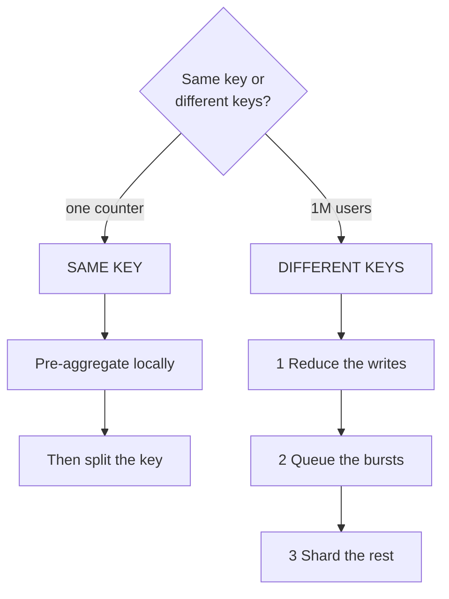
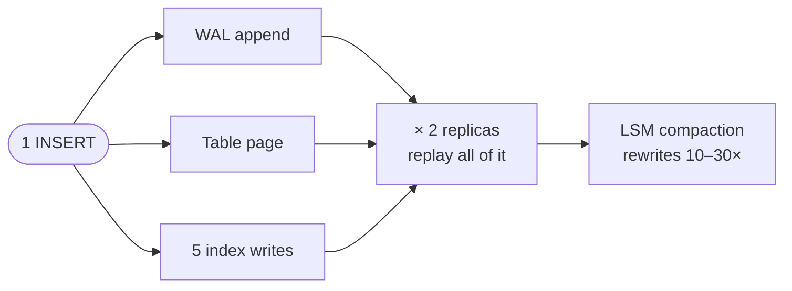
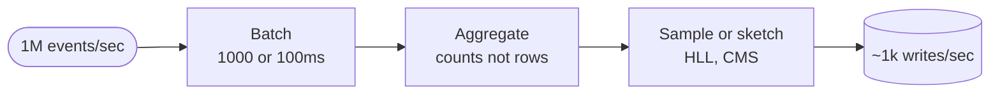
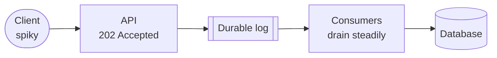
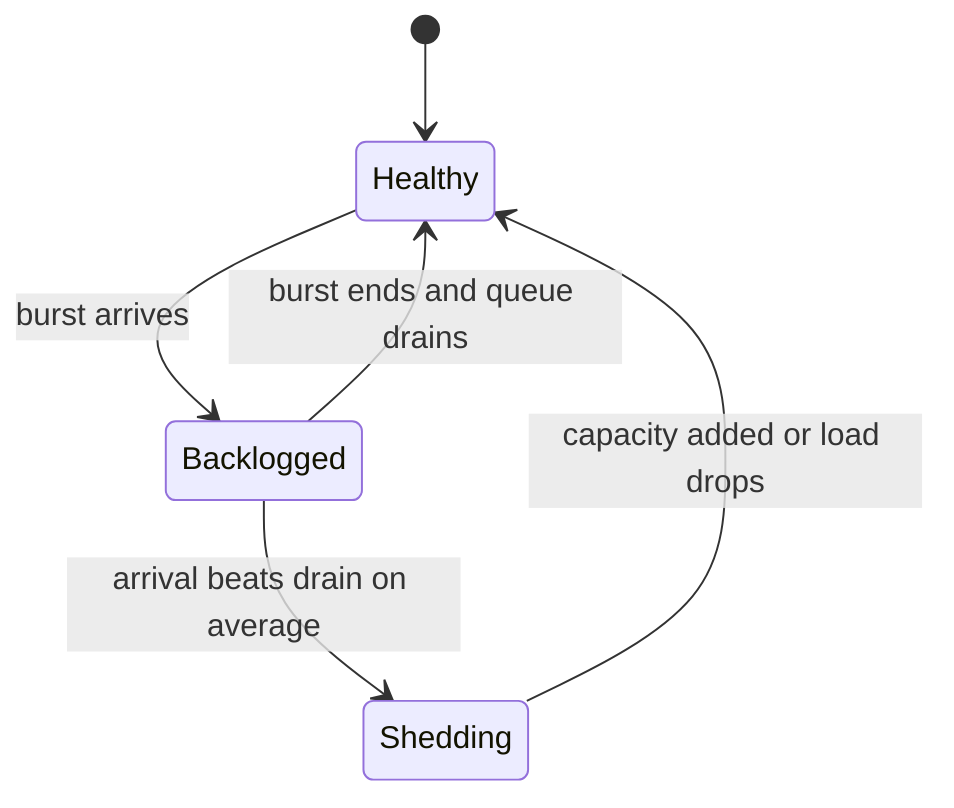
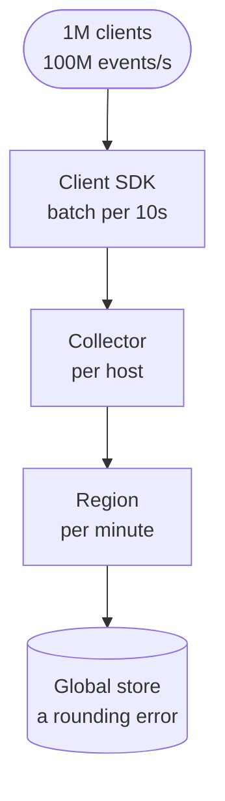
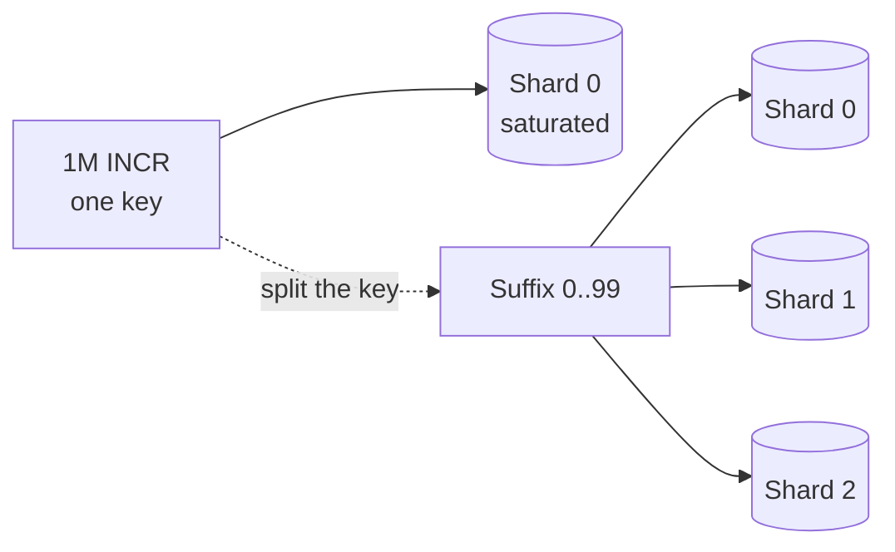
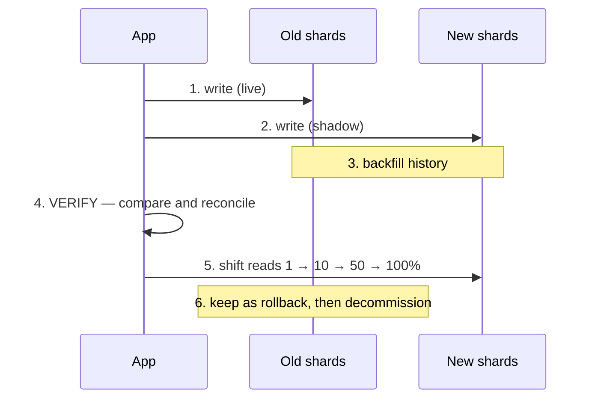

# Scaling Writes — Quick Revision

> **What this is:** the 10-minute version. Built for the morning of the interview.
> **Deep version:** [`scaling-writes.md`](./scaling-writes.md) — every section here links back to it.
> **Interviewer signal:** "1M events/sec" · "ingest every GPS ping" · "ad click aggregator" · "metrics pipeline" · "black-Friday spike" · "every user uploads a workout".

Writes are the hard side. You can't cache your way out of them.

Every write must land. Every write must be made durable. And for any one key, there is exactly one place it can go.

---

## The one-sentence split

**First ask: same key, or different keys? Then reduce the writes before you distribute them.**

The whole read toolbox is useless here. Worse than useless — **every replica you add executes the write stream again.**

| | Reads | Writes |
|---|---|---|
| Copy your way out? | Yes — replicas, caches, CDN | **No.** Every copy adds work |
| Serve stale? | Usually | No. It has to land |
| Durability cost | None | `fsync`, replication acks, WAL |
| Ordering | Irrelevant | Often required per key |
| Concurrency | Unlimited readers | One owner per key |

---

## Diagram 1 — The split

> **When to use:** the opening 60 seconds of any write-scaling question.



**The pen version**

```text
                       ┌── SAME KEY ──▶ pre-aggregate ─▶ split the key
   same key or          │                (sharding does NOT help)
   different keys?  ────┤
                        └── DIFFERENT ─▶ [1 reduce] ─▶ [2 queue] ─▶ [3 shard]
                                             └─ always ask this first ─┘
```

**Draw order (~45s)**
1. Diamond on the left: "same key or different?".
2. Branch up: box "SAME KEY". Two boxes after it.
3. Branch down: box "DIFFERENT KEYS". Three boxes after it, numbered.
4. Underline box 1. Write "always first" beneath it.

**Say while drawing**
1. "First question: is this a million writes to one key, or to a million keys?"
2. "One counter, one hot row, one celebrity — sharding does nothing."
3. "Different keys is the tractable case. But I still reduce before I distribute."
4. "Reducing writes is the rung people skip. It's the cheapest one."

→ [v1 §1](./scaling-writes.md#1-why-writes-are-fundamentally-harder-than-reads)

---

## Diagram 2 — Count the real number

> **When to use:** "10,000 writes/sec — is that a lot?"



**Say while drawing:** "One logical write is never one write. Let me count it."

```text
1 logical INSERT
  ├─ WAL append                        ×1
  ├─ table page write                  ×1
  ├─ 5 secondary indexes               ×5
  ├─ 2 replicas replay all of it       ×2 of everything above
  └─ LSM compaction, over its lifetime ×10–30

→ 10k logical writes/sec ≈ 100k+ physical IOPS
```

Two consequences worth saying out loud:

1. **Dropping an unused index can beat a hardware upgrade.** The cheapest optimization is deleting write work you don't need.
2. **Fan-out-on-write is amplification by design.** A celebrity with 50M followers posting once is 50M writes. That's the celebrity problem, seen from the write side.

*Amplification factors are order-of-magnitude planning numbers, not benchmarks.*

→ [v1 §2](./scaling-writes.md#2-write-amplification-count-the-real-number)

---

## Rung 1 — Pick a write-optimized engine

A B-tree files every paper straight into the right drawer. An LSM throws it in an inbox and tidies up later.

That's the whole difference. Random in-place updates versus a sequential append plus deferred cleanup.

| | B-Tree (Postgres, InnoDB) | LSM-Tree (Cassandra, RocksDB, Scylla) |
|---|---|---|
| Write path | Find page → **random** in-place update | Memtable insert → **sequential** flush |
| Amplification | Lower steady-state, random I/O | Higher (compaction), sequential I/O |
| Read path | One traversal, predictable | Memtable + N SSTables → needs Bloom filters |
| Best for | Balanced, strong transactions | **Write-heavy, high ingest** |

Sequential beats random by a wide margin. You pay for it in read amplification and background compaction I/O.

*Name-drop only:* the **RUM conjecture** — optimize Read, Update, or Memory, pick two. **Group commit** batches many `fsync` calls into one. **Compaction strategy** — size-tiered favours writes, leveled favours reads. And **deletes aren't free in an LSM**: a delete is a tombstone, which is another write.

Also: match the store to the shape. Append-only time series wants a TSDB. Unbounded event ingest wants Kafka, not a relational table.

→ [v1 §3](./scaling-writes.md#3-rung-1-pick-a-write-optimized-engine)

---

## Rung 2 — Reduce the number of writes

**The highest-leverage rung, and the one candidates skip.** Before distributing writes, ask whether they need to exist.

### Diagram 3 — Reduce before you distribute



**Say while drawing:** "A million events a second, but I never write a million rows."

**Batching.** Buffer 1000 events or 100 ms, whichever trips first.

Size alone stalls forever on a quiet stream. Time alone doesn't bound memory. So: **size OR time, whichever first.**

The cost is two things, and naming them *is* the answer:

- **Latency** — nothing is visible until the batch flushes.
- **Durability** — buffered events die with the process.

That's fine for metrics and logs. It's unacceptable for orders and payments. There, make the buffer durable first, then batch the downstream writes.

**Aggregation.** If the consumer only needs a count, don't store the events.

```text
100,000 clicks on ad 42 in one second
  naive:     100,000 rows
  aggregated:      1 row   {ad:42, second:…, count:100000}
```

**Coalescing.** For *state-conveying* writes, only the newest value matters — a driver's location, a user's presence, a cursor position. Collapsing 10 GPS pings into the latest loses nothing the product needs.

This is valid for state. It's invalid for events, where each item means something on its own.

**Sampling and sketches.** Ask whether exactness is required.

| Need | Exact cost | Approximate |
|---|---|---|
| Unique visitors | A set of every ID | **HyperLogLog** — ~12 KB for billions, ~2% error |
| "Seen this URL?" | A full index | **Bloom filter** |
| Top-K | Full sort | Count-Min Sketch + heap |
| p99 latency | All samples | t-digest / HDR histogram |

**Say this:** "Is 2% error on the unique-visitor count acceptable?" It usually is. That turns unbounded memory into a fixed 12 KB.

**Write less per write.** Delta encoding, columnar formats, drop fields nobody queries. And don't write high-cardinality labels into a metrics system — same problem, different hat.

→ [v1 §4](./scaling-writes.md#4-rung-2-reduce-the-number-of-writes)

---

## Rung 3 — Queues as shock absorbers

Put a durable log between the request path and the database.

### Diagram 4 — The shock absorber



**Say while drawing:** "The API accepts at burst rate. The consumers drain at a rate the database can actually sustain."

What it genuinely buys:

- **Burst absorption.** A 10× spike for 30 seconds becomes queue depth, not errors.
- **Decoupling.** The DB can be slow or restarting. Ingest keeps accepting.
- **Replay.** You can re-process after a consumer bug. A synchronous path can never offer this.
- **Natural batching.** Consumers read in batches, which composes with rung 2.
- **Ordering per key**, via the partition key.

### The caveat to say before the interviewer does

**A queue absorbs bursts, not sustained overload.**

If arrival beats drain *on average*, queue depth grows without bound. You've converted a fast failure into unbounded latency and eventual data loss. That is strictly worse, because it fails silently and late.

Queue depth and consumer lag are the SLIs.

Second caveat: the write is now **asynchronous**. The API returns before the data is durable in the DB. So you owe the client a `202 Accepted` plus a status endpoint. **Don't let a queued write pretend to be a committed one.**

→ [v1 §5](./scaling-writes.md#5-rung-3-queues-as-shock-absorbers)

---

## Rung 4 — Shed load and push back

When demand genuinely exceeds capacity you have three options. Queue it, shed it, or fall over.

Falling over is the only unacceptable one. It's also the default if you don't choose.

### Diagram 5 — The three states



The middle state is the one a queue is for. The bottom state is the one a queue cannot fix.

**Shed by priority, never at random:**

```text
   1. drop analytics and telemetry       (nobody notices)
   2. defer non-critical notifications   (delayed, not lost)
   3. degrade: coarser aggregation
   4. reject with 429 + Retry-After      (honest; client backs off)
   ─────────────────────────────────────────────────────────
   NEVER shed: payments · orders · audit log
```

**Backpressure** is the cooperative version. Instead of accepting work you can't do, signal upstream to slow down. TCP does it natively. Kafka consumers do it by not polling. Your API does it with `429`/`503`.

The anti-pattern is an unbounded in-memory buffer. That turns overload into an OOM crash, and you lose everything buffered instead of just the excess.

**Retry storms are the amplifier.** A client retrying 3× on timeout triples load exactly when you're weakest. Name the four fixes: exponential backoff **with jitter** (unjittered retries synchronize into waves), retry *budgets*, circuit breakers, and idempotency keys.

**Shed or autoscale?** Both, on different timescales. Autoscaling lags by tens of seconds to minutes — boot, warmup, pools, cold caches. It cannot answer a 5-second spike.

And you can autoscale the stateless tier easily. You cannot autoscale the database. Scaling the front end into a fixed backend just moves the queue.

→ [v1 §6](./scaling-writes.md#6-rung-4-load-shedding-and-backpressure)

---

## Rung 5 — Partition and shard

Once writes are minimized and smoothed, the only way past one node is more independent owners.

**Three cuts, often confused:**

| Cut | What it splits | Example |
|---|---|---|
| **Horizontal sharding** | Rows across nodes by key | Users A–M on shard 1, N–Z on shard 2 |
| **Vertical partitioning** | Columns of one table | Hot `user(id, name)` vs cold `user_bio_blob` |
| **Functional sharding** | Whole tables by service | Orders DB, inventory DB, auth DB |

**Functional decomposition is usually the cheapest first cut.** Moving the write-heavy `events` table off the box serving `orders` gives immediate relief. No shard-key decision. No distributed queries.

### Choosing the shard key

The key decides everything downstream.

- **Range** (`created_at`, sequential IDs) keeps range scans efficient. But **every insert lands on the newest shard**. Time-ordered keys are the classic write-scaling mistake.
- **Hash** spreads evenly and kills range queries.
- **Composite** — `hash(tenant_id) + timestamp` — is usually the answer. Spread across tenants, keep order within one.

Check two properties out loud: **cardinality** (enough distinct values — `status` is a terrible key) and **uniformity** (no value dominating — `country` puts most traffic on one shard).

The costs you inherit: no cross-shard transactions without a [saga](./multi-step-processes.md), scatter-gather for non-key queries, and resharding as a project.

→ [v1 §7](./scaling-writes.md#7-rung-5-partitioning-and-sharding)

---

## Rung 6 — Hierarchical aggregation

For counting and metrics workloads, this is the strongest technique. Aggregate at every level, so volume shrinks as it climbs.

Like a company's reporting chain. Nobody sends every receipt to the CFO.

### Diagram 6 — The funnel

> **When to use:** "count 100M events/sec." This *is* the expected answer.



**Say while drawing:** "Nothing in this pipeline ever sees 100 million a second except the client library. That's the design."

Each level cuts volume by orders of magnitude. This is how metrics systems, ad-click aggregators, and view counters actually work.

Four details interviewers probe:

- **Aggregation must be associative and commutative.** Sums and counts merge. Medians don't — which is why you carry mergeable histograms or t-digests instead of raw percentiles.
- **Late data needs a watermark policy.** How long does a bucket stay open? What happens after? "Drop after 5 minutes and increment a late-event counter" is a fine answer. Ignoring it isn't.
- **Idempotency across levels**, or a retried batch double-counts. Dedupe by batch ID.
- **Two paths.** A fast approximate path for dashboards, plus a slower exact recompute for billing. Ad revenue can't be off by 2%.

→ [v1 §8](./scaling-writes.md#8-rung-6-hierarchical-aggregation)

---

## Hot keys — when sharding doesn't help

Sharding distributes *keys*. It does nothing when the traffic is all one key.

```text
Shard 1: ████████████████████████████  ← Taylor Swift's post
Shard 2: █
Shard 3: █
Shard 4: █
```

### Diagram 7 — Split the key



Write throughput ×100. But reads now sum 100 keys, and you'd pay that on *every* key — including the 99.9% that were never hot.

So the options, in the order you'd actually try them:

| Technique | Detail |
|---|---|
| **Local pre-aggregation** | Each instance buffers and flushes one write per interval. 1000 instances × 1/sec beats 1M/sec. **Usually the best first answer** — no key splitting at all |
| **Change the data model** | Append-only event rows, aggregated async. No hot mutable key exists |
| **Split hot keys dynamically** | Detect with a sketch, split only those, keep a small routing table |
| **Split all keys** | Random suffix. Simple, but taxes every read |
| **Dedicated shard** | Isolate the whale tenant so it can't hurt others |

→ [v1 §9](./scaling-writes.md#9-hot-keys-and-hot-shards)

---

## Resharding without downtime

A favourite senior question. 4 shards to 8, while serving traffic.

**The trap:** `hash(key) % 4` → `hash(key) % 8` relocates roughly **half of all keys**.

| Approach | How | Tradeoff |
|---|---|---|
| **Pre-allocated logical shards** | Make 1024 logical shards on day one, map many per node. Resharding = reassigning them | **Best answer.** Needs foresight. 1024 is cheap insurance |
| **Consistent hashing + vnodes** | Only `1/N` of keys move | Standard for KV stores. Range queries suffer |
| **Range splitting** | A range that gets too big splits in two | Automatic. Needs a routing tier |
| **Dual-write + backfill** | Write both, backfill, verify, cut over | Works for *any* migration. Most operationally involved |

### Diagram 8 — The dual-write migration

> **When to use:** "how do you actually do it?"



**Step 4 is the one people skip and regret.** Continuously compare old against new — checksums, or Merkle-style range comparison. A silent divergence found after cutover means data loss with no clean rollback.

Every step must be independently reversible.

→ [v1 §10](./scaling-writes.md#10-resharding-without-downtime)

---

## Durability dials

Every write has a durability level. It's a **choice**, made per data class — not something you inherit.

```text
weakest ──────────────────────────────────────────────▶ strongest

in-memory only        lost on process crash     (presence, cursors)
OS buffer, no fsync   lost on machine crash     (metrics, logs)
fsync'd WAL, 1 node   lost on host loss         (single-node DBs)
replicated W=1        lost if that replica dies
quorum W=⌈(N+1)/2⌉    survives minority failure (default for important data)
W=N / sync all        survives all but one, slowest
+ cross-region        survives a region loss    (money, compliance)
```

Each step costs latency. The honest framing is one question:

**Which of these writes am I allowed to lose, and how many?**

Telemetry can lose a second and nobody cares. An order cannot lose one, ever. Designing both to the same level means wasting money or taking an unacceptable risk.

*One thing people underestimate:* `fsync` on cheap cloud disks is much slower than expected. It's often the actual write ceiling.

→ [v1 §11](./scaling-writes.md#11-durability-dials)

---

## The decision tree

```text
Same key, or different keys?
├─ SAME KEY (one counter, one celebrity, one hot row)
│    ► Sharding will NOT help. In order:
│      local pre-aggregation → append-only + async rollup
│      → split hot key (suffix) → dedicated shard
│
└─ DIFFERENT KEYS
   ├─ Can I write FEWER times?  ← always ask first
   │    batching · aggregation · coalescing · sampling / HLL
   │    · drop unused indexes        ──────▶ DO THIS FIRST
   ├─ Spiky or sustained?
   │    spiky              ──────────────▶ QUEUE (202 Accepted)
   │    sustained over capacity ─────────▶ SHED BY PRIORITY
   ├─ Wrong engine for the workload?
   │    high ingest on a B-tree ─────────▶ LSM / TSDB / log
   ├─ Counting or metrics workload?
   │                        ─────────────▶ HIERARCHICAL AGGREGATION
   └─ Still past one node, or data too big?
                            ─────────────▶ SHARD
        • functional split first (cheapest)
        • composite key: hash(tenant) + time
        • pre-allocate 1024 logical shards NOW
        • never range-partition on time alone
```

→ [v1 §12](./scaling-writes.md#12-decision-framework)

---

## Scaling Writes in an Interview

### When to reach for this

- "1M events/sec", "every GPS ping", "every click", "metrics pipeline"
- Ingest, telemetry, analytics, or an aggregator of any kind
- A spike with a name — Black Friday, a product launch, a viral post
- Any counter, leaderboard, or view count under real load

### Where it breaks down

| Limit | What you say instead |
|---|---|
| It's actually reads that are slow | This is [Scaling Reads](./scaling-reads.md). Check which side is saturated |
| The hot key must also be **correct** | Fast isn't enough for inventory or balances — see [Dealing with Contention](./dealing-with-contention.md) |
| Writes must span shards atomically | You need a [saga](./multi-step-processes.md). Sharding removed your transactions |
| Overload is **sustained**, not bursty | A queue just defers the failure. Shed, or add capacity |
| Every write is money | Batching and sampling are off the table. Durability sets a latency floor you can't optimize away |

### The five sentences that score

1. "First question: same key or different keys? Same key means sharding won't help."
2. "Ten thousand logical writes is a hundred thousand physical IOPS. Let me count it."
3. "Before I distribute the writes, I'd ask whether they need to exist."
4. "A queue absorbs bursts, not sustained overload."
5. "Which of these writes am I allowed to lose, and how many?"

---

## Real systems

| Case | What's done | Lesson |
|---|---|---|
| **Ad click aggregators** | Pre-aggregate at collector, stream, per-minute rollups, plus a slow exact path for billing | Fast-approximate for dashboards, slow-exact for money |
| **Metrics systems** | Local scrape and aggregation, then rollup upward; cardinality strictly governed | The bill is set by *label cardinality*, not request rate |
| **Uber location ingest** | High-frequency writes into an in-memory geo tier, not a durable RDBMS per ping | Match durability to the data. A GPS ping from 4s ago is worthless |
| **Twitter/X timelines** | Fan-out-on-write for most users, read-time merge for celebrities | Precomputation's write amplification has a ceiling |
| **Kafka as a front door** | Accept-and-log at the edge, derive everything downstream | The log becomes the system of record; every store is a rebuildable projection |

*Architectures are directionally accurate patterns, not verified current implementations.*

→ [v1 §14](./scaling-writes.md#14-real-world-cases)

---

## The eight questions, answered in one breath

<details>
<summary>🔴 <b>deep-dive</b> — full paragraph-length answers to all 11 questions live in v1 §15</summary>

The one-liners below are the spoken version. [v1 §15](./scaling-writes.md#15-interview-questions) has the complete answers for Q1–Q11, including the staff-level metrics-pipeline design and "you've done everything and it's still saturated".

</details>

**Q1. Why can't you scale writes like reads?**
Reads are satisfied by copies. Writes aren't — every replica must *apply* every write, so copies add work. Ten replicas means the stream executes eleven times.

**Q2. 10,000 writes/sec — how much disk I/O really?**
Far more. WAL, table page, one B-tree write per index, all of it again per replica, plus compaction rewriting 10–30×. Call it 100k+ IOPS. That's why dropping two unused indexes can beat a hardware upgrade.

**Q3. LSM or B-tree for write-heavy?**
LSM. A memtable insert plus a sequential WAL append, with reorganization deferred to compaction. Sequential beats random. You pay in read amplification and background I/O.

**Q4. 1M events/sec into a database.**
I wouldn't write 1M rows. Batch at the producer, pre-aggregate if only counts are needed, then a durable log partitioned by entity key so ordering survives and the API can accept at burst rate. LSM or TSDB, not a relational table. Sharding comes last.

**Q5. You add a queue. Write rate doubles permanently.**
The queue fails, just later and more quietly. Depth grows unbounded, latency grows unbounded, then you hit retention and lose data. Only three real answers: more drain capacity, fewer writes at the source, or shed by priority.

**Q6. One counter, 1M increments/sec.**
Sharding can't help — there's one key. Local pre-aggregation first: 1000 instances flushing once a second is 1000 writes, not a million. Then key splitting with a suffix. The most robust fix changes the model to append-only rows with async rollup, so no hot mutable key exists.

**Q7. Four shards to eight, no downtime.**
`%4` → `%8` moves half the keys. Best position is to have pre-allocated 1024 logical shards on day one. Otherwise consistent hashing with vnodes, or dual-write plus backfill — and never skip the verify step.

**Q8. Shed or autoscale?**
Both, different timescales. Autoscaling lags tens of seconds, so it can't answer a 5-second spike. Shed by priority: telemetry, then notifications, then degrade, then `429`. Never payments or audit.

---

## Cheat sheet

| Term | One line |
|---|---|
| **Core asymmetry** | Reads scale by copying; every copy *adds* write work |
| **First question** | Same key or different keys? Same key ⇒ sharding won't help |
| **Write amplification** | WAL + heap + N indexes + replicas + compaction. 10k logical ≈ 100k+ IOPS |
| **Cheapest write win** | Drop unused indexes |
| **LSM vs B-tree** | LSM: sequential append + background compaction ⇒ high ingest |
| **RUM conjecture** | Optimize Read, Update, or Memory — pick two |
| **Group commit** | Amortize `fsync` across concurrent commits |
| **LSM deletes** | Tombstones are *more* writes. Space returns only after compaction |
| **Batching rule** | Flush on size OR time, whichever first |
| **Batching cost** | Added latency + in-memory loss on crash. Fine for telemetry, not money |
| **Coalescing** | State-conveying writes (location, presence) only need the latest |
| **HyperLogLog** | ~12 KB for billions of uniques, ~2% error. Ask if exactness is required |
| **Queue = shock absorber** | Absorbs **bursts**, not sustained overload |
| **Sustained overload** | Depth grows unbounded → latency + silent loss. Worse than fast rejection |
| **Async contract** | Queued ≠ committed. Owe the client a `202` + status endpoint |
| **Shedding order** | Telemetry → notifications → degrade → `429`. Never payments/audit |
| **Backpressure** | Signal upstream to slow. Unbounded buffer = OOM instead of shedding |
| **Retry storm** | Retries triple load when you're weakest. Backoff **with jitter**, budgets, breaker |
| **Autoscaling lag** | Tens of seconds. Can't answer a 5s spike. And you can't autoscale the DB |
| **Functional sharding** | Whole tables to separate stores. Often the cheapest first cut |
| **Shard key must have** | High cardinality + uniformity. `status` and `country` are bad keys |
| **Time-key trap** | Range-partitioning on time puts every insert on the newest shard |
| **Composite key** | `hash(tenant_id) + timestamp` — spread across, order within |
| **Hierarchical aggregation** | client → collector → region → global. Each level cuts orders of magnitude |
| **Aggregation must be** | Associative + commutative. Sums merge, medians don't |
| **Late data** | Needs a watermark policy + a late-event counter |
| **Best hot-key first move** | Local pre-aggregation per instance. No key splitting needed |
| **Split all keys** | Random suffix ⇒ write ×N, read ×N. Only for known-hot keys |
| **Resharding trap** | `%4` → `%8` moves ~half of all keys |
| **Best resharding answer** | Pre-allocate 1024 logical shards on day one |
| **Dual-write migration** | both-write → backfill → **verify** → shift reads → stop old → decommission |
| **The skipped step** | Verification. Silent drift found after cutover has no rollback |
| **Durability dial** | memory → OS buffer → fsync → W=1 → quorum → W=N → cross-region |
| **The real question** | Which writes am I allowed to lose, and how many? |

---

## Related

- **Full depth:** [`scaling-writes.md`](./scaling-writes.md)
- **Patterns:** [Scaling Reads](./scaling-reads.md) — check which side is actually saturated · [Dealing with Contention](./dealing-with-contention.md) — when the hot key must also be *correct* · [Multi-Step Processes](./multi-step-processes.md) — cross-shard writes need sagas
- **Fundamentals:** [write-ahead-log](../fundamentals/write-ahead-log.md) · [consistent-hashing](../fundamentals/consistent-hashing.md) · [quorum](../fundamentals/quorum.md) · [bloom-filters](../fundamentals/bloom-filters.md) · [merkle-trees](../fundamentals/merkle-trees.md) · [circuit-breaker](../fundamentals/circuit-breaker.md)
- **Topics:** [`sharding-replication`](../interviews/sharding-replication/README.md) · [`storage-engines`](../interviews/storage-engines/README.md) · [`message-queues`](../interviews/message-queues/README.md) · [`kv-store`](../interviews/kv-store/README.md) · [`observability`](../interviews/observability/README.md) · [`ride-sharing`](../interviews/ride-sharing/README.md)
